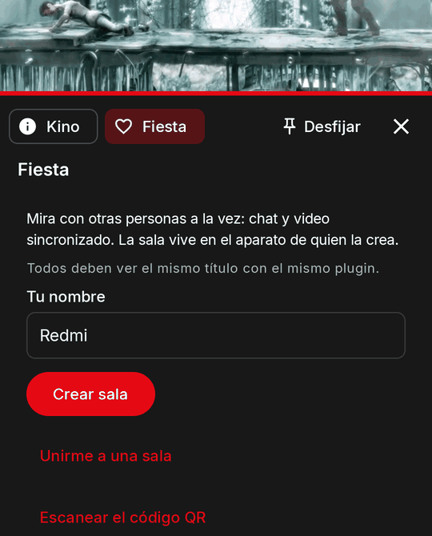
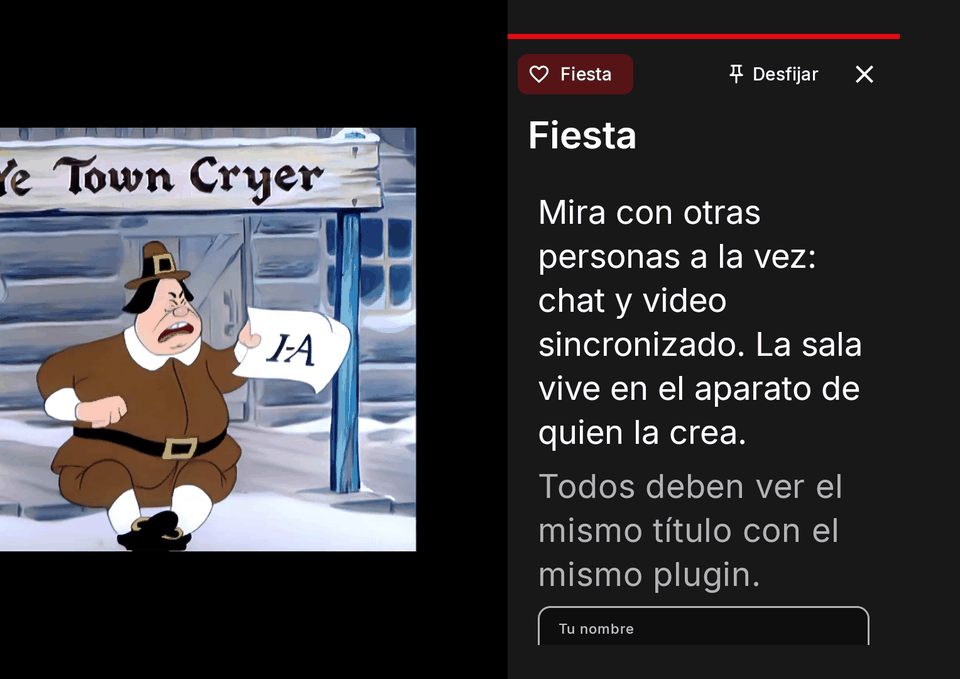

# El panel del reproductor (apiVersion 9)

Desde **Kino 0.9.55** tu plugin puede abrir **su propio panel desde el reproductor**: una superficie que tú
describes con JavaScript para lo que se está viendo ahora mismo (película, episodio, copia, posición), con
texto, imágenes, botones y campos, cuyos valores se guardan por video o para todo tu plugin y se sincronizan
entre los aparatos de la persona. Con el mismo panel puedes **mover el reproductor** (saltar, velocidad,
tamaño de imagen, marcadores, cuenta regresiva al siguiente episodio) y, con `playerEvent`, enterarte de lo
que pasa en la reproducción. Todo desde `"apiVersion": 9`; por debajo, o en Kino 0.9.54 y anteriores (que
rechazan un manifiesto con `"apiVersion": 9`), nada de esto existe. Tu plugin **no debe depender de él para
reproducir**.

Un ejemplo completo con todos los elementos, las dos pestañas y todas las acciones es
[`sdk/test/panel-demo`](https://github.com/kinotvapp/kino-plugin-sdk/tree/main/sdk/test/panel-demo) en el repositorio del kit; abajo hay [uno pequeño](#example).

Desde `"apiVersion": 14` (Kino 0.9.74) el panel también se arma con el kit de pantallas, una pestaña puede vivir en el
panel de otro plugin o en un canal en vivo, y la persona puede fijarlo junto al video: mira
[El panel con el kit de pantallas](#screen-kit).

!!! note "Qué no está en esta versión"
    `ai` (la IA de Kino) y `chat` no vienen en Kino 0.9.55; llegarán en una versión posterior. Si tu panel
    incluye un elemento `ai` o `chat`, Kino lo descarta y escribe «needs a newer Kino» en el registro. Tampoco
    hay `kino.socket`.

## Dónde aparece { #where }

- Un botón con el nombre y el ícono de tu manifiesto, **junto al de subtítulos** («Audio y subtítulos»), solo
  **mientras suena un título de ese plugin**. En el celular está en la fila de íconos de abajo, al lado del de
  subtítulos (si la fila no cabe, se desplaza y el botón del panel queda entre los primeros); en la TV, justo
  después del botón de subtítulos, navegable con el control remoto (D-pad).
- No aparece si el plugin está apagado o dañado, si su `apiVersion` es menor que 9, si el manifiesto no declara
  `panel` o si el plugin no exporta `panel`. En la TV, un canal en vivo de un plugin no tiene botones en
  pantalla, así que no tiene panel; los canales de la pestaña En vivo tampoco (en el celular, un canal en vivo
  de un plugin sí lo tiene).
- **El video nunca se pausa** mientras el panel está abierto. Atrás, o la X, lo cierra; también se cierra al
  mandar la app al fondo y al cambiar el idioma de la app.
- Mientras el panel se carga la persona ve «Cargando el panel…». Si la primera llamada falla, ve el mensaje y
  «Reintentar» / «Cerrar»; si ya había un panel, el error sale como una línea roja y el panel se queda.

## El manifiesto: `panel` { #manifest }

```json
"apiVersion": 9,
"panel": { "label": "Opciones", "labelEn": "Options", "icon": "tune" }
```

| Campo | Qué es |
| --- | --- |
| `label` | De 1 a 24 caracteres: el nombre del botón. |
| `labelEn` | Opcional, de 1 a 24: el nombre con la app en inglés (si falta se usa `label`). |
| `icon` | Opcional: uno de los 16 íconos de Kino: `info`, `tune` (el de siempre), `settings`, `star`, `bolt`, `language`, `subtitles`, `list`, `magic`, `heart`, `movie`, `tv`, `sports`, `music`, `bookmark`, `help`. Un nombre desconocido dibuja `tune` (y `validate.mjs` te avisa). |
| `iconFile` | Opcional: tu propio ícono, un archivo del repositorio de tu plugin junto al manifiesto (ruta relativa, `.png`). Un **PNG de exactamente 96×96 px, con canal alfa, de máximo 24 KB**. Kino dibuja **solo su alfa** y lo tiñe con el color del botón (enfocado o no), así que una imagen a todo color se ve como su silueta. Kino lo descarga al instalar y al actualizar; si no cumple, la instalación falla con «The panel icon must be a 96×96 px PNG with a transparent background, at most 24 KB». Si luego no carga, el botón dibuja `tune`. |

`icon` e `iconFile` no van juntos (el manifiesto se rechaza). Declarar `panel` exige exportar `panel`; `panelAction` y
`playerEvent` son opcionales (una acción sin `panelAction` muestra el error del plugin en el panel). Un `label`
vacío o de más de 24, un `panel` que no es un objeto o un `iconFile` que no es una ruta relativa a un `.png`
se rechazan al instalar. Por debajo de apiVersion 9 el campo se ignora. Mira también
[el manifiesto](manifest.md#panel).

## `panel(context)`: lo que recibes { #context }

```js
export async function panel(context) { /* devuelve un Panel */ }
```

Kino lo llama al abrir el panel, al tocar una pestaña (con `context.tab`) y cada `refreshMs`. El contexto trae
**exactamente** estas claves (un campo opcional que Kino no conoce se omite):

| Campo | Qué es |
| --- | --- |
| `kind` | `"movie"`, `"episode"` o `"live"`. |
| `ref` | el `ref` del título que suena, tal como lo diste. |
| `title`, `year?` | el título y el año. |
| `season?`, `episode?`, `episodeTitle?` | solo en un episodio. |
| `ids` | los ids que Kino conoce del título: `tmdb`, `imdb`, `mal`, `anilist` (`tvdb` y `kitsu` existen en el tipo, pero hoy Kino no los manda). |
| `playing` | la copia que suena: hoy Kino llena solo `label` (el nombre que ve la persona en «Servidor»); `lang`, `quality` y `server` existen en el tipo y no se mandan. |
| `positionMs`, `durationMs?`, `paused` | la posición; la duración (ausente en vivo o si el reproductor no la sabe); si está en pausa. |
| `seekStepMs` | el paso de los botones de adelantar/atrasar en vigor (10 000 por defecto). |
| `stats` | estadísticas de solo lectura, solo lo que el reproductor sabe: `width`, `height`, `videoCodec`, `audioCodec`, `bitrateKbps`, `bufferedMs`, `droppedFrames`, `network` (`wifi`, `ethernet`, `cellular` u `other`), `stallsThisSession`. |
| `device` | `"tv"` o `"phone"`. |
| `lang` | el idioma de la app, `"es-CO"` o `"en-US"`. Úsalo para tus textos propios. |
| `tab?` | la pestaña que pidió la persona (la primera vez, ausente). |
| `values` | lo que la persona (o tú) guardó: `{ video: {…}, plugin: {…} }`. |
| `player` | las propiedades del reproductor en vigor: `seekStepMs`, `speed?`, `resize?` (`"fit"` si nadie lo cambió) y tu `autoNext?` si lo pusiste. |
| `features?` | **Kino 0.9.64, aditivo**: qué dibuja este Kino además del panel de apiVersion 9; `"loading"` significa que entiende el elemento `loading`. Ausente en un Kino más viejo, que lo descarta como un tipo desconocido: revísalo antes de responder con uno. |

El contexto no lleva nada de otros plugins ni de la cuenta de la persona.

## `Panel`: lo que devuelves { #panel }

```js
return {
  presentation: "panel",       // "modal" (por defecto) o "panel"
  title: context.title,        // hasta 60 caracteres (también titleEn)
  accent: "#2E7D32",           // opcional, #RRGGBB
  refreshMs: 10000,            // opcional, 2000 a 60000
  tabs: [{ id: "info", label: "Info" }],   // opcional
  tab: "info",
  elements: [ /* elementos */ ],            // máximo 40 en el nivel de arriba
};
```

- **`presentation`**: se acepta por compatibilidad y ya no se lee: todo panel se dibuja igual, como una
  **cajonera** sobre todo el reproductor (desde la derecha en la TV y en un celular en horizontal, desde abajo
  en un celular en vertical), con el video visible y sonando detrás. Cualquier valor (`"modal"`, `"panel"` o
  ninguno) se ve igual.
- **`accent`**: un `#RRGGBB` que pinta la barra de arriba, los estados y el foco. Sigue las mismas reglas de
  contraste que el `accent` de [`theme`](section-theme.md#theme); si falla, se usa el de Kino y el panel sigue.
- **`refreshMs`**: pide a Kino llamar `panel(context)` otra vez cada tanto mientras el panel está abierto
  (entre 2000 y 60 000, se ajusta). Las llamadas nunca se solapan (la siguiente espera a la anterior y a las
  acciones); una que falla o se pasa del tiempo se salta sin mostrar error; el refresco se detiene al cerrar el
  panel o al pasar la app al fondo.
- **`title`** y los demás textos tienen un gemelo `...En` (`titleEn`, `labelEn`, `textEn`…) que se muestra con la
  app en inglés, como en [los textos del formulario de ajustes](settings-form.md#english).
- Todo se valida. Un elemento inválido se descarta con una línea en el registro del plugin; un panel que no es
  un objeto no muestra nada.

## Los elementos { #elements }

Todo elemento puede llevar además `enabled: false` (se ve atenuado y el foco no cae en él) y `hidden: true` (no
se dibuja). Una `key` es de 1 a 128 caracteres de `A-Z a-z 0-9 . _ ~ -` y **no se repite en todo el panel**
(el segundo elemento con la misma clave se descarta). Todo lo que se pueda presionar o guarde un valor lleva `key`.

| `type` | Campos | Notas y límites |
| --- | --- | --- |
| `section` | `title`, `text?` | un encabezado con un texto opcional; `title` hasta 60, `text` hasta 1000. |
| `text` | `text` | texto de varias líneas, hasta 1000 caracteres; no se puede seleccionar ni hace nada. |
| `status` | `text` | una línea de estado destacada, hasta 200 caracteres. |
| `image` | `url`, `aspect?`, `alt?` | solo `https`, en una dirección pública: Kino nunca llega a las direcciones del aparato ni de la red de la casa (la única excepción es un servidor que la persona escribió en los ajustes de tu plugin); `aspect` es `16:9`, `2:3`, `1:1` o `banner`; `alt` hasta 200. Si falla al cargar no ocupa lugar ni rompe el panel. |
| `button` | `key`, `label`, `confirm?` | al tocarlo llama `panelAction` con `trigger: "press"`. `label` de 1 a 40 (más largo, el botón se descarta). Con `confirm` (hasta 160) Kino pregunta antes. |
| `toggle` | `key`, `label`, `scope`, `hint?`, `autoSave?` | un interruptor. Llama `panelAction` con `trigger: "change"`. |
| `select` | `key`, `label`, `scope`, `options`, `hint?`, `autoSave?` | una lista de 1 a 20 opciones `{ value, label }` (cada una de 1 a 40, valores distintos; una opción mala descarta el `select`). |
| `text-input` | `key`, `label`, `scope`, `hint?`, `placeholder?` | un campo de texto. Llama `panelAction` con `trigger: "submit"` solo al confirmar (el «Listo» del teclado de la TV, la acción del teclado del celular), **nunca por cada letra**. `placeholder` hasta 40. |
| `qr` | `url`, `label?` | un código QR más el texto del enlace; solo `https`, hasta 512 caracteres, en un host público **con punto** (o una dirección IPv4 pública; nunca el aparato ni la red de la casa: ni un host local o de una sola palabra, ni una dirección privada, ni una dirección IPv6). En la TV se lee con la cámara del celular; en el celular, tocarlo abre el enlace. Kino nunca lo abre solo. `label` hasta 40. |
| `loading` | `text?` | **Kino 0.9.64, aditivo (cualquier apiVersion)**: un spinner con `text` al lado (si falta, «Cargando…» de Kino). Responde de una con la carcasa de la pestaña y este elemento, y pon `refreshMs` para que Kino vuelva a preguntar cuando termines. Mándalo solo si `context.features` incluye `"loading"`: un Kino más viejo lo descarta como un elemento desconocido (ahí responde con un `status`). |
| `episodes` | `ref` | la lista de episodios de la serie que suena, con el actual resaltado; elegir uno lo reproduce, por el mismo camino que «siguiente episodio». Puede quedar vacía (una película, por ejemplo) y entonces no toma foco. |
| `row`, `col`, `card` | mira [el diseño](#layout) | contenedores. |
| `ai`, `chat` | | **no están en esta versión**: se descartan («needs a newer Kino»). |

Reglas de los campos con valor (`toggle`, `select`, `text-input`):

- `scope` es `"video"` (un valor por título; para una serie, **por episodio**) o `"plugin"` (uno para todos tus
  títulos; es el valor por defecto si lo omites). Cualquier otro valor descarta el elemento.
- El valor en pantalla viene de `context.values[scope][key]`.
- `hint` hasta 80 caracteres; la etiqueta de 1 a 40; con `autoSave: true` (solo si vale exactamente `true`) cada
  cambio se guarda solo (mira [Persistencia](#persistence)).
- Los `toggle` y `select` avisan 300 ms después del último cambio (varios seguidos se funden en uno).

## El diseño: filas, columnas y tarjetas { #layout }

Armas el panel con contenedores, nunca con píxeles: solo pesos, separaciones y el `aspect` de las imágenes, así
nada se desborda en un TV ni en un celular.

```js
{ type: "row", gap: "small", children: [
  { type: "col", weight: 4, children: [{ type: "image", url: "https://…/poster.jpg", aspect: "2:3" }] },
  { type: "col", weight: 8, children: [{ type: "text", text: "…" }] },
] }
```

| Contenedor | Campos |
| --- | --- |
| `row` | `children`, `gap?` (`none`, `small`, `medium`, `large`; 0, 8, 16 o 24 dp), `align?` (`start`, `center`, `end`, `stretch`), `stackOnNarrow?` (por defecto `true`). Pone a sus hijos lado a lado. |
| `col` | `children`, `weight?` (1 a 12; otro valor vale 1), `gap?`, `align?`. Una columna dentro de una fila toma `weight` partes de su ancho. Cualquier elemento suelto en una fila pesa 1. |
| `card` | `children`, `title?` (hasta 60), `style?` (`plain` sin borde ni margen, `outlined` con borde, `filled` con fondo). Un grupo enmarcado. |

- **Límites**: anidamiento de máximo **4** niveles (cuentan los contenedores), máximo **6** hijos por fila,
  máximo **120** nodos en total en el panel (los contenedores cuentan; el que se descarta no gasta cupo). Lo que
  pase se recorta con una línea en el registro (máximo 10 líneas por panel y luego «N more problems not logged»),
  nunca rompe el panel.
- **Pantallas angostas.** Una fila con `stackOnNarrow` (por defecto) apila sus hijos en vertical, en orden,
  cuando el espacio del panel mide menos de **480 dp** (un celular en vertical, o una franja angosta).
  `stackOnNarrow: false` los deja lado a lado. `align: "stretch"` en una fila alinea arriba (no iguala alturas);
  en una columna hace que los hijos ocupen todo el ancho.
- **Atenuado y oculto.** Un contenedor con `enabled: false` atenúa y saca del foco todo lo que lleva dentro; uno
  con `hidden: true` no se dibuja (una fila con todos sus hijos ocultos no deja hueco).

## Desplazamiento y foco { #focus }

- El panel **se desplaza** cuando el contenido no cabe: en el celular con el dedo; en la TV el foco
  siempre se trae a la vista, con un margen (el D-pad arriba/abajo mueve el foco y desplaza).
- El texto, las secciones, las imágenes y los estados no toman foco (se pasan de largo). Toman foco los botones,
  los campos, los `episodes` y los `qr`.
- **TV**: el foco empieza en el primer elemento que lo toma (si no hay ninguno, en la X de cerrar); dentro de una fila,
  izquierda/derecha; entre filas, arriba/abajo, en orden de lectura. **El foco no sale del panel** y Atrás lo
  cierra: para llegar a los controles del reproductor, se cierra primero. Mientras
  el panel está abierto el reproductor no le roba el foco. Todo el cuerpo del panel se alcanza con el D-pad (el QR y
  los bloques de texto largos son paradas de foco para que se desplacen a la vista) y, si el control con foco
  desaparece cuando tu respuesta reemplaza el panel, el foco vuelve al primer control.
- **Celular**: el panel no toma foco solo, para que un campo de texto no levante el teclado de entrada. La
  franja se acomoda entre la barra de arriba y los controles de abajo mientras están visibles.
- La respuesta de una acción puede pedir `focus: "<key>"` para mover el foco; solo vale en la TV, una vez por
  respuesta (un refresco no lo repite).
- Un botón ocupado (esperando tu `panelAction`) muestra un indicador y no acepta otra pulsación sin soltar el foco.

## Pestañas { #tabs }

`tabs: [{ id, label }]` (máximo 6; `id` como una clave, `label` hasta 24, los repetidos se descartan) y `tab` (la
actual; si no existe, la primera). Se dibujan como una tira de arriba (izquierda/derecha en la TV). Tocar una
llama otra vez `panel(context)` con `context.tab`: **tú armas el contenido de cada pestaña**. No hay un
disparador `tab`: esa pestaña llega en el contexto.

## `panelAction(event, context)`: tu JavaScript manda { #panel-action }

```js
export async function panelAction(event, context) { /* devuelve una respuesta, o null */ }
```

Se llama con **dos argumentos**. Kino solo dibuja lo que devuelves y te cuenta lo que hace la persona;
tú puedes leer cualquier campo, calcular, llamar `kino.fetch`, `kino.tmdb`, `kino.meta`, `kino.storage` y
responder con un panel nuevo, valores y acciones del reproductor.

```ts
event = {
  key: string,                                  // el elemento que lo disparó
  trigger: "press" | "change" | "submit",       // "tab" y "open" están reservados: esta versión no los manda
  values: Record<string, Value>,                // el valor ACTUAL de cada campo en pantalla, guardado o no
  value?: Value                                 // el valor nuevo de `key` en "change" y "submit"
}
```

`press` es un botón; `change` un `toggle` o `select`; `submit` un `text-input` confirmado.

### Qué puede traer la respuesta { #answer }

Todos los campos son opcionales; `null` (o nada) significa «no hay nada que hacer».

| Campo | Qué hace |
| --- | --- |
| `panel` | reemplaza el panel entero (mismas reglas que `panel(context)`). |
| `patch` | `{ "<key>": elemento }`: reemplaza solo esos elementos en su lugar (solo los elementos con `key`: `button`, `toggle`, `select` y `text-input`; para cambiar un `text`, un `status` o una imagen devuelve un `panel` entero). Máximo 40 claves; cada entrada es un solo nodo, validado como cualquier elemento y con su propio cupo de 120 nodos. Kino la descarta (con una línea en el registro) si la clave no nombra un elemento que esté en pantalla, si repite la clave de otro elemento del panel, o si el panel resultante pasa de 120 nodos o de 4 niveles. |
| `values` | `{ "<key>": valor }`: cambia lo que ven los campos (limpiar uno, llenar uno desde otro). Máximo 120 claves; cada valor es texto de hasta 500 caracteres, un booleano, un número finito o `null`. **No guarda.** Una clave que no es un campo en pantalla se ignora. |
| `save` | `["<key>", …]`: guarda esos campos, cada uno con el `scope` que declaró (máximo 50). Solo se guardan claves de campos que están en pantalla. Además, el `toggle` o `select` con `autoSave: true` que disparó la acción se guarda solo, sin que lo listes. |
| `focus` | la clave a la que mover el foco (TV). |
| `message` | un aviso breve para la persona, de hasta 160 caracteres, que Kino muestra como un mensaje corto. Pasa por **las mismas reglas que un [`userMessage`](contract.md#user-message)** (Kino la muestra como «Mensaje de &lt;tu plugin&gt;: …» (en inglés, "Message from &lt;your plugin&gt;: …"), y si el nombre de tu plugin no puede presentarla, por ejemplo `Cuevana3`, se descarta); si no las cumple se descarta con una línea en el registro. |
| `player` | acciones sobre el reproductor: la [tabla de abajo](#player). |

Kino aplica, en este orden, `panel` o `patch`, `values`, `save`, `focus`, `player` y, al final, `message`.

Mientras corre tu `panelAction`, el control que la disparó muestra que está ocupado; **hay una sola acción en
vuelo** y las demás esperan su turno (en orden). Un error o un tiempo agotado se muestra como la línea de error
del plugin dentro del panel, sin cerrarlo, y **nunca guarda nada a medias**: los valores se escriben solo
después de que tu acción responde sin error. Un `save` que reparte entre los dos `scope` se guarda entero o no
se guarda.

## Controlar el reproductor: `player` { #player }

La respuesta de `panelAction` y de `playerEvent` puede traer `player: { … }`. Cualquier otra clave dentro de
`player` se ignora con una línea en el registro (el resto de `player` sí se aplica). Un valor fuera de su rango se ajusta o se descarta, también con
una línea en el registro.

| Propiedad | Valores | Qué hace |
| --- | --- | --- |
| `seekToMs` | un número; se limita a 0 hasta la duración | salta a esa posición, con el mismo salto que usan los demás controles (también al enviar a una pantalla). Se ignora en vivo. Nunca pausa ni reinicia la reproducción. **Máximo un salto por segundo por plugin**, sumando el panel y los eventos; los demás se descartan. |
| `seekStepMs` | 5000 a 120 000, en segundos enteros | el paso de adelantar/atrasar (control remoto, teclado, doble toque y botones); las etiquetas en pantalla siguen el valor («−30», «+30»; con 10 s quedan los íconos de siempre). |
| `speed` | 0.5, 0.75, 1, 1.25, 1.5, 1.75 o 2 | la velocidad de reproducción. |
| `resize` | `"fit"`, `"fill"`, `"zoom"`, `"4:3"`, `"16:9"` o `"21:9"` | el tamaño de la imagen. |
| `skip` | `{ openingStartMs, openingEndMs, endingStartMs }` | el botón de saltar intro/final de **este video**, con las mismas reglas que `Stream.skip`. |
| `markers` | hasta 30: `{ atMs, label }` (`label` hasta 24) | puntos sobre la barra de progreso («Gol 63'»), también en el menú de marcadores; elegir uno salta ahí. Reemplaza la lista del video; una lista vacía la borra. |
| `autoNext` | `{ enabled, countdownS, nextRef? }` | el final del episodio: mira abajo. |

**`autoNext`** gobierna lo que pasa cuando termina un capítulo de tu plugin:

- Sin `autoNext`, o con `countdownS: 0` y sin `nextRef`: pasa al siguiente de inmediato, como siempre.
- `{ enabled: false }` (no necesita `countdownS`): el reproductor se queda al final, sin avanzar.
- `{ enabled: true, countdownS: 1..30 }` (con `enabled: true`, `countdownS` es obligatorio; de 0 a 30): una tarjeta abajo a la derecha
  dice «Siguiente en N s» con «Ver ahora» (el foco de la TV empieza ahí) y «Cancelar» (Atrás también cancela y deja el
  reproductor al final). Al llegar a cero, o con «Ver ahora», se reproduce el siguiente. Si la persona salta atrás
  o reanuda, la cuenta se cancela.
- `nextRef` sugiere cuál es el siguiente: solo se usa si es el `ref` de un episodio de la lista de la serie;
  si no, se reproduce el siguiente de Kino y se anota en el registro. Con `countdownS: 0` y un `nextRef` válido,
  se reproduce de una vez sin tarjeta. La cuenta regresiva solo empieza donde Kino ya habría avanzado (donde existe
  un siguiente capítulo).

### Quién gana { #wins }

Todo aplica **solo mientras suena el contenido de tu plugin** y **lo que la persona hace a mano siempre gana**:

- **Velocidad y tamaño**: si la persona toca el botón de velocidad o el zoom del reproductor, tu `speed` o `resize`
  se ignoran mientras dure esa pantalla de reproducción. El ciclo de velocidades de la persona **no cambia**
  (0,75, 1, 1,25, 1,5 y 2); tus velocidades 0,5 y 1,75 se aplican y se muestran, y el siguiente toque pasa al
  paso siguiente del ciclo de la persona. En la TV no hay botón de velocidad, así que ahí la persona no puede
  anular la tuya.
- **Saltar intro/final**: una corrección manual de la persona (el botón «No tiene intro/outro» o ajustar los
  tiempos) gana sobre tu `skip`. No se guarda para canales en vivo ni para títulos +18.
- Lo demás (paso, `autoNext`) lo guardas tú y la persona lo ve como parte del plugin; «Restablecer» lo deshace.
- El contexto (`context.player`) te dice lo que está en vigor de verdad: la velocidad de la persona si la cambió,
  si no la tuya, si no 1; y para `resize`, `"zoom"`/`"fit"` si la persona tocó el zoom.

## Persistencia y sincronización { #persistence }

- Los valores con `scope: "video"` se guardan **por plugin y por título** (la clave del título es la del
  elemento que suena: para una serie, el episodio); los de `scope: "plugin"`, por plugin.
- También se guardan así, sin que escribas nada, las propiedades del reproductor: `seekStepMs`, `speed`, `resize`
  y `autoNext` **por plugin**, y `markers` **por video**. `skip` va al botón de saltar de ese episodio.
- Límites: máximo **50 claves por alcance** y valores de máximo **500 caracteres**; si te pasas, la escritura se
  rechaza entera con «No se pudo guardar: …» (en inglés «Couldn't save: …»). Kino también guarda como mucho
  1500 valores vivos en total en el aparato (todos los alcances y todos los plugins); pasado eso, se van los
  valores por video más viejos.
- **Se sincroniza en las dos vías** entre los aparatos de la persona, como todo lo suyo (gana la última escritura por clave).
  Un valor que llega de otro aparato actualiza el panel abierto.
- Se borra al **desinstalar** el plugin.
- Cada panel tiene abajo el botón **«Restablecer»**, que pone Kino (no tú): pregunta «¿Qué quieres dejar como
  estaba?» con «Solo este video» (borra los valores de ese título, sus marcadores y el `skip` que vino de tu
  plugin) y «Todo lo de este plugin, en todos los videos» (borra todos los valores del plugin y vuelven los valores
  de siempre del paso, la velocidad, el tamaño y `autoNext`; los tiempos de saltar intro ya guardados se quedan).

## `playerEvent(event, context)`: enterarte de la reproducción { #player-event }

Exporta `playerEvent` (no necesita `panel`) para saber lo que pasa mientras suena un título tuyo. Es
de "lanzar y olvidar": Kino no espera nada a cambio y nunca se bloquea por él.

```js
export async function playerEvent(event, context) {
  if (event.type === "ended") return { player: { autoNext: { enabled: true, countdownS: 8 } } };
  return null;
}
```

El evento es plano, `{ type, ...detalle }`, y el contexto es el mismo del panel (con `values`):

| `type` | Cuándo | Detalle |
| --- | --- | --- |
| `started` | la primera vez que el título está listo. Otra copia del mismo título no lo repite. | |
| `paused`, `resumed` | cuando la persona pausa o reanuda (la intención de reproducir cambia). Un buffering o un salto no mandan nada. | |
| `ended` | una sola vez por título, solo en el final de verdad (un corte a mitad no cuenta), nunca en vivo. | |
| `failed` | **ocurrió un error** (no significa que la reproducción terminó: puede seguir un cambio de copia o una reapertura). | `kind`: en video, el nombre del código de error del reproductor (como `"ERROR_CODE_IO_BAD_HTTP_STATUS"`) o `"UNREACHABLE_SERVER"`; en vivo, la clase de error. En vivo se manda por cada error dentro del cupo de reaperturas. |
| `copyChanged` | cambió la copia que suena. | `automatic` (`true` si cambió Kino, `false` si eligió la persona), `label?` (la copia nueva) y, si fue automático, `kind` (por qué falló la anterior). |

- Solo se mandan **`started`, `paused`, `resumed` y `ended` del reproductor normal**: una descarga que se
  reproduce desde el servicio y el envío a otra pantalla (Chromecast, DLNA) no los mandan. `failed` y `copyChanged`
  sí. Los canales de la pestaña En vivo no mandan eventos.
- **No se solapan.** Hay como mucho una llamada en vuelo por plugin; mientras corre, solo se guarda el **último**
  evento que llegó y se manda al terminar (entre `failed`/`ended` y `paused`/`resumed`, los primeros no se
  reemplazan por los segundos). Un `failed` que espera puede ser reemplazado por un `copyChanged` posterior.
- Límite de **5 s** por llamada; pasado, el evento se descarta con una línea en el registro y sigue el siguiente.
- De tu respuesta solo cuentan `player` y `message` (por las mismas reglas de arriba, y el mismo límite de un
  salto por segundo por plugin, panel incluido); lo demás se ignora. Un error, un tiempo agotado o una respuesta
  inválida se anota y se descarta: **nunca detiene el video**.
- Una respuesta que llega después de que la persona cambió de título se descarta.

## `settingsLayout`: acomodar tus ajustes { #settings-layout }

El formulario de tu plugin (Ajustes ▸ tu plugin) puede usar los mismos contenedores. Es **compatible hacia
atrás**: `settings` queda como siempre (claves, tipos, valores por defecto, `required`, `validateSettings`…) y el
diseño solo **coloca** ajustes que ya existen, por su clave.

```json
"settings": [ …como siempre… ],
"settingsLayout": [
  { "type": "card", "title": "Idioma y calidad", "titleEn": "Language and quality", "children": [
    { "type": "row", "children": [ { "setting": "preferred" }, { "setting": "maxQuality" } ] } ] },
  { "type": "text", "text": "Lo demás va debajo.", "textEn": "Everything else goes below." },
  { "type": "image", "url": "https://example.com/banner.png", "aspect": "banner" }
]
```

- Las hojas son `{ "setting": "<clave>" }`, `{ "type": "text", "text" }` (con `textEn`) y
  `{ "type": "image", "url" }` (`https`, con las reglas de imagen del panel). Los contenedores son `row`, `col` y
  `card` (con `title` y `titleEn`) con los mismos límites y la misma apariencia que en el panel; en el
  formulario `enabled` y `hidden` se ignoran.
- **Un diseño nunca esconde nada**: un ajuste que no nombras se agrega al final, en el orden del manifiesto. Una
  clave repetida o que no existe se ignora al ejecutar (con una línea en el registro del plugin) y `validate.mjs` la
  marca como problema.
- Sin `settingsLayout` el formulario es exactamente el de siempre, y un Kino anterior ignora el campo y muestra la lista de
  siempre. Un `settingsLayout` que solo lista los ajustes en el orden del manifiesto, sin contenedores, se ve
  igual que la lista. Por debajo de apiVersion 9 se ignora.
- El tipo de ajuste `section` sigue funcionando; una `card` con `title` es su versión más rica.

## El panel con el kit de pantallas (apiVersion 14) { #screen-kit }

!!! note "Disponible con Kino 0.9.74"
    Disponible con Kino 0.9.74 (la próxima versión, aún no publicada). Lo de esta sección necesita `"apiVersion": 14`;
    una versión anterior de Kino rechaza estos plugins con «Este plugin necesita una versión más nueva de Kino»; para
    seguir llegando a quien tiene una versión anterior usa `enhancements` (ver
    [Pantallas sin subir tu apiVersion](enhancements.md)). Todo lo de arriba sigue valiendo igual para apiVersion 9 a 13.

Desde apiVersion 14 el panel del reproductor se puede armar con los mismos nodos que una [pantalla](screens.md), una
pestaña puede vivir en el panel de **otro** plugin o en un canal en vivo, y la persona puede fijar el panel junto al
video. El ejemplo de referencia es **Party Chat** (<https://github.com/kinotvapp/kino-plugin-watch-party>): una pestaña
que aporta al panel de cualquier título, con una sala y un chat.




### Panel clásico y modo pantalla { #screen-mode }

`panel(context)` puede devolver `{ format: "screen", root, title?, titleEn?, tabs?, tab?, refreshMs?, accent?, player?, layout? }`:
la misma cajonera (su título, sus pestañas, `refreshMs` y el `accent` siguen las reglas de arriba; una entrada de `tabs`
puede llevar además el [`badge`](screen-components.md#badge) compartido, `"dot"` o `{ text, textEn?, color? }`, dibujado
junto a su nombre) con un cuerpo que es un árbol de pantalla. Un resultado sin `format` es el panel clásico, leído y
dibujado exactamente como antes; el formato puede cambiar de una llamada a la siguiente, y por debajo de apiVersion 14 un
resultado de pantalla se lee como un panel clásico (con una línea en el registro).

```js
export async function panel(context) {
  if (!(context.features || []).includes("screen")) return { title: "Party Chat", elements: [{ type: "status", text: "Actualiza Kino" }] };
  return { format: "screen", title: "Party Chat", root: { type: "Column", children: [{ type: "ElevatedButton", labelText: "Sincronizar", onPressed: "sync" }] } };
}
```

| Qué | En un panel en modo pantalla |
| --- | --- |
| Resultado | `{ format: "screen", root, title, titleEn, accent, refreshMs, tabs, tab, player, layout }` |
| Árbol | profundidad 6, 200 nodos; `AlertDialog`, `BottomSheet` y `PopupMenuButton` no se dibujan, salvo que tengan un `anchor` (un popover dentro de la cajonera, mira [anchor](screen-forms.md#anchor)); sin `every` |
| El contexto agrega | `state`, `size`, y `features` incluye `"screen"` mientras las pantallas están encendidas |
| Disparadores de `panelAction` | `press`, `change`, `submit` |
| Campos de la respuesta que se aplican | `state`, `toast`, `toastEn`, `ui`, `config`, `go`, `close`, `focus`, `player`, `message`, `pause`, `panel` |
| Campos de la respuesta que se descartan | `dialog`, `sheet`, `menu`, `route`; `patch`, `values` y `save` son solo del panel clásico |

Diferencias con una pantalla completa:

- **Límites**: profundidad 6 y 200 nodos. Un nodo `popup` se descarta (los pop-ups son de la pantalla, no de la cajonera)
  salvo que tenga un `anchor`, y `every` se descarta: `refreshMs` (de 2000 a 60 000 ms, solo mientras el panel está
  abierto) es LA llamada periódica.
- **Llamadas**: dibujar llama `panel(context)`; los eventos de la persona llaman `panelAction({ event, context })` con
  `event = { key?, trigger, name, arg?, value?, values }` (`trigger` es `press`, `change` o `submit`; `tab` y `open` siguen
  reservados); no hay un evento reservado `open`. El `context` de un plugin de apiVersion 14 trae `state` (el de Kino,
  guardado para la reproducción de este título) y `size` (las clases de la cajonera; una estimación de Kino hasta que se
  midió) **en cada llamada, la primera incluida**, porque Kino no puede saber el formato antes de tu respuesta. Mira
  [el estado](screen-reference.md#state) y [los valores por tamaño](screen-reference.md#per-size-values).
- **Respuestas**: se aplican `state`, `toast`, `ui`, `config`, `focus`, `go` (todas sus formas; todas menos `screen` y
  `close` cierran primero el panel), `close`, y los clásicos `player`, `message`, `pause` y `panel`; `dialog`, `sheet`,
  `menu` y `route` no se atienden, y `patch`, `values` y `save` son solo del panel clásico (se descartan, con una línea en
  el registro). El `panel` de una respuesta de `playerEvent` (en cualquier formato) se muestra en el panel abierto de ese
  título, pero su `state` nunca se aplica: guárdalo en tus propias variables o en `kino.storage`. Mira
  [las respuestas](screen-reference.md#answers).
- **Detecta el formato**: responde un resultado de pantalla solo cuando `context.features` incluye `"screen"`. Kino lo pone
  ahí solo mientras las pantallas de plugins están encendidas; cuando están apagadas un resultado de pantalla no muestra
  ningún panel, así que entonces responde uno clásico.
- **Errores**: un evento que falla muestra de una vez la línea de error de la cajonera; tres seguidos muestran el estado de
  error del panel.
- **TV**: la acción de un [aviso](screen-components.md#toast) corre con la tecla Menú o Reproducir/Pausa del control (la
  cajonera no baja al aviso). El texto del panel es un paso más chico que en una pantalla completa (la cajonera y el panel
  fijado miden de 360 a 480 dp): `h1` se dibuja del tamaño de `h3` de una pantalla, `h2` del de `h4`, `h3` del de `h5`,
  `h4` y `h5` del tamaño grande del cuerpo, `p` a 15 sp; en el celular los tamaños no cambian.
- **Foco en la TV**: en cualquier panel, clásico o en modo pantalla, solo toma foco y el anillo de Kino lo que hace algo:
  botones, interruptores, selecciones, campos, la lista de episodios, las pestañas, fijar y cerrar. Un texto, una sección,
  un estado, una imagen o un QR nunca son una parada de foco ni se enmarcan: Arriba y Abajo pasan por ellos. Cuando el árbol
  nuevo de una respuesta ya no tiene el nodo con foco (una vista de QR que reemplaza al botón presionado), el foco va al
  primer elemento enfocable en su lugar o después; si no hay ninguno, lo toma el cuerpo mismo (sin anillo) para que Arriba y
  Abajo sigan desplazando. El `focus` de una respuesta gana.
- La pestaña propia de Kino sobre el título muestra, de arriba abajo, el póster con el título y sus datos, la sinopsis,
  los detalles, las imágenes y al final el reparto (tres tarjetas por fila, dos en un panel de menos de 360 dp), cada parte
  solo cuando TMDB la tiene.
- **Kit**: `node sdk/run.mjs --state '<json>' --screen <carpeta> panelAction <ref> <name> <press|change|submit>`.

### Diseño `fill`: una pestaña de chat { #layout-fill }

El cuerpo de un panel se desplaza por defecto (`layout: "scroll"`): el árbol no tiene límite de alto, así que un
[`ListView`](screen-components.md#list-view) se dibuja plano y `flex` no hace nada, y una fila después de una lista queda
justo debajo de su último elemento. Un chat quiere lo contrario: los mensajes ocupan el espacio y la fila para escribir se
queda abajo del panel, como en cualquier app de chat. Responde `layout: "fill"` (se elige por resultado: junto a `root` en
un resultado de `panel()`, en el objeto raíz de una respuesta de `screen()`): la raíz se dibuja al tamaño del cuerpo, sin
desplazamiento del cuerpo, `flex` reparte el alto que queda, y un `ListView` con `flex` es perezoso y se desplaza solo.

```js
export async function panel(context) {
  const messages = ((context.state || {}).messages || []).map((m, i) => ({ type: "Text", key: "m" + i, text: m }));
  return { format: "screen", title: "Party Chat", layout: "fill", root: { type: "Column", gap: 8, children: [
    { type: "Text", text: "Sala 1234", style: "h4" },
    { type: "ListView", key: "chat", flex: 1, stickToBottom: true, items: messages,
      empty: { type: "Text", text: "Sin mensajes", textEn: "No messages", color: "muted" } },
    { type: "Row", gap: 8, children: [
      { type: "TextField", key: "msg", flex: 1, hintText: "Escribe…", hintTextEn: "Type…" },
      { type: "IconButton", icon: "send", labelText: "Enviar", labelTextEn: "Send", onPressed: "send" },
    ] },
  ] } };
}
```

- **Dónde va la fila de abajo**: abajo del panel, fijado o en la cajonera, en vertical u horizontal, con los mensajes que
  sean; cuando el panel se abre otra vez (al volver a Kino, al girar) también está ahí. El teclado del celular la levanta:
  el panel fijado y la cajonera terminan encima del teclado, y la lista recibe el alto que queda.
- **`stickToBottom`**: la lista abre en el último mensaje y sigue los nuevos mientras la persona lee el final; si sube para
  leer los anteriores, se queda quieta hasta que vuelva a bajar.
- **TV**: Arriba y Abajo pasan página por una lista sin nada enfocable (los mensajes), y salen de ella en sus extremos hacia
  los controles.
- **Demasiado alto**: cuando las partes sin `flex` ya son más altas que el panel (una ventana baja, un teclado grande), Kino
  dibuja ese resultado con el diseño `scroll` y anota una vez `screen: layout fill does not fit, using scroll`; vuelve a
  probar `fill` cuando cambia el tamaño o los hijos de la raíz. El `layout` propio de la raíz de un `panel` se ignora (con
  una línea en el registro): ponlo junto a `root`.
- **Las pantallas completas** ya dibujan la raíz al tamaño de la pantalla sin desplazamiento propio (lo que hace `fill`),
  diga lo que diga `layout`. Cualquier otro valor se anota y se lee como `scroll`.

### Una pestaña en el panel de otro plugin (`playerPanelTab`) { #contributed-tab }

```json
"apiVersion": 14,
"capabilities": ["playerPanelTab"],
"panel": { "contributes": true, "label": "Party Chat", "icon": "mood" }
```

`"panel": { "contributes": true, "label"?, "labelEn"?, "icon"? | "iconFile"? }` con la capacidad `playerPanelTab` (cada
uno necesita al otro; exporta `panel` y puede ir sola) agrega **tu pestaña al panel del reproductor del título de
cualquier plugin**. Si falta `label`, se usa el nombre de tu plugin (cortado a 24 caracteres).

- La cajonera se vuelve un anfitrión de pestañas: primero la pestaña de información propia de Kino (fija), después el
  panel del plugin que suena (con sus propias pestañas), y luego las pestañas aportadas en el orden de la persona (Ajustes,
  «Paneles del reproductor»; por defecto, el orden de instalación), máximo 6. Cada pestaña muestra el nombre y el ícono de
  su plugin, nunca el ícono de información de Kino; un nombre que se lee como «Kino» se muestra como «Plugin «nombre»». El
  id `kino` está reservado. Sin pestañas aportadas, la cajonera es exactamente la de antes.
- **Cuándo te llaman**: solo mientras tu pestaña es la elegida y la cajonera está abierta (`refreshMs` solo entonces), y
  `playerEvent` solo mientras tu pestaña está abierta (sin la etiqueta en `copyChanged`). Nada corre en segundo plano:
  cuando la persona cambia de pestaña o cierra la cajonera, te detienes ([fija el panel](#pinned) para seguir corriendo).
- **Lo que ves** (una lista permitida): `kind`, `title`, `year`, `season`, `episode`, `episodeTitle`, `ids`,
  `positionMs`, `durationMs`, `paused`, `seekStepMs`, `stats`, `device`, `lang`, tu `tab`, `values`, `features`, `state` y
  `size`; de `player`, solo `seekStepMs`, `speed` y `resize`; además `foreign: true`, `source: { pluginId, name }` (el
  plugin que da el video) y `ref`, un id **opaco**: `"foreign:"` y 32 caracteres hexadecimales, el mismo para el mismo
  título en esta instalación para tu plugin, distinto para otro plugin u otra instalación. Es opaco, **no secreto**. Nunca
  la copia que suena del plugin dueño (`playing`) ni su `autoNext`.
- **Dónde no**: nunca en un título +18, en ningún título de un plugin +18 (una pestaña de un plugin +18 solo mientras el
  código está desbloqueado), en tus propios títulos (ahí eres el dueño), en listas M3U, en canales propios ni en otro
  contenido que no es de un plugin.
- **Lo que puedes hacer**: tu `go.title` y tu `go.play` se descartan (no puedes abrir el contenido del plugin que suena);
  `search`, `browse`, `section`, `categories`, `screen`, `titleByIds`, `url` y `close` funcionan (mira
  [`go`](screens.md#go)). Tus acciones de `player` cuentan solo en la respuesta a un `panelAction` después de un **press**
  en tu pestaña, y solo `seekToMs`; con [`playerControl`](rooms.md#player-control) también `pause` y `speed`, desde cualquier
  origen. Tu lista de episodios no dibuja nada.
- **Kit**: `node sdk/run.mjs --foreign <id del plugin fuente>[:<nombre>] <carpeta> panel <ref>` le da a tus llamadas el
  contexto ajeno.

Los textos con que se rechaza un manifiesto:

| Problema | Texto |
| --- | --- |
| `contributes` no es booleano | `The "panel.contributes" field must be true or false` |
| `contributes` sin la capacidad | `The "panel.contributes" field needs the "playerPanelTab" capability` |
| la capacidad sin `contributes` | `The "playerPanelTab" capability needs "panel": { "contributes": true }` |

#### El consentimiento { #contributed-tab-consent }

`playerPanelTab` necesita la aprobación de la persona con una línea **en rojo**, al instalar y en la actualización que la
agrega (Kino nunca la aprueba por su cuenta; al importar con el kit empieza sin marcar):

> «Su pestaña en el reproductor verá lo que estás viendo (título, año, identificadores y posición, o el canal en vivo)
> mientras la tengas abierta, y podrá enviarlo a sus servicios»

La persona puede esconderla con «Mostrar en el reproductor» (en tu pestaña en Ajustes; vale para todo el aparato y se
sincroniza con sus otros aparatos) o reordenarla (Ajustes, «Paneles del reproductor»). Mira
[el modelo de consentimiento](screens.md#consent).

### Tu pestaña en un canal en vivo (`"kinds": ["live"]`) { #live-kinds }

Cada canal de En vivo tiene el mismo panel del reproductor (Derecha en el control de la TV; el botón del panel en la
franja de en vivo en un celular), con la pestaña **General** propia de Kino primero (el favorito y el brillo del canal).
Agrega `"kinds": ["title", "live"]` (o `["live"]`) a tu `"panel": { "contributes": true }` y tu pestaña se suma después de
General (por defecto `["title"]`: solo títulos, como antes). El consentimiento es la misma capacidad (`playerPanelTab`).

```json
"panel": { "contributes": true, "label": "Party Chat", "kinds": ["title", "live"] }
```

- **Lo que ves**: `kind: "live"`, `live: true`, `channel: { provider, code, name }` (el plugin que lista el canal, su id
  ahí, su nombre), `foreign: true`, `source`, `device`, `lang`, tu `tab`, `values` (`video` es un solo conjunto para todos
  los canales en vivo: la sesión sigue abierta al cambiar de canal), `features`, `state` y `size`. Sin `ref`, título, ids,
  posición, duración, pausa, estadísticas ni `player`: en vivo no hay salto ni una pausa que importe.
- **Cuándo**: como en un título, solo mientras tu pestaña está elegida y el panel abierto. Al cambiar de canal Kino llama
  otra vez `panel` con el canal nuevo (el panel sigue abierto); en vivo no hay `playerEvent`.
- **Dónde no**: un canal que el listado de su propio proveedor no confirmó como no +18, un canal de un proveedor +18,
  «Mis canales» (las listas M3U y canales propios de la persona) y los canales guardados antiguos: ahí tu pestaña no está.
- **Lo que puedes hacer**: toda acción de `player` se descarta (`panel: player actions do nothing on a live channel,
  dropped (live_channel)`). [`go.liveChannel`](screen-forms.md#go-live-channel) `{ provider, code }` sintoniza el
  reproductor en un canal después del toque de la persona (en el panel en vivo cambia en el mismo lugar): así un invitado
  de una sala ve el canal del anfitrión.
- **Kit**: `node sdk/run.mjs --live-channel <proveedor>:<código>[:<nombre>] <carpeta> panel -`.

| Problema | Texto |
| --- | --- |
| `kinds` vacío, desconocido o que no es lista | `The "panel.kinds" field must be a non-empty list of "title" and "live"` |
| `kinds` sin `contributes` | `The "panel.kinds" field needs "panel": { "contributes": true }` |

### El panel fijado { #pinned }

Propio de Kino, para todo panel: «Fijar» en el encabezado del panel (un ícono de chincheta solo, en una TV) lo acomoda
junto al video:

- el tercio derecho en una TV o en una ventana horizontal de 600 dp o más; debajo del video en un celular en vertical, cuyo
  video conserva entonces al menos 300 dp o el 38 % del alto para sus controles;
- no se ofrece en imagen sobre imagen, mientras se envía a otra pantalla, ni en una ventana horizontal angosta.

Fijado, el video sigue sonando y las sesiones del panel, `refreshMs` y `playerEvent` siguen corriendo mientras Kino está
al frente. La fijación dura lo que dura la reproducción: sobrevive a un giro y a los siguientes episodios reproducidos en
el reproductor, y una reproducción nueva empieza sin fijar (no se recuerda, no se guarda ni se sincroniza). El panel solo
se abre cuando la persona lo abre.

En una TV: Derecha desde el último control de la fila del reproductor (de cualquiera de las dos filas) entra al panel,
primero en «Desfijar», y con los controles escondidos Derecha sobre el video también; Izquierda más allá de su borde vuelve
a los controles; el primer Atrás esconde el panel (sigue fijado: al abrirlo otra vez, se vuelve a acomodar) y el siguiente
Atrás es del reproductor. Un pop-up o un diálogo encima del panel se lleva ese primer Atrás. Mientras el panel está fijado
en una TV o en un celular en horizontal, los dos grupos de botones del reproductor se ponen uno debajo del otro.

Nada del contrato del plugin cambia; un plugin que tiene que seguir corriendo (Party Chat) le dice a su gente que lo fije
durante la reproducción.

## Robustez { #robustness }

- **Un fallo nunca detiene el video.** El panel corre en la sandbox del plugin; una excepción, un tiempo agotado
  o una forma inválida muestran un estado de error contenido (con tu `userMessage` si lo hay) y el video sigue.
- **Tiempos**: `panel` y `panelAction`, **20 s** cada uno; `playerEvent`, **5 s**.
- **Una sola `panelAction` en vuelo** (las demás esperan en orden, también los refrescos); los cambios rápidos de
  un mismo campo se funden en uno (300 ms).
- **Validación**: todo lo que devuelves se revisa contra el contrato; lo inválido se descarta con una línea en el
  registro del plugin, y un panel entero inválido muestra el estado de error. Los mensajes se limpian como un
  `userMessage`.
- Una respuesta tardía de una acción que ya no aplica (se cerró el panel, cambió el título, o se restableció)
  no escribe nada.

## Probarlo con el kit { #kit }

El kit de Node (`sdk/run.mjs`) ejecuta las tres funciones con un contexto falso (un título «Demo», `tmdb: 550`,
posición 10:00 de 1:30:00, TV, `es-CO`) y valida la respuesta con las mismas reglas y los mismos textos de log
que Kino:

```
node sdk/run.mjs . panel <ref> [pestaña]
node sdk/run.mjs . panelAction <ref> <clave> <press|change|submit> ['<valor json>'] ['<values json>']
node sdk/run.mjs . playerEvent <ref> <tipo> ['<detalle json>']
node sdk/run.mjs --context '{"lang":"en-US","kind":"episode","device":"phone"}' . panel <ref>
```

- `--context` mezcla tu JSON sobre el contexto falso (por ejemplo, `lang`, `kind`, `paused`, `values`, `tab`).
- La respuesta validada sale por stdout; cada elemento descartado sale por stderr como `· dropped: <motivo>`. El
  código de salida es 1 si el panel entero es inválido y 2 si un argumento está mal. `playerEvent` sin ese export
  dice que Kino nunca llamará a tu plugin para eventos.
- `sdk/validate.mjs` revisa el manifiesto: `panel`, el `iconFile` (96×96, alfa, 24 KB, desde el disco), un
  `icon` desconocido (aviso), un panel o diseño por debajo de apiVersion 9 (se ignora) y `settingsLayout` (una clave
  repetida o desconocida es un problema).

Mira también [Probar en local](test-locally.md).

## Un ejemplo completo y pequeño { #example }

`kino-plugin.json`:

```json
{
  "id": "mi-plugin", "name": "Mi plugin", "version": "1.0.0", "apiVersion": 9,
  "entry": "plugin.js", "hosts": ["example.com"], "capabilities": ["search", "resolve"],
  "panel": { "label": "Opciones", "labelEn": "Options", "icon": "tune" }
}
```

`plugin.js`:

```js
export async function search() { return []; }
export async function resolve() { throw kino.error("not_found", "ejemplo"); }

export async function panel(context) {
  const en = context.lang.startsWith("en");
  const left = Math.max(0, Math.round(((context.durationMs ?? 0) - context.positionMs) / 60000));
  return {
    presentation: "panel",
    title: context.title,
    accent: "#2E7D32",
    refreshMs: 10000,
    elements: [
      { type: "status", text: en ? `${left} min left` : `Faltan ${left} min` },
      { type: "row", gap: "small", children: [
        { type: "button", key: "back30", label: "−30 s" },
        { type: "button", key: "faster", label: en ? "Speed 1.25x" : "Velocidad 1,25x" },
      ] },
      { type: "toggle", key: "remember", label: en ? "Remember this copy" : "Recordar esta copia", scope: "video", autoSave: true },
      { type: "text-input", key: "note", label: en ? "Note" : "Nota", scope: "video", placeholder: "…" },
    ],
  };
}

export async function panelAction(event, context) {
  if (event.key === "back30") return { player: { seekToMs: Math.max(0, context.positionMs - 30000) } };
  if (event.key === "faster") return { player: { speed: 1.25 }, message: "Velocidad subida" };
  if (event.key === "note" && event.trigger === "submit") return { save: ["note"], message: "Nota guardada" };
  return null; // "remember" (autoSave) no necesita nada más
}

export async function playerEvent(event) {
  if (event.type === "ended") return { player: { autoNext: { enabled: true, countdownS: 8 } } };
  return null;
}
```

Y lo que imprime el kit:

```
$ node sdk/run.mjs . panel m1
{ "presentation": "panel", "title": "Demo", "accent": "#2E7D32", "refreshMs": 10000, "tabs": [], "tab": null,
  "elements": [ { "type": "status", "text": "Faltan 80 min" }, { "type": "row", … }, … ] }
$ node sdk/run.mjs . panelAction m1 back30 press
{ "player": { "seekToMs": 570000 } }
$ node sdk/run.mjs . panelAction m1 note submit '"hola"' '{"remember":true,"note":"hola"}'
{ "save": [ "note" ], "message": "Nota guardada" }
$ node sdk/run.mjs . playerEvent m1 ended
{ "player": { "autoNext": { "enabled": true, "countdownS": 8 } } }
```

Fíjate: `remember` se guarda solo (`autoSave`), la nota solo cuando la confirma (`save`), y el mensaje no lleva un
dígito pegado a una letra («Velocidad 1,25x» lo habría descartado la regla de `userMessage`).

## Lo que el kit no puede revisar { #kit-limits }

El kit corre cada llamada sola, sin el estado de una sesión del reproductor. Estas reglas las aplica **solo Kino**:

- Las del `patch` que necesitan el panel que está en pantalla: que la clave **nombre un elemento**, que no repita la clave de otro
  y que el panel resultante no pase de 120 nodos ni de 4 niveles. El kit valida cada entrada del `patch` por separado
  (y avisa con una nota).
- El tope de **un salto por segundo por plugin**, sumando `panelAction` y `playerEvent`.
- Las claves de `values` y de `save` que **no nombran un campo en pantalla** (se ignoran), y lo que depende de lo
  guardado: los alcances, el tope de 50 claves y 500 caracteres, «Restablecer».
- Que un `message` que contiene **una contraseña de la persona** se rechaza (el kit aplica las demás reglas de
  `userMessage`).
- Todo lo que depende del aparato: el contexto real (las estadísticas, la copia, los ids que se conocen), el diseño y el foco
  en la TV y el celular, el aspecto del ícono, y quién gana (la velocidad o el zoom de la persona).
- Los disparadores `tab` y `open`: el kit los acepta porque están reservados, pero Kino 0.9.55 nunca los manda.
- Los eventos reales del reproductor: con `playerEvent` los llamas tú, a mano.
