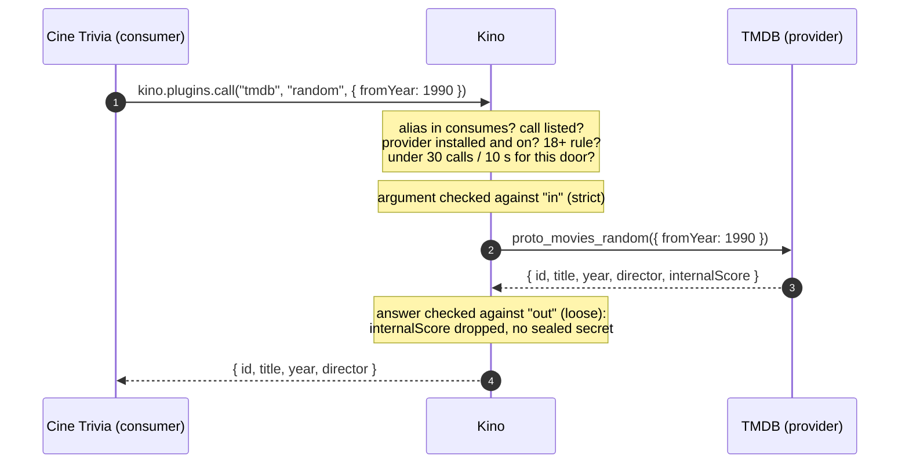
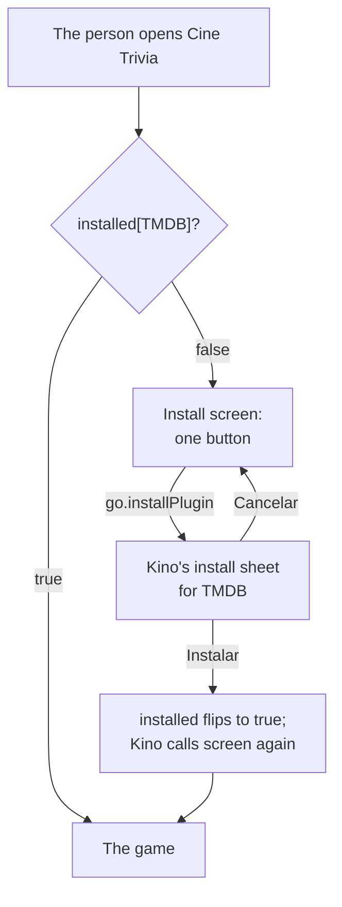

# The plugin protocol: plugins that use each other { #protocol }

!!! note "Kino 0.9.81, not in any released Kino yet"
    The plugin protocol is `apiVersion` 20 and ships with Kino 0.9.81. Every older Kino refuses a manifest with
    `"apiVersion": 20` («Este plugin necesita una versión más nueva de Kino»), but a plugin that stays on a lower
    `apiVersion` can still open its doors through [`enhancements["20"]`](#versions), which an older Kino ignores. Every number
    on this page is in `contract.json`, section `protocol` ([Reference](reference/index.md)).

A Kino plugin can **build on another plugin**. One plugin, the **provider**, opens named **doors** in its manifest: a few
calls (question and answer) and streams (news it publishes every so often), each with the shape of what it receives and what
it returns. Another plugin, the **consumer**, lists the doors it uses and asks them with
`await kino.plugins.call(alias, call, arg)`. **Kino is the only middleman**: the two plugins never see each other, never
share memory and never call each other directly. Kino finds the provider, checks every request and every answer against the
types the provider declared, limits the rate and reports a clear error code when something is missing.

Why it exists: so that work done once can be reused by everyone. A plugin that knows how to talk to a service (TMDB, a
music catalog, a sports feed) can offer that knowledge as a door, and other plugins (a game, a widget, a recommendations
screen) use it without copying its code, its hosts or its keys.

The first real pair, used as the example all along this page:

| Plugin | Role | Repository |
| --- | --- | --- |
| **TMDB** | Provider: opens the `movies` door (find a movie by id, a random one, search, and a `trending` stream) | [kinotvapp/kino-plugin-tmdb](https://github.com/kinotvapp/kino-plugin-tmdb) (TMDB 1.3.0 and later) |
| **Cine Trivia** | Consumer: a five-question movie trivia that takes every movie from TMDB's door | [kinotvapp/kino-plugin-cine-trivia](https://github.com/kinotvapp/kino-plugin-cine-trivia) |

!!! info "TMDB 1.3.0 and later, Kino 0.9.81 or newer"
    The `movies` door arrives in TMDB 1.3.0 and later. It sits in `enhancements["20"]`, so TMDB keeps its `apiVersion` and
    keeps installing on older Kinos, but **only Kino 0.9.81 or newer opens the door**: on an older Kino, TMDB is the
    same catalog plugin as always and Cine Trivia (which declares `apiVersion` 20) does not install.

## In one minute { #summary }

- **Provider:** declares `provides` in `kino-plugin.json` and exports one function per call, `proto_<door>_<call>(arg)`, and
  one per stream, `proto_<door>_<stream>(cursor)`.
- **Consumer:** declares `consumes` (an alias, the provider's `repo`, the `door`, the calls and streams it uses) and also
  `recommends` the provider, so it can offer to install it.
- **The call:** `const movie = await kino.plugins.call("tmdb", "random", { fromYear: 1990 })`. It resolves to the provider's
  answer, already checked against the declared type, or rejects with an `Error` whose `code` is one of seven.
- **A stream:** the consumer's screen sets `state.protocol.<alias>.<stream> = true`; Kino polls the provider and delivers the
  new items to `screenEvent` as the event `protocol`.
- **Nothing installs on its own.** While the provider is missing, the consumer draws only an install screen with a
  [`go.installPlugin`](screen-forms.md#go-install-plugin) button. Kino opens its normal install sheet; the person decides.
- **Kino checks everything:** requests strictly, answers loosely (undeclared fields are dropped), 64 KB each way, 10 s per
  call, 30 calls in any 10 s per door. 18+ content never crosses into a plugin that is not 18+, sealed secrets never cross at
  all.

## The mental model { #model }

Kino sits in the middle of every exchange. Neither plugin knows where the other one lives; they only know a door name and the
types written in the provider's manifest.



| Who | Does | Never does |
| --- | --- | --- |
| **The provider** | Declares its doors and their types; answers each call with JSON; decides in code what to share | Learns which plugin asked; reaches the consumer; sends a type it did not declare (Kino drops it) |
| **The consumer** | Declares what it uses; calls with an argument that matches `in`; handles the error codes; invites the person to install the provider | Calls a door it did not list; installs anything; reads the provider's storage, settings or secrets |
| **Kino** | Finds the provider by repository, validates both ways, limits the rate and the time, runs streams while a screen is open, shows the consent line | Stores anything about the exchange (nothing new is synced); asks the person on every call |
| **The person** | Sees "Usa datos de TMDB (Movie records from TMDB)" on the consumer's install sheet; installs the provider with their own tap | Gets a plugin installed without tapping Instalar |

A door is not a capability. A provider keeps the capabilities of the kind of plugin it is (TMDB is still a catalog with
`search`, `home`, `meta`...), and a consumer keeps its own (Cine Trivia is a `screen` plugin). `provides` and `consumes` are
two extra manifest blocks next to them.

## A complete example: TMDB and Cine Trivia { #example }

### The provider: TMDB opens the `movies` door { #example-provider }

TMDB is an existing catalog plugin on `apiVersion` 7. To open its door **without raising its `apiVersion`** (so it keeps
installing on every Kino it already supports) it puts `provides` inside `enhancements["20"]`. This is the part of
`kino-plugin.json` that TMDB 1.3.0 adds (the rest of the manifest, its capabilities and settings, is unchanged):

```json
{
  "id": "tmdb",
  "name": "TMDB",
  "version": "1.3.0",
  "apiVersion": 7,
  "entry": "plugin.js",
  "hosts": ["image.tmdb.org"],
  "capabilities": ["search", "home", "browse", "episodes", "resolve", "meta"],
  "enhancements": {
    "20": {
      "provides": {
        "movies": {
          "summary": "Movie records from TMDB",
          "calls": {
            "byId":   { "in": { "id": "number" }, "out": "Movie" },
            "random": { "in": { "fromYear": "number?", "toYear": "number?" }, "out": "Movie" },
            "search": { "in": { "q": "string" }, "out": "Movie[]" }
          },
          "streams": {
            "trending": { "out": "Movie", "everySeconds": 60 }
          },
          "types": {
            "Movie": { "id": "number", "title": "string", "year": "number", "director": "string?", "overview": "string?", "posterUrl": "string?" }
          }
        }
      }
    }
  }
}
```

Read it as the door's documentation: `byId` takes `{ id }` and answers one `Movie`; `random` takes an optional year range and
answers one `Movie`; `search` takes `{ q }` and answers a list of `Movie`; `trending` is a stream of `Movie`, polled at most
once a minute. A `Movie` always has `id`, `title` and `year`, and may have `director`, `overview` and `posterUrl`.

Each call and stream is one export of the entry file, named `proto_<door>_<name>`. TMDB answers through Kino's own
[`kino.tmdb`](kino-api.md#tmdb) service, so it needs no host and no key of its own for this:

```js
// The "movies" door. Kino checks every argument against "in" before calling, and every answer against "out" after.
export async function proto_movies_byId(arg) {
  return movieById(arg && arg.id);                 // one kino.tmdb request (credits included, for the director)
}

export async function proto_movies_random(arg) {
  const { fromYear, toYear } = arg || {};          // both optional: Kino passes {} when the consumer sends nothing
  const params = { include_adult: false, sort_by: "popularity.desc", "vote_count.gte": 100 };
  if (Number.isInteger(fromYear)) params["primary_release_date.gte"] = `${fromYear}-01-01`;
  if (Number.isInteger(toYear)) params["primary_release_date.lte"] = `${toYear}-12-31`;
  const pool = await discoverPool({ ...params, page: 1 + Math.floor(Math.random() * 10) });
  if (!pool.length) throw new Error("not_found");  // a throw reaches the consumer as provider_failed
  return movieById(pool[Math.floor(Math.random() * pool.length)].id);
}

export async function proto_movies_search(arg) {
  const q = String(arg.q).trim().slice(0, 200);
  return q ? moviesOf(await kino.tmdb("/search/movie", { query: q, include_adult: false })) : [];
}

// A stream: the argument is the cursor this function returned last time (null the first time).
export async function proto_movies_trending(cursor) {
  const seen = Array.isArray(cursor) ? cursor : [];
  const fresh = moviesOf(await kino.tmdb("/trending/movie/week", {})).filter((m) => !seen.includes(m.id));
  return { items: fresh, cursor: seen.concat(fresh.map((m) => m.id)).slice(-200) };
}
```

`movieById`, `discoverPool` and `moviesOf` are TMDB's own helpers: they turn TMDB's rows into the declared `Movie`
(`{ id, title, year, director?, overview?, posterUrl? }`) and leave adult rows out. The complete code is in the TMDB
repository.

### The consumer: Cine Trivia { #example-consumer }

Cine Trivia is useless without TMDB, so it declares `apiVersion` 20 directly. Its manifest:

```json
{
  "id": "cine-trivia",
  "name": "Cine Trivia",
  "version": "1.0.0",
  "apiVersion": 20,
  "entry": "plugin.js",
  "description": "Cinco preguntas de cine, quince segundos cada una: las películas llegan del plugin TMDB",
  "hosts": ["image.tmdb.org"],
  "capabilities": ["screen"],
  "screen": { "label": "Cine Trivia", "labelEn": "Cine Trivia", "icon": "movie", "menuOpens": "screen" },
  "recommends": ["kinotvapp/kino-plugin-tmdb"],
  "consumes": {
    "tmdb": {
      "repo": "kinotvapp/kino-plugin-tmdb",
      "door": "movies",
      "calls": ["random", "byId"],
      "streams": ["trending"]
    }
  }
}
```

- `consumes.tmdb`: `tmdb` is a **local alias**, the first argument of `kino.plugins.call`. `repo` is the provider's GitHub
  repository, `door` the door's name, `calls` and `streams` exactly the names Cine Trivia uses (it never calls `search`, so it
  does not list it).
- `recommends` names the same repository, so `screen` and `screenEvent` receive `installed["kinotvapp/kino-plugin-tmdb"]`
  (see [the install gate](#install-gate)).
- `hosts` is only `image.tmdb.org`, for the posters it draws. The movie data does not come from the network: it comes
  through Kino from the provider.

### The install gate { #install-gate }

Kino never installs anything on its own. Until TMDB is installed, Cine Trivia shows **only** an install screen with one
button. The button's `go` is [`installPlugin`](screen-forms.md#go-install-plugin): Kino opens its normal install sheet over
the screen, and the person taps Instalar (or Cancelar).

```js
const TMDB_REPO = "kinotvapp/kino-plugin-tmdb";
const gateOpen = (installed) => !!installed && installed[TMDB_REPO] === true;

export async function screen({ state = {}, installed } = {}) {
  if (!gateOpen(installed)) return installView();        // nothing else is drawn or interactive
  return gameView(state);
}

function installView() {
  return {
    type: "Column", padding: 24, gap: 16, crossAxisAlignment: "center", children: [
      { type: "Text", text: "Cine Trivia", textEn: "Cine Trivia", style: "h1", textAlign: "center" },
      { type: "Text", text: "Para jugar necesitas el plugin TMDB: de ahí salen las películas de cada pregunta.",
        textEn: "To play you need the TMDB plugin: every question's movies come from it.", textAlign: "center" },
      { type: "ElevatedButton", key: "install", labelText: "Instalar TMDB", labelTextEn: "Install TMDB", autofocus: true,
        onPressed: { go: { installPlugin: { repo: TMDB_REPO } } } },
    ],
  };
}

export async function screenEvent({ name, installed } = {}) {
  if (!gateOpen(installed)) return null;                  // no event does anything until TMDB is there
  // ... the game
}
```



When the person installs TMDB, `installed` changes and Kino calls `screen` again while the screen is open: the game appears in
place, without reopening the plugin. From then on it loads straight away. If the person removes TMDB later, Cine Trivia is
not touched: the gate simply shows the install screen again, and any call that was in flight answers `provider_missing`.

### Asking a door { #calling }

Each round asks TMDB for one random movie of a random era. Kino keeps a screen's state, so the handler calls, answers with
new `state` and keeps nothing alive between events:

```js
async function round(game) {
  try {
    const movie = await kino.plugins.call("tmdb", "random", eraArg(Math.random));   // e.g. { fromYear: 1990, toYear: 1999 }
    const q = buildQuestion(movie);                                                  // movie is a checked Movie
    return { state: { game: { ...game, phase: "question", q, error: null } }, focus: "opt0" };
  } catch (e) {
    const code = e && typeof e.code === "string" ? e.code : "provider_failed";
    return { state: { game: { ...game, phase: "error", error: code } }, focus: "retry" };   // the view offers "Reintentar"
  }
}
```

The answer is exactly the declared `Movie`: if TMDB had added a field the door does not declare, Kino would have dropped it
before Cine Trivia saw it. If TMDB had answered without `title`, the call would reject with `bad_output` instead.

### Live news with a stream { #stream-example }

Cine Trivia has a "Tendencias en vivo" switch. Turning it on sets a state flag; Kino then polls TMDB's `trending` stream while
the screen is open and delivers the new movies as the event `protocol`:

```js
export async function screenEvent({ name, arg, value, state = {}, installed } = {}) {
  if (!gateOpen(installed)) return null;
  switch (name) {
    case "trending":                                  // the Switch's onChanged
      return { state: { protocol: { tmdb: { trending: value === true } }, trendingTitle: null } };
    case "protocol": {                                // arg: { alias: "tmdb", stream: "trending", items: [Movie, ...] }
      if (arg.alias !== "tmdb" || arg.stream !== "trending") return null;
      const movie = arg.items.find((m) => typeof m.title === "string" && m.title.trim());
      return movie ? { state: { trendingTitle: movie.title.slice(0, 120) } } : null;
    }
    // ...
  }
}
```

### What happens on one call, step by step { #steps }

1. Cine Trivia's `screenEvent` runs `kino.plugins.call("tmdb", "random", { fromYear: 1990 })`.
2. Kino looks up the alias `tmdb` in Cine Trivia's `consumes` and checks that `random` is listed there (else `not_declared`).
3. Kino finds the installed plugin whose repository is `kinotvapp/kino-plugin-tmdb` (a fork does not count). If there is none,
   or it is off, or it needs setup, or it is 18+ and Cine Trivia is not, the call is `provider_missing`.
4. Kino checks that TMDB's door `movies` still declares `random` (else `not_declared`) and that Cine Trivia has made fewer than
   30 calls to that door in the last 10 s (else `rate_limited`).
5. Kino checks the argument against `random`'s `in`, strictly (else `bad_input`).
6. Kino calls TMDB's export `proto_movies_random` as a background call, for at most 10 s (else `timeout`; a throw or a missing
   export is `provider_failed`).
7. Kino checks the answer against `random`'s `out`, loosely: it drops undeclared fields, refuses a missing or mistyped
   required field, anything over 64 KB, and any answer that holds one of TMDB's sealed secrets (all `bad_output`).
8. The promise in Cine Trivia resolves to the checked `Movie`.

## The provider in detail { #provider }

### The `provides` block { #provides }

`provides` maps a door name to its declaration. A plugin opens **at most 4 doors**.

| Field of a door | What it is | Rules |
| --- | --- | --- |
| `summary` | One sentence for the person: it appears in the consumer's consent line, after your plugin's name | Optional, at most 120 characters. One text for both languages (there is no `summaryEn`): keep it short and plain |
| `calls` | `{ "<call>": { "in"?, "out" } }`, question and answer | At most 16. `out` is required; `in` may be left out for a call with no argument |
| `streams` | `{ "<stream>": { "out", "everySeconds"? } }`, subscriptions | At most 8. `out` is the type of **one item**; `everySeconds` is clamped between 30 and 86,400 (60 when omitted) |
| `types` | `{ "<Type>": { "<field>": "<type>" } }`, named object types | Names start with a capital letter (`^[A-Z][A-Za-z0-9]{0,31}$`) and are local to the door |

Door, call, stream (and, on the consumer side, alias) names are letters and digits starting with a letter, at most 32
(`^[A-Za-z][A-Za-z0-9]{0,31}$`). A call and a stream of the same door cannot share a name. A malformed block refuses the
whole manifest with a message that names the door and the field (for example `door "movies": call "random" needs an "out"`);
inside `enhancements["20"]` it drops only that block instead.

### The exports { #exports }

| Declared | Export | Receives | Returns |
| --- | --- | --- | --- |
| a call `random` of the door `movies` | `proto_movies_random` | the consumer's argument, already checked against `in` (`{}` when the consumer sent none and every field of `in` is optional) | JSON that matches `out` (a value or a promise of one) |
| a stream `trending` of the door `movies` | `proto_movies_trending` | the `cursor` you returned last time, `null` the first time | `{ items: [...], cursor }`: `items` are new since that cursor, each one an `out`; `cursor` is any JSON you want back next time |

- **Throw to fail.** A thrown error reaches the consumer as `provider_failed` (the message is not passed on, so put nothing
  private in it). A missing export is also `provider_failed`.
- **You decide what to share.** The export is ordinary code: answer what you want to give out and nothing more. Kino adds a
  safety net (it drops undeclared fields and refuses sealed secrets), but the first filter is yours.
- **It runs as a background call.** A provider that takes more than 10 s fails that call with `timeout`, but Kino does not mark
  it "No responde" for it, and a provider's failure never touches the consumer's other work or other plugins.
- **Your own limits still apply.** The provider's `kino.fetch` stays on its own `hosts`, and Kino's services keep their limits
  ([`kino.tmdb`](kino-api.md#tmdb): 20 calls per 10 s per plugin on Kino's key). Design calls that cost one or two requests
  (TMDB's `byId` asks for the credits in the same request; `random` costs two).
- **Your manifest is the documentation.** Authors of consumers read your `provides` to know what to send and what comes back.
  Describe the door in your README too: what each call does, its errors, how often a stream changes.

### Changing a door later { #evolving }

Kino re-reads the provider's door at **every call**, never at install time of the consumer, so a change applies at once:

| Change in a provider update | What consumers see |
| --- | --- |
| A new call, stream or door | Nothing, until a consumer lists it in its own `consumes` |
| A new **optional** field in a type (`"rating": "number?"`) | Old consumers keep working; Kino passes the field once declared |
| A new **required** field in an `in` | Old consumers that do not send it get `bad_input`: avoid it, add an optional one |
| A call or stream removed or renamed | Every consumer that uses it gets `not_declared` |
| A field removed from an `out` type, or its type changed | Consumers that read it break silently or get `bad_output` |

So treat a published door like a public API: only add, and only optional fields. When you must break it, open a **new door**
(`movies2`) next to the old one and keep both for a while. A provider update that widens a door does not show the consent line
again to people who already have the consumer.

## The type language { #types }

A small, closed language, the same for `in`, `out` and `types`:

| Type | Means | Example |
| --- | --- | --- |
| `string`, `number`, `boolean` | the JSON primitive (`number` is a finite number) | `"id": "number"` |
| `T?` | optional: absent or `null` | `"director": "string?"` |
| `T[]` | an array of `T` | `"out": "Movie[]"` |
| `Name` | a type declared in the door's `types` | `"out": "Movie"` |
| `{ ... }` | an inline object of field to type | `"in": { "q": "string" }` |

Suffixes combine (`"string[]?"`: an optional list of strings; `"Movie?[]"`: a list whose items may be null). There is no
`any`, no union, no enum and no map: if you need a free-form value, send it as a `string` (JSON inside a string, if you must)
and document it.

| | Requests (`in`) | Answers (`out`, stream items) |
| --- | --- | --- |
| Checked | **strictly** | **loosely** |
| An undeclared field | refused: `bad_input` | dropped silently |
| A required field missing | `bad_input` | `bad_output` |
| A wrong type | `bad_input`, never coerced (`"1990"` is not a `number`) | `bad_output`, never coerced |
| No argument at all | read as `{}` when every field of `in` is optional; else `bad_input` | — |
| Size | at most 64 KB of JSON (UTF-8 bytes) | at most 64 KB of JSON (UTF-8 bytes) |

Only the argument itself reads as `{}` when absent: a `null` nested inside it (an element of an `Opts[]`, say) is still
`bad_input`.

## The consumer in detail { #consumer }

### The `consumes` block { #consumes }

`consumes` maps a local alias to the door it stands for. **At most 8 entries.**

| Field | Rules |
| --- | --- |
| *key* (the alias) | Letters and digits, starting with a letter, at most 32. Only your code sees it |
| `repo` | Required. The provider's plain GitHub `owner/name` (no URL, no sub-path, no `@ref`), the same kind of string as `recommends`. A fork with another repository does **not** satisfy it |
| `door` | Required. The door's name in the provider's `provides` |
| `calls` | The call names you use, at most 16. A call not listed here answers `not_declared` even if the door has it |
| `streams` | The stream names you use, at most 8 |

Two aliases may point at the same door (rarely useful): the rate limit is per **provider door**, whatever alias reaches it.
A provider installed after the consumer simply starts working: nothing is resolved at install time.

### `kino.plugins.call(alias, call, arg?)` { #call }

```js
const movie = await kino.plugins.call("tmdb", "byId", { id: 603 });
```

- `alias` is a key of your `consumes`, `call` a name listed there, `arg` JSON that matches the call's `in` (leave it out, or
  pass `{}`, when every field is optional).
- It resolves to the provider's answer, checked against `out`, or rejects with an `Error` whose `code` is one of the seven
  [error codes](#errors).
- **Where:** in `screen`, `screenEvent` and the other exports that can use Kino's services (a player panel's exports too).
  **Not** in a background `job` (it rejects with `not_allowed`) and not in `sign()`.
- **Feature detection:** `typeof kino.plugins === "object"`. Useful when a consumer offers the protocol through
  `enhancements["20"]` and keeps a lower `apiVersion` (see [Old Kinos](#versions)).
- Each call is independent: a screen's state lives in Kino, so a handler calls, answers with new `state`, and nothing has to
  stay alive between events. Do not cache answers in global variables expecting them to survive; put what you need in
  `state`, `kino.storage` or [`kino.shared`](jobs-and-shared.md#shared).

## Streams { #streams }

A stream is a subscription **Kino owns, tied to one of your screens**. Nothing runs in the background when no screen of yours
is open.

1. **Switch it on** with a state flag in your answer: `{ state: { protocol: { tmdb: { trending: true } } } }`, that is
   `state.protocol.<alias>.<stream> = true`. `false` switches it off. The `protocol` key is replaced whole like any other state
   key, so send all your flags together when you have more than one.
2. While that screen is **open, shown and Kino in front**, Kino calls the provider's `proto_<door>_<stream>(cursor)` every
   `everySeconds` (30 at least, 60 when the provider did not say), with the last cursor (`null` the first time).
3. Kino checks every item against the stream's `out` and drops the ones that do not match.
4. If there are new items, your `screenEvent` receives the event **`protocol`** with `arg` `{ alias, stream, items }`. Its answer
   is treated like an [`every` timer tick](screens.md#timers): only `state`, `toast`, `close` and `config` are kept.
5. Three failures in a row switch that subscription off for this opening of the screen. It never counts toward "No responde".

| Rule | Number |
| --- | --- |
| Live subscriptions per plugin | 4 |
| Flags read from `state.protocol` | 16 |
| Polls per provider door | 8 in any 10 s, shared by all its subscribers (separate from the 30 calls, so your calls never starve your polls) |
| Poll interval | `everySeconds` from 30 to 86,400; 60 by default |

Good to know:

- Closing the screen ends the subscription; nothing is persisted. Kino leaving the front stops every subscription.
- A feed's cursor is dropped when its last subscriber leaves: after a return the provider is polled from `null` again, and a
  batch already delivered **may arrive again**. Make your `protocol` handler idempotent (Cine Trivia only shows the newest
  title).
- A subscriber that joins a feed others already share gets only the items polled after it joined.
- Streams are for plugin screens, not for a player-panel session.
- The provider's cursor is its own business: an offset, a date, the list of ids already delivered (TMDB keeps up to 200 ids).
  Keep it small: it travels with every poll.

## Errors { #errors }

`kino.plugins.call` rejects with an `Error` whose `code` is exactly one of these:

| `code` | When | What the consumer should do |
| --- | --- | --- |
| `provider_missing` | The provider (the plugin of that repository) is not installed, is off or needs setup, or is 18+ while your plugin is not | Show the [install gate](#install-gate) (or "turn TMDB on") |
| `not_declared` | The alias is not in your `consumes`, the call or stream is not listed there, the provider's door lacks it, or the door is your own plugin's | A bug in your manifest, or the provider removed the call: log it, say "no disponible" |
| `bad_input` | Your argument does not match the call's `in`, is not JSON, or is over 64 KB | A bug in your code: check the provider's types |
| `bad_output` | The provider's answer does not match `out`, is not JSON, is over 64 KB, or holds one of its sealed secrets | The provider's bug: show a short error with "Reintentar" |
| `rate_limited` | More than 30 calls in any 10 s from your plugin to one door of one provider (whatever alias you use) | Slow down; never retry in a loop |
| `timeout` | The provider took more than 10 s | Offer "Reintentar" |
| `provider_failed` | The provider threw, or does not export `proto_<door>_<call>` | Offer "Reintentar"; if it keeps failing, the provider has a problem |

In a background `job`, `kino.plugins.call` rejects with `not_allowed`. The rejection is a normal `Error`: always `await` the
call inside `try`/`catch`, and show the person a sentence of your own, in Spanish and English, never the raw code alone.

```js
try {
  const list = await kino.plugins.call("tmdb", "search", { q });
  return { state: { results: list } };
} catch (e) {
  if (e.code === "provider_missing") return { state: { needsTmdb: true } };      // the screen draws the install button
  return { toast: { text: "TMDB no respondió, intenta otra vez", textEn: "TMDB did not answer, try again" } };
}
```

## Limits { #limits }

| What | Limit |
| --- | --- |
| Doors per provider | 4 |
| Calls / streams per door | 16 / 8 |
| Door `summary` | 120 characters |
| Names (door, call, stream, alias) | `^[A-Za-z][A-Za-z0-9]{0,31}$` |
| Type names | `^[A-Z][A-Za-z0-9]{0,31}$` |
| `consumes` entries | 8; each lists at most 16 calls and 8 streams |
| Request and answer | JSON, at most 64 KB (65,536 UTF-8 bytes) each |
| Time per call | 10 s |
| Calls | 30 in any 10 s, per consumer and provider door |
| Stream interval | `everySeconds` 30 to 86,400, default 60 |
| Live subscriptions | 4 per consumer; 16 flags read from the state |
| Polls | 8 in any 10 s per provider door |
| Where | screens and the other exports; never a background `job` (`not_allowed`) nor `sign()` |

The same numbers are in [Limits and engine quirks](engine-limits.md#limits).

## A plugin that only provides { #provides-only }

A plugin whose **only** purpose is to open doors needs nothing else: `apiVersion` 20, a non-empty `provides`, no capability at
all (the `capabilities` field may be left out) and `"hosts": []`. It plays nothing, is no source and does not show up in
search or Home. Its consent sheet claims no network and no role, and its installed card says it does not connect to the
internet. It reaches the world only through Kino's services, such as [`kino.tmdb`](kino-api.md#tmdb).

```json
{
  "id": "movie-facts",
  "name": "Movie Facts",
  "version": "1.0.0",
  "apiVersion": 20,
  "entry": "plugin.js",
  "hosts": [],
  "provides": {
    "facts": {
      "summary": "Short facts about a movie",
      "calls": { "forMovie": { "in": { "tmdbId": "number" }, "out": "string[]" } }
    }
  }
}
```

Declare any capability or any setting, or put `provides` below `apiVersion` 20, and the ordinary rules come back (`resolve`
and `search` or `home`, at least one host...).

## Old Kinos: `apiVersion` 20 or `enhancements["20"]` { #versions }

| How you declare it | On Kino 0.9.81 or newer | On an older Kino |
| --- | --- | --- |
| `"apiVersion": 20` with `provides` / `consumes` at the top level | Works | The plugin does not install («Este plugin necesita una versión más nueva de Kino») |
| A lower `apiVersion` with `provides` / `consumes` at the top level | **Refused**: `The "provides" block needs apiVersion 20` | Ignored |
| A lower `apiVersion` with `"enhancements": { "20": { "provides": … } }` | Works: the block is merged and checked as `apiVersion` 20 | The block is ignored; the plugin installs and works as before |

- A **provider** that already has users should use `enhancements["20"]` (TMDB's way): nobody loses the plugin.
- A **consumer** that only makes sense with its provider can declare `apiVersion` 20 (Cine Trivia's way). A consumer that has
  other uses can put `consumes` in `enhancements["20"]` and hide the feature with `typeof kino.plugins === "object"`.
- `recommends` and `installed` have no `apiVersion` of their own (Kino 0.9.81 reads them at any `apiVersion`, an older Kino
  ignores them); `go.installPlugin` is honoured from `apiVersion` 19 (below it, Kino drops it and logs it).
- A block inside `enhancements` that breaks a rule is dropped and logged, never refusing your plugin: run
  `node sdk/validate.mjs .`, which lists every drop. More in [Screens without raising your apiVersion](enhancements.md).

## What the person sees { #what-people-see }

- **On the consumer's install sheet**, one plain informational line per door it uses, not red and without a switch:
  «Usa datos de TMDB (Movie records from TMDB)» («Uses data from TMDB (Movie records from TMDB)» in English): the provider's
  `name` and the door's `summary`. If the provider is not installed yet, the line names its repository instead
  («Usa datos de kinotvapp/kino-plugin-tmdb»).
- **On an update** that adds a door to `consumes`, the line is marked new (also in the notice of an update Kino applied on its
  own).
- **No prompt per call.** Having the provider installed is the consent.
- **Nothing installs silently.** A consumer can only show a [`go.installPlugin`](screen-forms.md#go-install-plugin) button;
  Kino opens its own install sheet with the provider's own consent lines, and only the person's Instalar installs it.
- **Removing the provider** only makes its doors answer `provider_missing`; the consumers are not changed or uninstalled.
- **Nothing new is synced**: the protocol stores nothing. Keep your own state in `kino.storage` or `kino.shared` as usual.

## Security and privacy { #security }

!!! warning "Your arguments reach the provider"
    The consent line says that the consumer uses the provider's data; it says nothing about what the consumer **sends**.
    Every argument of every call reaches the provider, which may send it to its own `hosts` (or to any public host, with
    `"fetchHosts": "any"`). Never put in an argument what you would not hand to the provider's author: no tokens, no
    passwords, nothing the person typed in a private field.

- **18+:** an 18+ provider answers only an 18+ consumer. To any other plugin its doors answer `provider_missing`, so 18+
  content never crosses into a plugin that is shown with the 18+ lock closed.
- **Sealed secrets never cross.** An answer (or a stream poll) that holds one of the provider's [sealed secrets](manifest.md#secrets),
  in any form, or a secret marker, is `bad_output`, the same rule `kino.shared` applies.
- **No self-calls.** A plugin cannot use its own door: it answers `not_declared` (the call would wait on itself until the
  timeout). Two plugins that use each other's doors must not call back from inside an answer: the second call may wait on the
  first until `timeout`.
- **Hosts are not widened.** Receiving data from a provider gives the consumer no new host: what it fetches is still limited
  to its own approved `hosts`.
- **Only declared data leaves.** The provider decides in code what to answer; Kino drops every field the door does not
  declare.
- **Repository, not id.** A consumer names its provider by repository. A plugin that copies the provider's `id` from another
  repository (or a fork) is not that provider.

## Testing offline with the kit { #kit }

The Node kit answers `kino.plugins.call` from a provider **folder** on your computer, through the same validation and the same
error codes:

```sh
# a call: the consumer's "play" event, answered by the provider's proto_movies_random
node sdk/run.mjs --provider ../kino-plugin-tmdb ./cine-trivia screenEvent play

# a stream: poll tmdb.trending once and send the "protocol" event { alias, stream, items }
node sdk/run.mjs --provider ../kino-plugin-tmdb ./cine-trivia screenEvent protocol tmdb.trending

# the install gate: draw the screen as if TMDB were installed (without --context every recommends entry is false)
node sdk/run.mjs --context '{"installed":{"kinotvapp/kino-plugin-tmdb":true}}' ./cine-trivia screen
```

- `--provider <folder>` (repeatable) loads the provider's manifest and entry in its own sandbox. Without it every call rejects
  with `provider_missing`.
- The kit has no repositories to match: it serves each `consumes` entry with the **first provider that has its door** (the
  app matches the entry's `repo`).
- The provider's own services work as usual in the kit: TMDB needs `KINO_TMDB_KEY` or a `KINO_TMDB_FIXTURE` for `kino.tmdb`
  ([Test it locally](test-locally.md#kino-services)).
- `node sdk/validate.mjs <folder>` reads `provides` and `consumes` (top level and in `enhancements`) the way the app does and
  lists what it would refuse.
- In your own tests, `createProtocolCaller` and `createKino(manifest, { protocol })` from `sdk/protocol.mjs` give you the same
  caller.
- `--provider` and `sdk/protocol.mjs` belong to the kit of Kino 0.9.81. If `run.mjs` does not know `--provider` or
  `validate.mjs` does not know `provides`, your copy of `sdk/`, `contract.json` and `kino.d.ts` is older: replace all three
  with a copy that has `sdk/protocol.mjs` (never silence the error by removing the blocks).

!!! warning "What only the app checks"
    The kit does **not** apply the 18+ rule, the refusal of sealed secrets in answers, nor the self-call refusal, and it does
    not match `repo`: those need the installed plugins, and only Kino has them. Before publishing, install both plugins in
    Kino 0.9.81 or newer and try the real flow: the install gate, a call, the stream switch, and removing the provider.
    More in [What the kit cannot copy](engine-limits.md#kit-protocol).

## Checklists { #checklists }

**Provider**

- `provides` at the top level with `"apiVersion": 20`, or in `enhancements["20"]` to keep your `apiVersion`.
- One export per call and per stream: `proto_<door>_<name>`, spelled exactly like the manifest (case included).
- Every answer matches `out`; a stream answers `{ items, cursor }`.
- Nothing private in answers or in thrown messages; no sealed secret anywhere in an answer.
- A short `summary` the person understands; the door described in your README.
- Changes after publishing only add (new calls, optional fields); a breaking change goes to a new door.

**Consumer**

- `consumes` with the provider's exact `repo`, `door`, and only the calls and streams you use.
- The same repository in `recommends`, and an install screen with `go.installPlugin` while `installed[repo]` is not
  `true`.
- Every `kino.plugins.call` in `try`/`catch`, with a Spanish and English message per case; no retry loops.
- Arguments carry nothing the provider's author should not see.
- No calls from a background `job`.
- A `protocol` handler that tolerates repeated items.
- Tried with `--provider` in the kit, and in the app with the real provider installed and removed.
