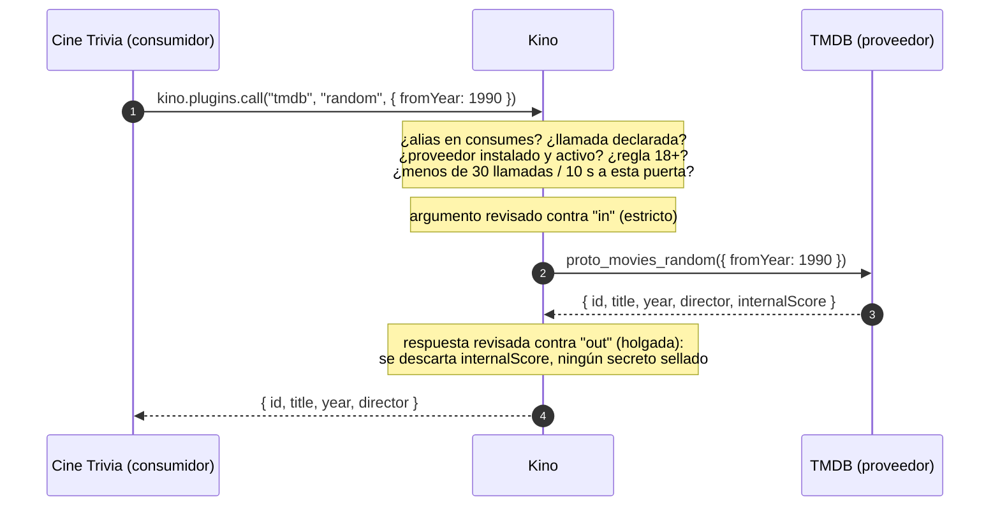
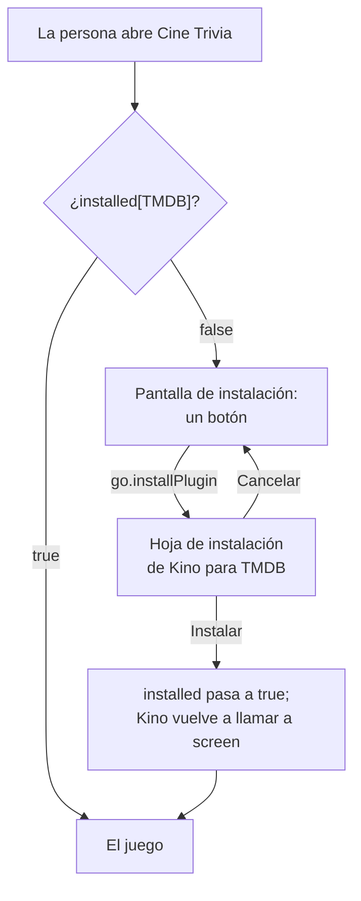

# Protocolo entre plugins: plugins que se usan entre sí { #protocol }

!!! note "Kino 0.9.81, todavía en ningún Kino publicado"
    El protocolo entre plugins es el `apiVersion` 20 y llega con Kino 0.9.81. Todo Kino anterior rechaza un manifiesto con
    `"apiVersion": 20` («Este plugin necesita una versión más nueva de Kino»), pero un plugin que se queda en un `apiVersion`
    más bajo igual puede abrir sus puertas con [`enhancements["20"]`](#versions), que un Kino anterior ignora. Cada número de
    esta página está en `contract.json`, sección `protocol` ([Referencia](reference/index.md)).

Un plugin de Kino puede **apoyarse en otro plugin**. Un plugin, el **proveedor**, abre **puertas** con nombre en su
manifiesto: unas cuantas llamadas (pregunta y respuesta) y flujos (novedades que publica cada tanto), cada una con la forma
de lo que recibe y de lo que devuelve. Otro plugin, el **consumidor**, declara las puertas que usa y les pregunta con
`await kino.plugins.call(alias, llamada, arg)`. **Kino es el único intermediario**: los dos plugins nunca se ven, nunca
comparten memoria y nunca se llaman directamente. Kino encuentra al proveedor, revisa cada petición y cada respuesta contra
los tipos que declaró el proveedor, limita el ritmo y devuelve un código de error claro cuando falta algo.

Para qué existe: para que el trabajo hecho una vez lo reúsen todos. Un plugin que sabe hablar con un servicio (TMDB, un
catálogo de música, un feed de deportes) puede ofrecer ese conocimiento como una puerta, y otros plugins (un juego, un
widget, una pantalla de recomendaciones) lo usan sin copiar su código, sus hosts ni sus llaves.

La primera pareja real, el ejemplo de toda esta página:

| Plugin | Papel | Repositorio |
| --- | --- | --- |
| **TMDB** | Proveedor: abre la puerta `movies` (buscar una película por id, una al azar, buscar por texto y un flujo `trending`) | [kinotvapp/kino-plugin-tmdb](https://github.com/kinotvapp/kino-plugin-tmdb) (TMDB 1.3.0 y posteriores) |
| **Cine Trivia** | Consumidor: una trivia de cine de cinco preguntas que saca cada película de la puerta de TMDB | [kinotvapp/kino-plugin-cine-trivia](https://github.com/kinotvapp/kino-plugin-cine-trivia) |

!!! info "TMDB 1.3.0 y posteriores, Kino 0.9.81 o más nuevo"
    La puerta `movies` llega en TMDB 1.3.0 y posteriores. Va dentro de `enhancements["20"]`, así que TMDB conserva su
    `apiVersion` y se sigue instalando en los Kino anteriores, pero **solo Kino 0.9.81 o más nuevo abre la puerta**: en un
    Kino anterior, TMDB es el mismo plugin de catálogo de siempre y Cine Trivia (que declara `apiVersion` 20) no se instala.

## En un minuto { #summary }

- **Proveedor:** declara `provides` en `kino-plugin.json` y exporta una función por llamada, `proto_<puerta>_<llamada>(arg)`,
  y una por flujo, `proto_<puerta>_<flujo>(cursor)`.
- **Consumidor:** declara `consumes` (un alias, el `repo` del proveedor, la `door`, las llamadas y los flujos que usa) y además
  pone al proveedor en `recommends`, para poder ofrecer instalarlo.
- **La llamada:** `const movie = await kino.plugins.call("tmdb", "random", { fromYear: 1990 })`. Se resuelve con la respuesta
  del proveedor, ya revisada contra el tipo declarado, o se rechaza con un `Error` cuyo `code` es uno de siete.
- **Un flujo:** la pantalla del consumidor pone `state.protocol.<alias>.<flujo> = true`; Kino consulta al proveedor y entrega
  lo nuevo a `screenEvent` como el evento `protocol`.
- **Nada se instala solo.** Mientras falta el proveedor, el consumidor dibuja solo una pantalla de instalación con un botón
  [`go.installPlugin`](screen-forms.md#go-install-plugin). Kino abre su hoja de instalación de siempre; la persona decide.
- **Kino lo revisa todo:** las peticiones con rigor, las respuestas con holgura (los campos no declarados se descartan), 64 KB
  en cada sentido, 10 s por llamada, 30 llamadas en cualquier ventana de 10 s por puerta. El contenido 18+ nunca pasa a un
  plugin que no es 18+, y los secretos sellados no pasan nunca.

## El modelo mental { #model }

Kino está en medio de cada intercambio. Ningún plugin sabe dónde vive el otro; solo conocen el nombre de una puerta y los
tipos escritos en el manifiesto del proveedor.



| Quién | Hace | Nunca hace |
| --- | --- | --- |
| **El proveedor** | Declara sus puertas y sus tipos; responde cada llamada con JSON; decide en código qué comparte | Saber qué plugin preguntó; llegar al consumidor; mandar algo que no declaró (Kino lo descarta) |
| **El consumidor** | Declara lo que usa; llama con un argumento que cumple `in`; maneja los códigos de error; invita a la persona a instalar al proveedor | Llamar a una puerta que no declaró; instalar algo; leer el almacenamiento, los ajustes o los secretos del proveedor |
| **Kino** | Encuentra al proveedor por repositorio, valida en los dos sentidos, limita el ritmo y el tiempo, corre los flujos mientras hay una pantalla abierta, muestra la línea de consentimiento | Guardar algo del intercambio (no hay nada nuevo que sincronizar); preguntarle a la persona en cada llamada |
| **La persona** | Ve «Usa datos de TMDB (Movie records from TMDB)» en la hoja de instalación del consumidor; instala al proveedor con su propio toque | Recibir un plugin instalado sin tocar Instalar |

Una puerta no es una capacidad. Un proveedor conserva las capacidades del tipo de plugin que es (TMDB sigue siendo un
catálogo con `search`, `home`, `meta`...) y un consumidor conserva las suyas (Cine Trivia es un plugin con `screen`).
`provides` y `consumes` son dos bloques más del manifiesto, al lado de esas capacidades.

## Un ejemplo completo: TMDB y Cine Trivia { #example }

### El proveedor: TMDB abre la puerta `movies` { #example-provider }

TMDB es un plugin de catálogo que ya existe, con `apiVersion` 7. Para abrir su puerta **sin subir su `apiVersion`** (y
seguir instalándose en todos los Kino que ya soporta) pone `provides` dentro de `enhancements["20"]`. Esta es la parte de
`kino-plugin.json` que agrega TMDB 1.3.0 (el resto del manifiesto, sus capacidades y ajustes, no cambia):

```json
{
  "id": "tmdb",
  "name": "TMDB",
  "version": "1.3.0",
  "apiVersion": 7,
  "entry": "plugin.js",
  "hosts": ["image.tmdb.org"],
  "capabilities": ["search", "home", "browse", "episodes", "resolve", "meta"],
  "enhancements": {
    "20": {
      "provides": {
        "movies": {
          "summary": "Movie records from TMDB",
          "calls": {
            "byId":   { "in": { "id": "number" }, "out": "Movie" },
            "random": { "in": { "fromYear": "number?", "toYear": "number?" }, "out": "Movie" },
            "search": { "in": { "q": "string" }, "out": "Movie[]" }
          },
          "streams": {
            "trending": { "out": "Movie", "everySeconds": 60 }
          },
          "types": {
            "Movie": { "id": "number", "title": "string", "year": "number", "director": "string?", "overview": "string?", "posterUrl": "string?" }
          }
        }
      }
    }
  }
}
```

Léelo como la documentación de la puerta: `byId` recibe `{ id }` y responde una `Movie`; `random` recibe un rango de años
opcional y responde una `Movie`; `search` recibe `{ q }` y responde una lista de `Movie`; `trending` es un flujo de `Movie`
que se consulta como mucho una vez por minuto. Una `Movie` siempre trae `id`, `title` y `year`, y puede traer `director`,
`overview` y `posterUrl`.

Cada llamada y cada flujo es una exportación del archivo de entrada que se llama `proto_<puerta>_<nombre>`. TMDB responde a
través del servicio propio de Kino, [`kino.tmdb`](kino-api.md#tmdb), así que para esto no necesita ni host ni llave propia:

```js
// La puerta "movies". Kino revisa cada argumento contra "in" antes de llamar, y cada respuesta contra "out" después.
export async function proto_movies_byId(arg) {
  return movieById(arg && arg.id);                 // una petición a kino.tmdb (con los créditos, para el director)
}

export async function proto_movies_random(arg) {
  const { fromYear, toYear } = arg || {};          // los dos opcionales: Kino pasa {} cuando el consumidor no manda nada
  const params = { include_adult: false, sort_by: "popularity.desc", "vote_count.gte": 100 };
  if (Number.isInteger(fromYear)) params["primary_release_date.gte"] = `${fromYear}-01-01`;
  if (Number.isInteger(toYear)) params["primary_release_date.lte"] = `${toYear}-12-31`;
  const pool = await discoverPool({ ...params, page: 1 + Math.floor(Math.random() * 10) });
  if (!pool.length) throw new Error("not_found");  // un throw le llega al consumidor como provider_failed
  return movieById(pool[Math.floor(Math.random() * pool.length)].id);
}

export async function proto_movies_search(arg) {
  const q = String(arg.q).trim().slice(0, 200);
  return q ? moviesOf(await kino.tmdb("/search/movie", { query: q, include_adult: false })) : [];
}

// Un flujo: el argumento es el cursor que devolvió esta función la vez anterior (null la primera vez).
export async function proto_movies_trending(cursor) {
  const seen = Array.isArray(cursor) ? cursor : [];
  const fresh = moviesOf(await kino.tmdb("/trending/movie/week", {})).filter((m) => !seen.includes(m.id));
  return { items: fresh, cursor: seen.concat(fresh.map((m) => m.id)).slice(-200) };
}
```

`movieById`, `discoverPool` y `moviesOf` son ayudantes propios de TMDB: convierten las filas de TMDB en la `Movie` declarada
(`{ id, title, year, director?, overview?, posterUrl? }`) y dejan fuera las filas para adultos. El código completo está en
el repositorio de TMDB.

### El consumidor: Cine Trivia { #example-consumer }

Cine Trivia no sirve sin TMDB, así que declara `apiVersion` 20 directamente. Su manifiesto:

```json
{
  "id": "cine-trivia",
  "name": "Cine Trivia",
  "version": "1.0.0",
  "apiVersion": 20,
  "entry": "plugin.js",
  "description": "Cinco preguntas de cine, quince segundos cada una: las películas llegan del plugin TMDB",
  "hosts": ["image.tmdb.org"],
  "capabilities": ["screen"],
  "screen": { "label": "Cine Trivia", "labelEn": "Cine Trivia", "icon": "movie", "menuOpens": "screen" },
  "recommends": ["kinotvapp/kino-plugin-tmdb"],
  "consumes": {
    "tmdb": {
      "repo": "kinotvapp/kino-plugin-tmdb",
      "door": "movies",
      "calls": ["random", "byId"],
      "streams": ["trending"]
    }
  }
}
```

- `consumes.tmdb`: `tmdb` es un **alias local**, el primer argumento de `kino.plugins.call`. `repo` es el repositorio de
  GitHub del proveedor, `door` el nombre de la puerta, `calls` y `streams` exactamente los nombres que usa Cine Trivia (nunca
  llama a `search`, así que no lo declara).
- `recommends` nombra el mismo repositorio, así `screen` y `screenEvent` reciben `installed["kinotvapp/kino-plugin-tmdb"]`
  (mira [la puerta de instalación](#install-gate)).
- `hosts` es solo `image.tmdb.org`, para los pósters que dibuja. Los datos de las películas no llegan por la red: llegan por
  Kino, desde el proveedor.

### La puerta de instalación { #install-gate }

Kino nunca instala nada por su cuenta. Hasta que TMDB esté instalado, Cine Trivia muestra **solo** una pantalla de
instalación con un botón. El `go` del botón es [`installPlugin`](screen-forms.md#go-install-plugin): Kino abre su hoja de
instalación de siempre encima de la pantalla, y la persona toca Instalar (o Cancelar).

```js
const TMDB_REPO = "kinotvapp/kino-plugin-tmdb";
const gateOpen = (installed) => !!installed && installed[TMDB_REPO] === true;

export async function screen({ state = {}, installed } = {}) {
  if (!gateOpen(installed)) return installView();        // no se dibuja ni se puede tocar nada más
  return gameView(state);
}

function installView() {
  return {
    type: "Column", padding: 24, gap: 16, crossAxisAlignment: "center", children: [
      { type: "Text", text: "Cine Trivia", textEn: "Cine Trivia", style: "h1", textAlign: "center" },
      { type: "Text", text: "Para jugar necesitas el plugin TMDB: de ahí salen las películas de cada pregunta.",
        textEn: "To play you need the TMDB plugin: every question's movies come from it.", textAlign: "center" },
      { type: "ElevatedButton", key: "install", labelText: "Instalar TMDB", labelTextEn: "Install TMDB", autofocus: true,
        onPressed: { go: { installPlugin: { repo: TMDB_REPO } } } },
    ],
  };
}

export async function screenEvent({ name, installed } = {}) {
  if (!gateOpen(installed)) return null;                  // ningún evento hace nada hasta que TMDB esté
  // ... el juego
}
```



Cuando la persona instala TMDB, `installed` cambia y Kino vuelve a llamar a `screen` con la pantalla abierta: el juego
aparece en su lugar, sin volver a abrir el plugin. Desde ahí carga directo. Si más adelante la persona quita TMDB, a Cine
Trivia no le pasa nada: la puerta vuelve a mostrar la pantalla de instalación, y una llamada que estuviera en curso responde
`provider_missing`.

### Preguntarle a una puerta { #calling }

Cada ronda le pide a TMDB una película al azar de una época al azar. Kino guarda el estado de la pantalla, así que el
manejador llama, responde con el `state` nuevo y no mantiene nada vivo entre eventos:

```js
async function round(game) {
  try {
    const movie = await kino.plugins.call("tmdb", "random", eraArg(Math.random));   // p. ej. { fromYear: 1990, toYear: 1999 }
    const q = buildQuestion(movie);                                                  // movie es una Movie ya revisada
    return { state: { game: { ...game, phase: "question", q, error: null } }, focus: "opt0" };
  } catch (e) {
    const code = e && typeof e.code === "string" ? e.code : "provider_failed";
    return { state: { game: { ...game, phase: "error", error: code } }, focus: "retry" };   // la vista ofrece "Reintentar"
  }
}
```

La respuesta es exactamente la `Movie` declarada: si TMDB hubiera agregado un campo que la puerta no declara, Kino lo habría
descartado antes de que Cine Trivia lo viera. Si TMDB hubiera respondido sin `title`, la llamada se habría rechazado con
`bad_output`.

### Novedades en vivo con un flujo { #stream-example }

Cine Trivia tiene un interruptor «Tendencias en vivo». Al encenderlo pone una marca en el estado; desde ahí Kino consulta el
flujo `trending` de TMDB mientras la pantalla está abierta y entrega las películas nuevas como el evento `protocol`:

```js
export async function screenEvent({ name, arg, value, state = {}, installed } = {}) {
  if (!gateOpen(installed)) return null;
  switch (name) {
    case "trending":                                  // el onChanged del Switch
      return { state: { protocol: { tmdb: { trending: value === true } }, trendingTitle: null } };
    case "protocol": {                                // arg: { alias: "tmdb", stream: "trending", items: [Movie, ...] }
      if (arg.alias !== "tmdb" || arg.stream !== "trending") return null;
      const movie = arg.items.find((m) => typeof m.title === "string" && m.title.trim());
      return movie ? { state: { trendingTitle: movie.title.slice(0, 120) } } : null;
    }
    // ...
  }
}
```

### Qué pasa en una llamada, paso a paso { #steps }

1. El `screenEvent` de Cine Trivia ejecuta `kino.plugins.call("tmdb", "random", { fromYear: 1990 })`.
2. Kino busca el alias `tmdb` en el `consumes` de Cine Trivia y revisa que `random` esté ahí (si no, `not_declared`).
3. Kino busca el plugin instalado cuyo repositorio es `kinotvapp/kino-plugin-tmdb` (un fork no cuenta). Si no hay ninguno, o
   está apagado, o le falta configurarse, o es 18+ y Cine Trivia no, la llamada es `provider_missing`.
4. Kino revisa que la puerta `movies` de TMDB siga declarando `random` (si no, `not_declared`) y que Cine Trivia haya hecho
   menos de 30 llamadas a esa puerta en los últimos 10 s (si no, `rate_limited`).
5. Kino revisa el argumento contra el `in` de `random`, con rigor (si no cumple, `bad_input`).
6. Kino llama a la exportación `proto_movies_random` de TMDB como llamada en segundo plano, como mucho 10 s (si no, `timeout`;
   un throw o una exportación que falta es `provider_failed`).
7. Kino revisa la respuesta contra el `out` de `random`, con holgura: descarta los campos no declarados y rechaza un campo
   obligatorio que falta o tiene otro tipo, cualquier cosa de más de 64 KB y cualquier respuesta que lleve uno de los secretos
   sellados de TMDB (todo eso es `bad_output`).
8. La promesa de Cine Trivia se resuelve con la `Movie` revisada.

## El proveedor en detalle { #provider }

### El bloque `provides` { #provides }

`provides` asocia el nombre de una puerta con su declaración. Un plugin abre **como mucho 4 puertas**.

| Campo de una puerta | Qué es | Reglas |
| --- | --- | --- |
| `summary` | Una frase para la persona: aparece en la línea de consentimiento del consumidor, después del nombre de tu plugin | Opcional, máximo 120 caracteres. Un solo texto para los dos idiomas (no hay `summaryEn`): que sea corto y claro |
| `calls` | `{ "<llamada>": { "in"?, "out" } }`, pregunta y respuesta | Máximo 16. `out` es obligatorio; `in` puede faltar en una llamada sin argumento |
| `streams` | `{ "<flujo>": { "out", "everySeconds"? } }`, suscripciones | Máximo 8. `out` es el tipo de **un ítem**; `everySeconds` se ajusta entre 30 y 86.400 (60 si falta) |
| `types` | `{ "<Tipo>": { "<campo>": "<tipo>" } }`, tipos de objeto con nombre | Los nombres empiezan con mayúscula (`^[A-Z][A-Za-z0-9]{0,31}$`) y son locales a la puerta |

Los nombres de puerta, llamada, flujo (y, del lado del consumidor, alias) son letras y dígitos que empiezan con letra, máximo
32 (`^[A-Za-z][A-Za-z0-9]{0,31}$`). Una llamada y un flujo de la misma puerta no pueden compartir nombre. Un bloque mal formado
rechaza todo el manifiesto con un mensaje que nombra la puerta y el campo (por ejemplo `door "movies": call "random" needs an
"out"`); dentro de `enhancements["20"]` solo se descarta ese bloque.

### Las exportaciones { #exports }

| Declarado | Exportación | Recibe | Devuelve |
| --- | --- | --- | --- |
| una llamada `random` de la puerta `movies` | `proto_movies_random` | el argumento del consumidor, ya revisado contra `in` (`{}` cuando el consumidor no mandó nada y todos los campos de `in` son opcionales) | JSON que cumple `out` (un valor o una promesa de uno) |
| un flujo `trending` de la puerta `movies` | `proto_movies_trending` | el `cursor` que devolviste la vez anterior, `null` la primera vez | `{ items: [...], cursor }`: `items` son lo nuevo desde ese cursor, cada uno un `out`; `cursor` es el JSON que quieras recibir la próxima vez |

- **Para fallar, lanza un error.** Un error lanzado le llega al consumidor como `provider_failed` (el mensaje no viaja, así que
  no pongas nada privado ahí). Una exportación que falta también es `provider_failed`.
- **Tú decides qué compartes.** La exportación es código normal: responde lo que quieras dar y nada más. Kino pone una red de
  seguridad (descarta los campos no declarados y rechaza los secretos sellados), pero el primer filtro es tuyo.
- **Corre como llamada en segundo plano.** Un proveedor que tarda más de 10 s hace fallar esa llamada con `timeout`, pero Kino
  no lo marca «No responde» por eso, y una falla del proveedor nunca toca el resto del trabajo del consumidor ni a otros
  plugins.
- **Tus propios límites siguen valiendo.** El `kino.fetch` del proveedor sigue limitado a sus `hosts`, y los servicios de Kino
  mantienen sus límites ([`kino.tmdb`](kino-api.md#tmdb): 20 llamadas cada 10 s por plugin con la llave de Kino). Diseña
  llamadas que cuesten una o dos peticiones (el `byId` de TMDB pide los créditos en la misma petición; `random` cuesta dos).
- **Tu manifiesto es la documentación.** Quien escribe un consumidor lee tu `provides` para saber qué mandar y qué vuelve.
  Describe la puerta también en tu README: qué hace cada llamada, sus errores, cada cuánto cambia un flujo.

### Cambiar una puerta después { #evolving }

Kino vuelve a leer la puerta del proveedor en **cada llamada**, nunca al instalar el consumidor, así que un cambio vale de
inmediato:

| Cambio en una actualización del proveedor | Lo que ven los consumidores |
| --- | --- |
| Una llamada, un flujo o una puerta nuevos | Nada, hasta que un consumidor lo declare en su propio `consumes` |
| Un campo **opcional** nuevo en un tipo (`"rating": "number?"`) | Los consumidores viejos siguen funcionando; Kino deja pasar el campo una vez declarado |
| Un campo **obligatorio** nuevo en un `in` | Los consumidores viejos que no lo mandan reciben `bad_input`: evítalo, agrega uno opcional |
| Una llamada o un flujo quitado o renombrado | Todo consumidor que lo usa recibe `not_declared` |
| Un campo quitado de un tipo de `out`, o con otro tipo | Los consumidores que lo leen se rompen en silencio o reciben `bad_output` |

Así que trata una puerta publicada como una API pública: solo agrega, y solo campos opcionales. Cuando tengas que romperla,
abre una **puerta nueva** (`movies2`) al lado de la vieja y mantén las dos un tiempo. Una actualización del proveedor que
amplía una puerta no vuelve a mostrar la línea de consentimiento a quien ya tiene el consumidor.

## El lenguaje de tipos { #types }

Un lenguaje pequeño y cerrado, el mismo para `in`, `out` y `types`:

| Tipo | Significa | Ejemplo |
| --- | --- | --- |
| `string`, `number`, `boolean` | el primitivo de JSON (`number` es un número finito) | `"id": "number"` |
| `T?` | opcional: ausente o `null` | `"director": "string?"` |
| `T[]` | una lista de `T` | `"out": "Movie[]"` |
| `Nombre` | un tipo declarado en los `types` de la puerta | `"out": "Movie"` |
| `{ ... }` | un objeto en línea de campo a tipo | `"in": { "q": "string" }` |

Los sufijos se combinan (`"string[]?"`: una lista de textos opcional; `"Movie?[]"`: una lista cuyos ítems pueden ser null).
No hay `any`, ni uniones, ni enumeraciones, ni mapas: si necesitas un valor libre, mándalo como `string` (JSON dentro de un
texto, si no queda otra) y documéntalo.

| | Peticiones (`in`) | Respuestas (`out`, ítems de un flujo) |
| --- | --- | --- |
| Se revisan | **con rigor** | **con holgura** |
| Un campo no declarado | se rechaza: `bad_input` | se descarta en silencio |
| Falta un campo obligatorio | `bad_input` | `bad_output` |
| Un tipo equivocado | `bad_input`, nunca se convierte (`"1990"` no es un `number`) | `bad_output`, nunca se convierte |
| Sin argumento | se lee como `{}` cuando todos los campos de `in` son opcionales; si no, `bad_input` | — |
| Tamaño | máximo 64 KB de JSON (bytes UTF-8) | máximo 64 KB de JSON (bytes UTF-8) |

Solo el argumento mismo se lee como `{}` cuando falta: un `null` metido dentro de él (un elemento de un `Opts[]`, por
ejemplo) sigue siendo `bad_input`.

## El consumidor en detalle { #consumer }

### El bloque `consumes` { #consumes }

`consumes` asocia un alias local con la puerta que representa. **Máximo 8 entradas.**

| Campo | Reglas |
| --- | --- |
| *clave* (el alias) | Letras y dígitos, empieza con letra, máximo 32. Solo lo ve tu código |
| `repo` | Obligatorio. El `owner/name` de GitHub del proveedor, sin más (sin URL, sin subcarpeta, sin `@ref`), el mismo tipo de texto que `recommends`. Un fork con otro repositorio **no** lo cumple |
| `door` | Obligatorio. El nombre de la puerta en el `provides` del proveedor |
| `calls` | Los nombres de las llamadas que usas, máximo 16. Una llamada que no está aquí responde `not_declared` aunque la puerta la tenga |
| `streams` | Los nombres de los flujos que usas, máximo 8 |

Dos alias pueden apuntar a la misma puerta (casi nunca sirve): el límite de ritmo es por **puerta del proveedor**, sin importar
qué alias llega a ella. Un proveedor que se instala después del consumidor simplemente empieza a funcionar: nada se resuelve
al instalar.

### `kino.plugins.call(alias, llamada, arg?)` { #call }

```js
const movie = await kino.plugins.call("tmdb", "byId", { id: 603 });
```

- `alias` es una clave de tu `consumes`, `llamada` un nombre declarado ahí, `arg` JSON que cumple el `in` de la llamada
  (omítelo, o pasa `{}`, cuando todos los campos son opcionales).
- Se resuelve con la respuesta del proveedor, revisada contra `out`, o se rechaza con un `Error` cuyo `code` es uno de los
  siete [códigos de error](#errors).
- **Dónde:** en `screen`, `screenEvent` y las demás exportaciones que pueden usar los servicios de Kino (también las de un
  panel del reproductor). **No** en un `job` en segundo plano (se rechaza con `not_allowed`) ni en `sign()`.
- **Detectarlo:** `typeof kino.plugins === "object"`. Sirve cuando un consumidor ofrece el protocolo con `enhancements["20"]` y
  se queda en un `apiVersion` más bajo (mira [Kino anteriores](#versions)).
- Cada llamada es independiente: el estado de una pantalla vive en Kino, así que un manejador llama, responde con el `state`
  nuevo y nada tiene que seguir vivo entre eventos. No guardes respuestas en variables globales esperando que sobrevivan; pon
  lo que necesitas en `state`, `kino.storage` o [`kino.shared`](jobs-and-shared.md#shared).

## Flujos { #streams }

Un flujo es una suscripción **que es de Kino y depende de una de tus pantallas**. Nada corre en segundo plano cuando no hay
ninguna pantalla tuya abierta.

1. **Enciéndelo** con una marca de estado en tu respuesta: `{ state: { protocol: { tmdb: { trending: true } } } }`, es decir
   `state.protocol.<alias>.<flujo> = true`. `false` lo apaga. La clave `protocol` se reemplaza entera como cualquier otra
   clave del estado, así que manda todas tus marcas juntas cuando tienes más de una.
2. Mientras esa pantalla está **abierta, visible y con Kino al frente**, Kino llama a `proto_<puerta>_<flujo>(cursor)` del
   proveedor cada `everySeconds` (30 como mínimo, 60 si el proveedor no lo dijo), con el último cursor (`null` la primera vez).
3. Kino revisa cada ítem contra el `out` del flujo y descarta los que no cumplen.
4. Si hay ítems nuevos, tu `screenEvent` recibe el evento **`protocol`** con `arg` `{ alias, stream, items }`. Su respuesta se
   trata como la de un [tic de un temporizador `every`](screens.md#timers): solo se conservan `state`, `toast`, `close` y
   `config`.
5. Tres fallas seguidas apagan esa suscripción durante esta apertura de la pantalla. Nunca cuenta para «No responde».

| Regla | Número |
| --- | --- |
| Suscripciones vivas por plugin | 4 |
| Marcas que se leen de `state.protocol` | 16 |
| Consultas por puerta del proveedor | 8 en cualquier ventana de 10 s, compartidas por todos sus suscriptores (aparte de las 30 llamadas, así tus llamadas nunca dejan sin consultas a tus flujos) |
| Intervalo de consulta | `everySeconds` de 30 a 86.400; 60 por defecto |

Bueno saberlo:

- Cerrar la pantalla termina la suscripción; nada se guarda. Cuando Kino deja de estar al frente, se detienen todas.
- El cursor de un flujo se pierde cuando se va su último suscriptor: al volver, el proveedor se consulta otra vez desde
  `null`, y un lote ya entregado **puede volver a llegar**. Haz que tu manejador de `protocol` tolere repetidos (Cine Trivia
  solo muestra el título más nuevo).
- Un suscriptor que se suma a un flujo que otros ya comparten recibe solo lo consultado después de sumarse.
- Los flujos son para las pantallas de un plugin, no para una sesión del panel del reproductor.
- El cursor es asunto del proveedor: un desplazamiento, una fecha, la lista de ids ya entregados (TMDB guarda hasta 200 ids).
  Que sea pequeño: viaja en cada consulta.

## Errores { #errors }

`kino.plugins.call` se rechaza con un `Error` cuyo `code` es exactamente uno de estos:

| `code` | Cuándo | Qué debería hacer el consumidor |
| --- | --- | --- |
| `provider_missing` | El proveedor (el plugin de ese repositorio) no está instalado, está apagado o le falta configurarse, o es 18+ y tu plugin no | Mostrar la [puerta de instalación](#install-gate) (o «enciende TMDB») |
| `not_declared` | El alias no está en tu `consumes`, la llamada o el flujo no está declarado ahí, la puerta del proveedor no lo tiene, o la puerta es de tu propio plugin | Un error de tu manifiesto, o el proveedor quitó la llamada: regístralo, di «no disponible» |
| `bad_input` | Tu argumento no cumple el `in` de la llamada, no es JSON o pasa de 64 KB | Un error de tu código: revisa los tipos del proveedor |
| `bad_output` | La respuesta del proveedor no cumple `out`, no es JSON, pasa de 64 KB o lleva uno de sus secretos sellados | Un error del proveedor: muestra un error corto con «Reintentar» |
| `rate_limited` | Más de 30 llamadas en cualquier ventana de 10 s de tu plugin a una puerta de un proveedor (con el alias que sea) | Baja el ritmo; nunca reintentes en bucle |
| `timeout` | El proveedor tardó más de 10 s | Ofrece «Reintentar» |
| `provider_failed` | El proveedor lanzó un error, o no exporta `proto_<puerta>_<llamada>` | Ofrece «Reintentar»; si sigue fallando, el problema es del proveedor |

En un `job` en segundo plano, `kino.plugins.call` se rechaza con `not_allowed`. El rechazo es un `Error` normal: espera
siempre la llamada con `await` dentro de `try`/`catch`, y muéstrale a la persona una frase tuya, en español y en inglés, nunca
el código pelado.

```js
try {
  const list = await kino.plugins.call("tmdb", "search", { q });
  return { state: { results: list } };
} catch (e) {
  if (e.code === "provider_missing") return { state: { needsTmdb: true } };      // la pantalla dibuja el botón de instalar
  return { toast: { text: "TMDB no respondió, intenta otra vez", textEn: "TMDB did not answer, try again" } };
}
```

## Límites { #limits }

| Qué | Límite |
| --- | --- |
| Puertas por proveedor | 4 |
| Llamadas / flujos por puerta | 16 / 8 |
| `summary` de una puerta | 120 caracteres |
| Nombres (puerta, llamada, flujo, alias) | `^[A-Za-z][A-Za-z0-9]{0,31}$` |
| Nombres de tipo | `^[A-Z][A-Za-z0-9]{0,31}$` |
| Entradas de `consumes` | 8; cada una declara como mucho 16 llamadas y 8 flujos |
| Petición y respuesta | JSON, máximo 64 KB (65.536 bytes UTF-8) cada una |
| Tiempo por llamada | 10 s |
| Llamadas | 30 en cualquier ventana de 10 s, por consumidor y puerta del proveedor |
| Intervalo de un flujo | `everySeconds` de 30 a 86.400, 60 por defecto |
| Suscripciones vivas | 4 por consumidor; se leen 16 marcas del estado |
| Consultas | 8 en cualquier ventana de 10 s por puerta del proveedor |
| Dónde | pantallas y las demás exportaciones; nunca un `job` en segundo plano (`not_allowed`) ni `sign()` |

Los mismos números están en [Límites y trampas del motor](engine-limits.md#limits).

## Un plugin que solo provee { #provides-only }

Un plugin cuyo **único** propósito es abrir puertas no necesita nada más: `apiVersion` 20, un `provides` no vacío, ninguna
capacidad (el campo `capabilities` puede faltar) y `"hosts": []`. No reproduce nada, no es una fuente y no aparece en la
búsqueda ni en Inicio. Su hoja de consentimiento no reclama red ni papel alguno, y su tarjeta de instalado dice que no se
conecta a internet. Llega al mundo solo a través de los servicios de Kino, como [`kino.tmdb`](kino-api.md#tmdb).

```json
{
  "id": "movie-facts",
  "name": "Movie Facts",
  "version": "1.0.0",
  "apiVersion": 20,
  "entry": "plugin.js",
  "hosts": [],
  "provides": {
    "facts": {
      "summary": "Datos cortos de una película",
      "calls": { "forMovie": { "in": { "tmdbId": "number" }, "out": "string[]" } }
    }
  }
}
```

Si declaras cualquier capacidad o cualquier ajuste, o pones `provides` por debajo de `apiVersion` 20, vuelven las reglas de
siempre (`resolve` y `search` o `home`, al menos un host...).

## Kino anteriores: `apiVersion` 20 o `enhancements["20"]` { #versions }

| Cómo lo declaras | En Kino 0.9.81 o más nuevo | En un Kino anterior |
| --- | --- | --- |
| `"apiVersion": 20` con `provides` / `consumes` en el nivel principal | Funciona | El plugin no se instala («Este plugin necesita una versión más nueva de Kino») |
| Un `apiVersion` más bajo con `provides` / `consumes` en el nivel principal | **Se rechaza**: `The "provides" block needs apiVersion 20` | Se ignora |
| Un `apiVersion` más bajo con `"enhancements": { "20": { "provides": … } }` | Funciona: el bloque se mezcla y se revisa como `apiVersion` 20 | El bloque se ignora; el plugin se instala y funciona como antes |

- Un **proveedor** que ya tiene usuarios debería usar `enhancements["20"]` (como TMDB): nadie se queda sin el plugin.
- Un **consumidor** que solo tiene sentido con su proveedor puede declarar `apiVersion` 20 (como Cine Trivia). Un consumidor
  que tiene otros usos puede poner `consumes` en `enhancements["20"]` y esconder la función con
  `typeof kino.plugins === "object"`.
- `recommends` e `installed` no tienen `apiVersion` propio (Kino 0.9.81 los lee con cualquier `apiVersion`, un Kino anterior
  los ignora); `go.installPlugin` vale desde `apiVersion` 19 (por debajo, Kino lo descarta y lo registra).
- Un bloque dentro de `enhancements` que rompe una regla se descarta y se registra, nunca rechaza tu plugin: corre
  `node sdk/validate.mjs .`, que lista cada descarte. Más en [Pantallas sin subir tu apiVersion](enhancements.md).

## Lo que ve la persona { #what-people-see }

- **En la hoja de instalación del consumidor**, una línea informativa normal por cada puerta que usa, sin rojo y sin
  interruptor: «Usa datos de TMDB (Movie records from TMDB)» («Uses data from TMDB (Movie records from TMDB)» en inglés): el
  `name` del proveedor y el `summary` de la puerta. Si el proveedor todavía no está instalado, la línea nombra su repositorio
  («Usa datos de kinotvapp/kino-plugin-tmdb»).
- **En una actualización** que agrega una puerta a `consumes`, la línea sale marcada como nueva (también en el aviso de una
  actualización que Kino aplicó por su cuenta).
- **No hay pregunta por llamada.** Tener el proveedor instalado es el consentimiento.
- **Nada se instala en silencio.** Un consumidor solo puede mostrar un botón [`go.installPlugin`](screen-forms.md#go-install-plugin);
  Kino abre su propia hoja de instalación con las líneas de consentimiento del proveedor, y solo el Instalar de la persona lo
  instala.
- **Quitar al proveedor** solo hace que sus puertas respondan `provider_missing`; los consumidores no cambian ni se desinstalan.
- **No hay nada nuevo que sincronizar**: el protocolo no guarda nada. Guarda tu propio estado en `kino.storage` o `kino.shared`
  como siempre.

## Seguridad y privacidad { #security }

!!! warning "Tus argumentos le llegan al proveedor"
    La línea de consentimiento dice que el consumidor usa los datos del proveedor; no dice nada de lo que el consumidor
    **manda**. Cada argumento de cada llamada le llega al proveedor, que puede mandarlo a sus propios `hosts` (o a cualquier
    host público, con `"fetchHosts": "any"`). Nunca pongas en un argumento lo que no le darías al autor del proveedor: ni
    tokens, ni contraseñas, ni nada que la persona escribió en un campo privado.

- **18+:** un proveedor 18+ solo le responde a un consumidor 18+. Para cualquier otro plugin sus puertas responden
  `provider_missing`, así el contenido 18+ nunca pasa a un plugin que se muestra con el candado 18+ cerrado.
- **Los secretos sellados nunca pasan.** Una respuesta (o una consulta de un flujo) que lleva uno de los
  [secretos sellados](manifest.md#secrets) del proveedor, en cualquier forma, o una marca de secreto, es `bad_output`: la misma
  regla que aplica `kino.shared`.
- **Nada de llamarse a sí mismo.** Un plugin no puede usar su propia puerta: responde `not_declared` (la llamada se esperaría a
  sí misma hasta el tiempo límite). Dos plugins que usan las puertas del otro no deben llamar de vuelta desde dentro de una
  respuesta: la segunda llamada puede esperar a la primera hasta `timeout`.
- **No se amplían los hosts.** Recibir datos de un proveedor no le da al consumidor ningún host nuevo: lo que pide sigue
  limitado a sus propios `hosts` aprobados.
- **Solo sale lo declarado.** El proveedor decide en código qué responde; Kino descarta todo campo que la puerta no declara.
- **Repositorio, no id.** Un consumidor nombra a su proveedor por repositorio. Un plugin que copia el `id` del proveedor desde
  otro repositorio (o un fork) no es ese proveedor.

## Probar sin conexión con el kit { #kit }

El kit de Node responde `kino.plugins.call` desde una **carpeta** del proveedor en tu computador, con la misma validación y los
mismos códigos de error:

```sh
# una llamada: el evento "play" del consumidor, respondido por proto_movies_random del proveedor
node sdk/run.mjs --provider ../kino-plugin-tmdb ./cine-trivia screenEvent play

# un flujo: consulta tmdb.trending una vez y manda el evento "protocol" { alias, stream, items }
node sdk/run.mjs --provider ../kino-plugin-tmdb ./cine-trivia screenEvent protocol tmdb.trending

# la puerta de instalación: dibuja la pantalla como si TMDB estuviera instalado (sin --context, cada entrada de recommends es false)
node sdk/run.mjs --context '{"installed":{"kinotvapp/kino-plugin-tmdb":true}}' ./cine-trivia screen
```

- `--provider <carpeta>` (se puede repetir) carga el manifiesto y la entrada del proveedor en su propio sandbox. Sin él, toda
  llamada se rechaza con `provider_missing`.
- El kit no tiene repositorios que comparar: atiende cada entrada de `consumes` con el **primer proveedor que tiene esa
  puerta** (la app compara el `repo` de la entrada).
- Los servicios propios del proveedor funcionan como siempre en el kit: TMDB necesita `KINO_TMDB_KEY` o un
  `KINO_TMDB_FIXTURE` para `kino.tmdb` ([Probar en local](test-locally.md#kino-services)).
- `node sdk/validate.mjs <carpeta>` lee `provides` y `consumes` (en el nivel principal y en `enhancements`) igual que la app
  y lista lo que rechazaría.
- En tus propias pruebas, `createProtocolCaller` y `createKino(manifest, { protocol })` de `sdk/protocol.mjs` te dan el mismo
  intermediario.
- `--provider` y `sdk/protocol.mjs` son del kit de Kino 0.9.81. Si `run.mjs` no conoce `--provider` o `validate.mjs` no
  conoce `provides`, tu copia de `sdk/`, `contract.json` y `kino.d.ts` es más vieja: reemplaza las tres por una copia que
  tenga `sdk/protocol.mjs` (nunca calles el error quitando los bloques).

!!! warning "Lo que solo revisa la app"
    El kit **no** aplica la regla 18+, ni el rechazo de secretos sellados en las respuestas, ni el rechazo de llamarse a sí
    mismo, y no compara `repo`: eso necesita los plugins instalados, y solo Kino los tiene. Antes de publicar, instala los dos
    plugins en Kino 0.9.81 o más nuevo y prueba el flujo real: la puerta de instalación, una llamada, el interruptor del flujo
    y quitar al proveedor. Más en [Lo que el kit no puede copiar](engine-limits.md#kit-protocol).

## Listas de revisión { #checklists }

**Proveedor**

- `provides` en el nivel principal con `"apiVersion": 20`, o en `enhancements["20"]` para conservar tu `apiVersion`.
- Una exportación por llamada y por flujo: `proto_<puerta>_<nombre>`, escrita exactamente como en el manifiesto (mayúsculas
  incluidas).
- Cada respuesta cumple `out`; un flujo responde `{ items, cursor }`.
- Nada privado en las respuestas ni en los mensajes de error; ningún secreto sellado en ninguna respuesta.
- Un `summary` corto que la persona entienda; la puerta descrita en tu README.
- Después de publicar, los cambios solo agregan (llamadas nuevas, campos opcionales); un cambio que rompe va en una puerta
  nueva.

**Consumidor**

- `consumes` con el `repo` exacto del proveedor, la `door` y solo las llamadas y los flujos que usas.
- El mismo repositorio en `recommends`, y una pantalla de instalación con `go.installPlugin` mientras `installed[repo]` no
  sea `true`.
- Cada `kino.plugins.call` dentro de `try`/`catch`, con un mensaje en español y en inglés por caso; nada de reintentos en
  bucle.
- Los argumentos no llevan nada que el autor del proveedor no deba ver.
- Ninguna llamada desde un `job` en segundo plano.
- Un manejador de `protocol` que tolera ítems repetidos.
- Probado con `--provider` en el kit, y en la app con el proveedor real instalado y quitado.
