# Componentes de pantalla: diseño, contenido y acciones { #screen-components }

!!! note "Disponible con Kino 0.9.74"
    Disponible con Kino 0.9.74 (la próxima versión, aún no publicada). Una versión anterior de Kino rechaza estos
    plugins con «Este plugin necesita una versión más nueva de Kino»; para seguir llegando a quien tiene una versión
    anterior usa `enhancements` (ver [Pantallas sin subir tu apiVersion](enhancements.md)).

Todo lo de esta página necesita `"apiVersion": 14`. Cada componente que puede dibujar la pantalla de un plugin, una
sección para cada uno: para qué sirve, sus propiedades, un árbol JSON, lo mismo en el JavaScript del plugin, cómo se
comporta en el celular y en la TV, sus límites y los errores que conviene evitar. Acompaña a la
[guía de Pantallas](screens.md), que explica el modelo (el manifiesto, los exports, el estado y los eventos); esta página
y las dos siguientes son el catálogo.

Las tablas de propiedades salen del contrato (`contract.json`), así que sus nombres, valores por defecto y números son
los que la app hace cumplir; `kino.d.ts` le da tipo a cada nodo (`KinoScreenNode`). Para ver todos los componentes
funcionando, instala el [ejemplo galería](https://github.com/kinotvapp/kino-plugin-ui-gallery): una pestaña por grupo,
cada componente en su propia sección con su nombre.

## Familias de componentes { #families }

El catálogo se reparte en tres páginas:

| Página | Familias | Componentes |
| --- | --- | --- |
| Esta página | Diseño, Contenido, Acciones | [Column](#column) · [Row](#row) · [Fila de doce columnas](#wrap-row) · [Stack](#stack) · [Hijos posicionados](#positioned) · [Spacer y SizedBox](#spacer) · [Divider](#divider) · [Scroll](#scroll) · [GridView](#grid-view) · [ListView](#list-view) · [TabBar](#tab-bar) · [ExpansionTile](#accordion) · [steps](#steps) · [Card](#card) · [Scaffold](#scaffold) ([AppBar](#app-bar), [NavigationBar](#navigation-bar)) · [PageView](#page-view) · [ListTile](#list-tile) · [Text](#text) · [Escala de texto](#text-scale) · [Colores](#colors) · [Image](#image) · [Icon](#icon) ([nombres](#icon-names)) · [Badge](#badge) · [CircleAvatar](#circle-avatar) · [MaterialBanner](#banner) · [Barra de progreso](#progress) · [Indicador de carga](#loading) · [Skeleton](#skeleton) · [QrImage](#qr) ([cuenta regresiva](#qr-countdown)) · [DataTable](#table) ([TableRow](#table-row), [TableCell](#table-cell)) · [emptyState](#empty-state) · [errorState](#error-state) · [titleCard](#title-card) · [titleRail](#title-rail) · [titleGrid](#title-grid) · [heroCard](#hero-card) · [Acciones y eventos](#actions) · [Botones](#button) ([pulsaciones lentas](#busy)) · [FloatingActionButton](#floating-action-button) · [Tooltip](#tooltip) · [Chips](#chips) · [Toasts](#toast) · [Operaciones `ui` locales](#ui-ops) |
| [Formularios, ventanas y navegación](screen-forms.md) | Formularios, Ventanas emergentes, Navegación | Form, TextField (campos secretos, varias líneas), DropdownButton, RadioGroup, Checkbox, Switch, Slider, NumberStepper, el foco en la TV, validación, patrones, reglas de envío, el nodo de ajustes, bind y config; Dialog, Sheet, Menu, ventanas declaradas y `onClose`; cada `go.*` y las rutas |
| [Datos, comportamiento y recetas](screen-reference.md) | Datos y comportamiento, Recetas | Estado, entradas, eventos, respuestas, temporizadores, valores por tamaño, nombres al estilo Flutter, estilo, propiedades comunes, compartidas, de caja y de texto, animaciones, tokens, límites; recetas (rejilla de noticias, formulario de ajustes, confirmación, pestañas con chips, matriz de botones, barra de app con pestañas y botón flotante) |

## Para empezar { #quick-start }

Un plugin con pantalla es un manifiesto con la capacidad `screen` y dos exports. Este muestra una tarjeta con una imagen,
un título y un botón; el evento del botón responde un parche de estado, y Kino vuelve a dibujar la pantalla.

`kino-plugin.json`:

```json
{
  "id": "hello-card",
  "name": "Tarjeta",
  "version": "1.0.0",
  "apiVersion": 14,
  "entry": "plugin.js",
  "hosts": ["kinotvapp.github.io"],
  "capabilities": ["screen"],
  "screen": { "label": "Tarjeta", "labelEn": "Card", "icon": "star", "menuOpens": "screen" }
}
```

`plugin.js`:

```js
export async function screen({ state }) {
  const liked = state.liked === true;
  return { type: "SingleChildScrollView", children: [{ type: "Column", padding: 16, gap: 12, children: [
    { type: "Card", key: "film", flush: true, children: [
      { type: "Image", url: "https://peach.blender.org/wp-content/uploads/title_anouncement.jpg", aspect: "16:9", alt: "Big Buck Bunny" },
      { type: "Column", padding: 12, gap: 8, children: [
        { type: "Text", text: "Big Buck Bunny", style: "h3" },
        { type: "Text", text: liked ? "Te gusta" : "Una película libre de 2008", textEn: liked ? "You like it" : "A free film from 2008", color: "muted" },
        { type: "ElevatedButton", key: "like", icon: "heart", labelText: "Me gusta", labelTextEn: "Like", onPressed: "like", enabled: !liked },
      ] },
    ] },
  ] }] };
}

export async function screenEvent({ name }) {
  return name === "like" ? { state: { liked: true }, toast: "¡Gracias!", toastEn: "Thanks!" } : null;
}
```

Pruébalo con el kit antes de usar un aparato ([Probar en local](test-locally.md)): `node sdk/validate.mjs <carpeta>`,
`node sdk/run.mjs <carpeta> screen`, `node sdk/run.mjs --device tv <carpeta> screen` y
`node sdk/run.mjs --state '{}' <carpeta> screenEvent like`.

### Cómo leer esta página { #reading }

- **Nombres.** Cada sección lleva el nombre al estilo Flutter que usa esta página (`Column`, `TextField`...); el nombre
  antiguo en minúsculas que Kino lee por dentro (`col`, `textInput`...) también se acepta, y las líneas de registro del
  kit lo usan. Ver [Nombres al estilo Flutter](screen-reference.md#flutter-style-names).
- **Tablas de propiedades.** *Por defecto* es lo que Kino usa cuando omites la propiedad; *Por tamaño* dice si la
  propiedad acepta un mapa por tamaño `{ compact, medium, expanded }`
  ([Valores por tamaño](screen-reference.md#per-size-values)). Todo nodo acepta además las
  [propiedades comunes](screen-reference.md#common-properties) y el [estilo](screen-reference.md#style), que no se
  repiten.
- **La validación nunca se cae.** Un valor equivocado, un tipo desconocido o una propiedad fuera de lugar se descarta con
  una línea de registro y el resto se dibuja. Corre `node sdk/run.mjs <carpeta> screen`: se imprime todo lo descartado.
- **Imágenes.** Cuando una sección muestra dos capturas, son el dibujo real del ejemplo galería, en un celular y en una
  TV.

## Diseño { #layout }

Los contenedores colocan a sus hijos; ninguno dibuja nada propio salvo `Card`, `Divider` y las pestañas. El lienzo no se
desplaza solo: pon una página larga en un [`SingleChildScrollView`](#scroll) o en un [`ListView`](#list-view).

### Column { #column }

Hijos uno debajo de otro: la columna vertebral de casi toda pantalla. `gap` los separa, `crossAxisAlignment` los coloca
a lo ancho (`stretch` hace a cada uno tan ancho como la columna) y `mainAxisAlignment` a lo alto. Un hijo con `flex`
toma su parte de la altura que sobra.

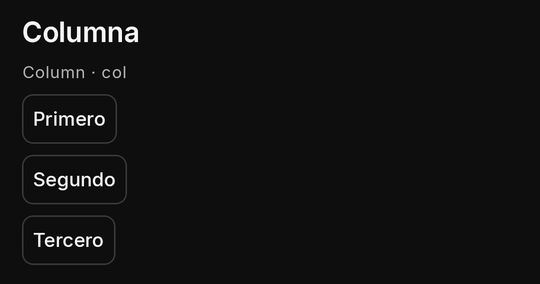
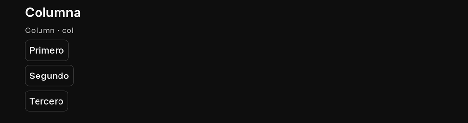

| Propiedad | Tipo | Por defecto | Por tamaño | Notas |
| --- | --- | --- | --- | --- |
| `children` | nodos[] | ninguno | no | sus hijos, dibujados en orden |

```json
{ "type": "Column", "gap": 8, "crossAxisAlignment": "stretch", "children": [
  { "type": "Text", "text": "Primero", "textEn": "First" },
  { "type": "Text", "text": "Segundo", "textEn": "Second" }
] }
```

```js
export async function screen() {
  const lines = ["Primero", "Segundo", "Tercero"];
  return { type: "Column", gap: 8, padding: 16, children: lines.map((text) => ({ type: "Text", text })) };
}
```

- **TV:** el foco baja y sube por los hijos enfocables de la columna, hacia el borde más cercano del vecino.
- **Celular y TV:** el mismo diseño; usa `padding` y `gap` por tamaño para la pantalla grande.
- **Límites y errores:** una `Column` raíz más alta que la ventana se corta, no se desplaza. La profundidad cuenta: como
  mucho 10 niveles de anidación en un árbol.

### Row { #row }

Hijos uno al lado del otro. `flex` reparte el ancho (`flex: 1` y `flex: 2` toman un tercio y dos tercios),
`mainAxisAlignment` los distribuye (`spaceBetween`, `spaceAround`), `crossAxisAlignment` los alinea en la altura de la
fila. Con `stackOnNarrow` la fila se vuelve columna en un ancho compacto; con `wrap: true` es el
[diseño de doce columnas](#wrap-row).

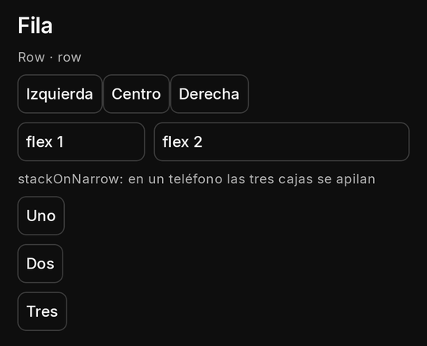
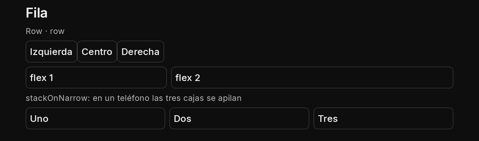

| Propiedad | Tipo | Por defecto | Por tamaño | Notas |
| --- | --- | --- | --- | --- |
| `children` | nodos[] | ninguno | no | sus hijos, dibujados en orden |
| `wrap` | boolean | `false` | sí | `true`: el diseño de doce columnas, los hijos colocados por `span` y `offset` en líneas de 12 columnas ([Fila de doce columnas](#wrap-row)) |
| `stackOnNarrow` | boolean | `false` | sí | en un ancho compacto los hijos se apilan como una columna; se ignora con `wrap` |

```json
{ "type": "Row", "gap": 8, "stackOnNarrow": true, "children": [
  { "type": "Card", "flex": 1, "children": [{ "type": "Text", "text": "Uno", "textEn": "One" }] },
  { "type": "Card", "flex": 2, "children": [{ "type": "Text", "text": "Dos", "textEn": "Two" }] }
] }
```

```js
export async function screen() {
  const box = (text, flex) => ({ type: "Card", flex, children: [{ type: "Text", text }] });
  return { type: "Row", gap: 8, mainAxisAlignment: "spaceBetween", children: [box("A", 1), box("B", 2)] };
}
```

- **TV:** Izquierda y Derecha pasan entre los hijos enfocables de la fila, incluido un `TabBar` o unos `Chips` dentro de
  ella (Derecha desde su última pestaña llega al control que sigue). En la TV, mantén las filas cortas.
- **Celular y TV:** `stackOnNarrow` solo cambia los anchos compactos (un celular en vertical); una TV es `expanded`.
- **Límites y errores:** `stretch` en una fila normal se dibuja como `start` (una fila no tiene una altura propia a la
  cual estirarse); `flex` va de 1 a 12; `span` y `offset` no significan nada aquí (solo con `wrap`).

### Fila de doce columnas (`wrap: true`) { #wrap-row }

La rejilla de Bootstrap dentro de Kino: una `Row` con `wrap: true` pone a sus hijos en líneas de 12 columnas. Cada hijo
toma su `span` (de 1 a 12, o `"auto"`, el valor por defecto) después de su `offset`; un hijo que no cabe en lo que queda
de la línea empieza la siguiente. Un botón, `Badge` o `Icon` en `"auto"` nunca es más angosto que su etiqueta: cuando no
cabe empieza la línea siguiente, y los `"auto"` de una línea se reparten lo que queda sin bajar de su propio ancho. Con
spans por tamaño es `col-12 col-md-6 col-lg-4`: una tarjeta por línea en un celular, dos en una ventana mediana, tres en
una TV. `gap` va entre celdas y entre líneas.

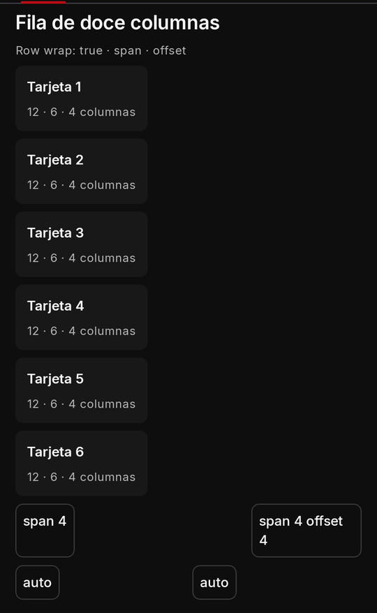
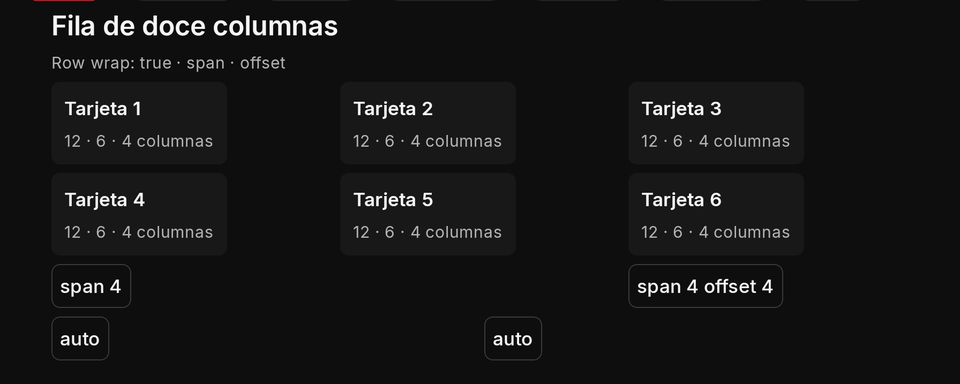

```json
{ "type": "Row", "wrap": true, "gap": 12, "children": [
  { "type": "Card", "key": "a", "span": { "compact": 12, "medium": 6, "expanded": 4 }, "children": [{ "type": "Text", "text": "A" }] },
  { "type": "Card", "key": "b", "span": { "compact": 12, "medium": 6, "expanded": 4 }, "children": [{ "type": "Text", "text": "B" }] },
  { "type": "Card", "key": "c", "span": 4, "offset": 4, "children": [{ "type": "Text", "text": "C" }] }
] }
```

```js
export async function screen() {
  const cards = ["Uno", "Dos", "Tres", "Cuatro"].map((text, i) => ({
    type: "Card", key: "card" + i, span: { compact: 12, medium: 6, expanded: 4 }, children: [{ type: "Text", text }],
  }));
  return { type: "SingleChildScrollView", children: [{ type: "Row", wrap: true, gap: 12, padding: 16, children: cards }] };
}
```

- **TV:** la rejilla retiene Izquierda y Derecha dentro de sí (nunca se escapan después de la última celda); Abajo y
  Arriba van a la celda más cercana de la línea siguiente, así una matriz de botones conserva sus columnas (ver la
  [receta de la matriz de botones](screen-reference.md#recipe-matrix)).
- **Celular y TV:** una línea es tan alta como su celda más alta y, por defecto, cada `Card` o celda contenedora sin
  `width`/`height` fijos se dibuja con esa altura, así una rejilla de tarjetas queda pareja; `crossAxisAlignment`
  `start`, `center` o `end` deja a cada una con su propia altura. Dentro de un desplazamiento lateral, las doce columnas se
  reparten sobre 600 dp.
- **Límites y errores:** `flex`, `mainAxisAlignment` y `stackOnNarrow` no significan nada en una fila que envuelve; un
  hijo toma su ancho natural salvo con `fill: true`. `span` y `offset` en cualquier otro lugar se ignoran (con registro).
  Una línea que contiene algo que no se puede medir (una lista perezosa, un riel, pestañas, una tabla, el formulario de
  ajustes) no se estira. Un hijo oculto no deja hueco. `offset` se reduce cuando no le dejaría espacio al span (con
  registro).

### Stack { #stack }

Hijos uno encima del otro, el primero al fondo: una insignia sobre una imagen, una etiqueta sobre un banner. Un hijo sin
[`positioned`](#positioned) empieza en la esquina superior inicial; usa `margin` y `padding` para moverlo.

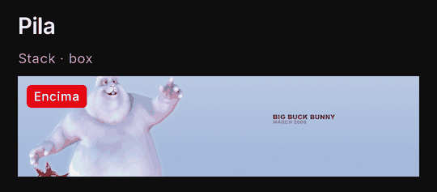
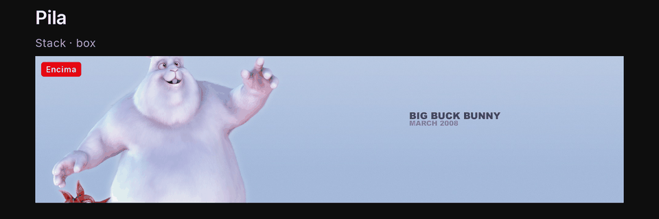

| Propiedad | Tipo | Por defecto | Por tamaño | Notas |
| --- | --- | --- | --- | --- |
| `children` | nodos (uno encima del otro, el primero al fondo)[] | ninguno | no | sus hijos, dibujados en orden |

```json
{ "type": "Stack", "children": [
  { "type": "Image", "url": "https://peach.blender.org/wp-content/uploads/title_anouncement.jpg", "aspect": "banner", "alt": "Big Buck Bunny" },
  { "type": "Badge", "text": "Nuevo", "textEn": "New", "margin": 8 }
] }
```

```js
export async function screen() {
  return { type: "Stack", children: [
    { type: "Image", url: "https://peach.blender.org/wp-content/uploads/title_anouncement.jpg", aspect: "banner", alt: "Big Buck Bunny" },
    { type: "Badge", text: "4K", margin: 8 },
  ] };
}
```

- **TV:** solo un hijo enfocable toma el foco; el stack mismo lo toma cuando tiene un `onTap`.
- **Celular y TV:** igual.
- **Límites y errores:** no hay `alignSelf`; un `Stack` es una celda contenedora en una fila de doce columnas (se estira a
  su línea).

### Hijos posicionados (`Stack`) { #positioned }

El `Positioned` de Flutter, como propiedad de estilo de un hijo de un `Stack`: `positioned: { top?, left?, right?,
bottom?, width?, height? }`, cada uno un número de dp (de 0 a 1280, recortado) o una parte del stack escrita `"25%"` (de
0% a 100%). Con `left` y `right` (o `top` y `bottom`) el hijo toma el espacio entre ambos; un `width` (`height`) dado
además se ignora, con registro. Un hijo sin `positioned` conserva la alineación del stack y le da su tamaño; un stack
cuyos hijos están todos posicionados toma el ancho que se le ofrece y su propio `height` (o `minHeight`; sin ninguno
mide 0 de alto: dale uno). Los hijos se dibujan en su orden (uno posterior encima de uno anterior) y el foco los recorre
en ese orden; todo se recorta al stack y se mantiene dentro de él, así que nada se pulsa fuera de él. En cualquier otro
nodo `positioned` se ignora, con registro. Acepta valores por tamaño como toda propiedad de estilo.

```json
{ "type": "Stack", "height": 200, "children": [
  { "type": "Image", "url": "https://img.example.com/cover.jpg", "fill": true, "height": 200 },
  { "type": "Badge", "text": "EN VIVO", "textEn": "LIVE", "color": "error", "positioned": { "top": 8, "right": 8 } },
  { "type": "Text", "text": "Final de la copa", "textEn": "Cup final", "style": "h4", "positioned": { "left": 12, "right": 12, "bottom": 12 } }
] }
```

### Spacer y SizedBox { #spacer }

Espacio vacío. `SizedBox` es una caja vacía de su `width` y `height` (en la escala de tamaños); `Spacer` es una caja
vacía que toma su parte `flex` de una `Row` o una `Column`, empujando lo que sigue hasta el final. Los dos son el mismo
nodo antiguo, `spacer`.

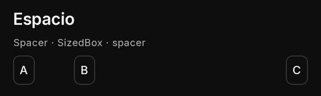
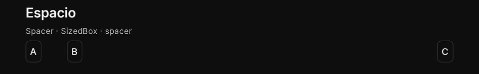

| Propiedad | Tipo | Por defecto | Por tamaño | Notas |
| --- | --- | --- | --- | --- |
| (ninguna) |  |  |  | `SizedBox` es una caja vacía de su `width`/`height`; `Spacer` toma su parte `flex` de una `Row` o una `Column` |

```json
{ "type": "Row", "children": [
  { "type": "Text", "text": "A" },
  { "type": "SizedBox", "width": 48 },
  { "type": "Text", "text": "B" },
  { "type": "Spacer", "flex": 1 },
  { "type": "Text", "text": "C" }
] }
```

```js
export async function screen() {
  return { type: "Row", children: [{ type: "Text", text: "Título" }, { type: "Spacer", flex: 1 }, { type: "Badge", text: "3" }] };
}
```

- **TV:** nunca recibe el foco.
- **Celular y TV:** igual; prefiere `gap` en el padre a poner espaciadores entre cada hijo.
- **Límites y errores:** `width` y `height` solo aceptan la escala de tamaños (de 16 a 640); un valor fuera de ella
  descarta el nodo.

### Divider { #divider }

Una raya fina a lo ancho de su padre: entre grupos de una columna, bajo un encabezado.

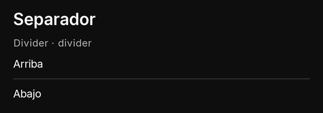
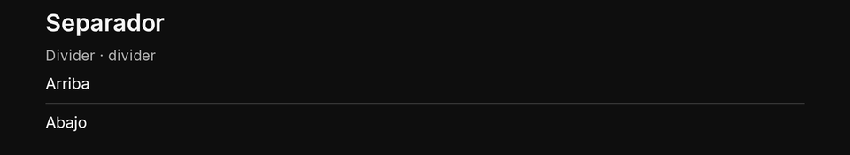

| Propiedad | Tipo | Por defecto | Por tamaño | Notas |
| --- | --- | --- | --- | --- |
| (ninguna) |  |  |  | una raya fina a lo ancho de su padre |

```json
{ "type": "Column", "gap": 8, "children": [
  { "type": "Text", "text": "Arriba", "textEn": "Above" },
  { "type": "Divider" },
  { "type": "Text", "text": "Abajo", "textEn": "Below" }
] }
```

```js
export async function screen() {
  return { type: "Column", gap: 8, children: [{ type: "Text", text: "Uno" }, { type: "Divider" }, { type: "Text", text: "Dos" }] };
}
```

- **TV:** nunca recibe el foco. **Celular y TV:** igual. **Errores:** un divider en una `Row` no dibuja nada útil (es
  horizontal).

### Scroll (SingleChildScrollView) { #scroll }

Sus hijos, con desplazamiento: `vertical` (por defecto) para una página larga, `horizontal` para una tira de chips o
insignias. La mayoría de las pantallas ponen todo lo que va bajo las partes fijas (un `TabBar`) en un solo desplazamiento
vertical con `flex: 1`.

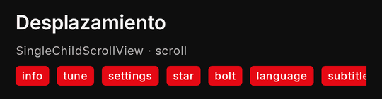
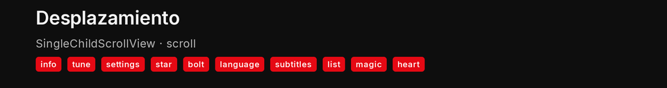

| Propiedad | Tipo | Por defecto | Por tamaño | Notas |
| --- | --- | --- | --- | --- |
| `children` | nodos[] | ninguno | no | sus hijos, dibujados en orden |
| `direction` | `vertical` \| `horizontal` | `vertical` | sí | un `ListView` o un riel dentro de un desplazamiento de la misma dirección se dibuja todo de una vez |

```json
{ "type": "Column", "children": [
  { "type": "TabBar", "key": "tabs", "tabs": [{ "value": "a", "label": "Uno", "labelEn": "One" }, { "value": "b", "label": "Dos", "labelEn": "Two" }], "onChanged": "tab" },
  { "type": "SingleChildScrollView", "flex": 1, "children": [{ "type": "Column", "padding": 16, "gap": 12, "children": [
    { "type": "Text", "text": "Una página larga", "textEn": "A long page" }
  ] }] }
] }
```

```js
export async function screen() {
  const badges = ["Acción", "Drama", "Comedia", "Terror"].map((text) => ({ type: "Badge", text }));
  return { type: "SingleChildScrollView", direction: "horizontal", children: [{ type: "Row", gap: 8, children: badges }] };
}
```

- **TV:** el desplazamiento sigue al foco: pasar a un nodo fuera de pantalla lo trae a la vista, desplazando solo lo
  necesario (con un pequeño margen); un nodo que ya está a la vista nunca mete el resto bajo un encabezado. Arriba
  (Abajo) solo lleva el foco a un enfocable que ya se ve en esa dirección; cuando todavía no se ve ninguno, el `Scroll`
  se desplaza un 80% de su altura en su lugar, pulsación tras pulsación, hasta que aparece uno (y la siguiente pulsación
  va ahí) o se llega a su inicio (final). Así un bloque sin nada enfocable (una tarjeta de estado, un pie de texto, una
  tabla) entre dos enfocables, encima del primero o debajo del último siempre se lee de paso, nunca se salta sin verlo;
  donde el siguiente enfocable está en pantalla (una lista densa) el foco se mueve enseguida, sin paginar. Solo en el
  inicio (final) la tecla sale del `Scroll`: en el cuerpo de un `Scaffold`, Arriba llega entonces a la pestaña elegida
  del `AppBar`; Abajo al final no hace nada (nunca da la vuelta hasta arriba). Abajo desde el `AppBar` siempre entra al
  cuerpo: su enfocable más cercano toma el foco y se desplaza a la vista, donde sea que el cuerpo haya quedado; un cuerpo
  sin nada enfocable (texto, tarjetas, tablas) pagina en su lugar. Una pulsación siempre desplaza o mueve el foco, hasta
  que no queda nada en esa dirección. Lo mismo en el cuerpo de un panel del reproductor. Un bloque en el que el control
  remoto debería detenerse puede decirlo con [`canRequestFocus: true`](screen-reference.md#shared-properties).
- **Celular y TV:** arrastrar con el dedo en el celular; el D-pad en la TV.
- **Límites y errores:** un `ListView` o un riel dentro de un desplazamiento de la misma dirección se dibuja todo de una
  vez (sin carga perezosa) y con un tope de 60 títulos; una celda de tabla nunca contiene un desplazamiento.

### GridView { #grid-view }

Sus hijos en `columns` iguales, llenadas fila por fila: una rejilla de mosaicos pequeños donde cada celda tiene el mismo
ancho. Para tarjetas cuya cantidad cambia según el tamaño, prefiere la [fila de doce columnas](#wrap-row) o `columns` por
tamaño.

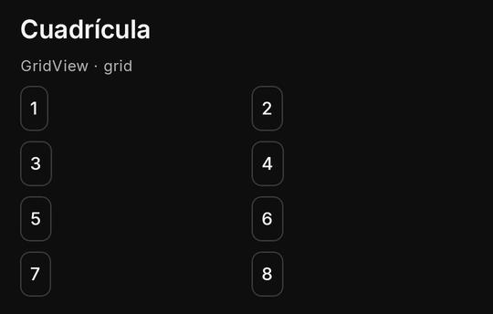
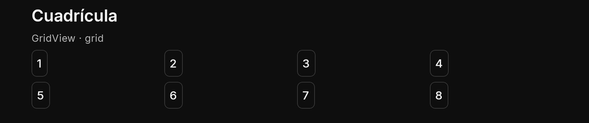

| Propiedad | Tipo | Por defecto | Por tamaño | Notas |
| --- | --- | --- | --- | --- |
| `children` | nodos[] | ninguno | no | sus hijos, dibujados en orden |
| `columns` | de 1 a 8 | `2` | sí | columnas iguales, llenadas fila por fila |

```json
{ "type": "GridView", "columns": { "compact": 2, "medium": 3, "expanded": 4 }, "gap": 8, "children": [
  { "type": "Card", "children": [{ "type": "Text", "text": "1" }] },
  { "type": "Card", "children": [{ "type": "Text", "text": "2" }] },
  { "type": "Card", "children": [{ "type": "Text", "text": "3" }] }
] }
```

```js
export async function screen() {
  const tiles = Array.from({ length: 8 }, (_, i) => ({ type: "Card", children: [{ type: "Text", text: String(i + 1) }] }));
  return { type: "GridView", columns: { compact: 2, expanded: 4 }, gap: 8, children: tiles };
}
```

- **TV:** el D-pad se mueve celda por celda. **Celular y TV:** `columns` por tamaño es la forma habitual de que quepa en
  los dos.
- **Límites y errores:** `columns` de 1 a 8; un `GridView` no es perezoso: para cientos de elementos usa un `ListView`
  con `columns`.

### ListView { #list-view }

Una lista perezosa de `items` (nodos), dibujados a medida que entran en la vista: la forma de mostrar feeds largos.
`empty` es lo que se muestra cuando no hay elementos; `columns` la convierte en rejilla; `onEndReached` le pide más a tu
plugin.

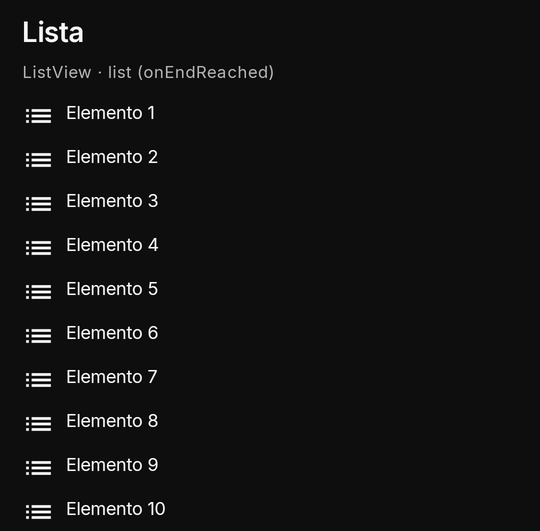
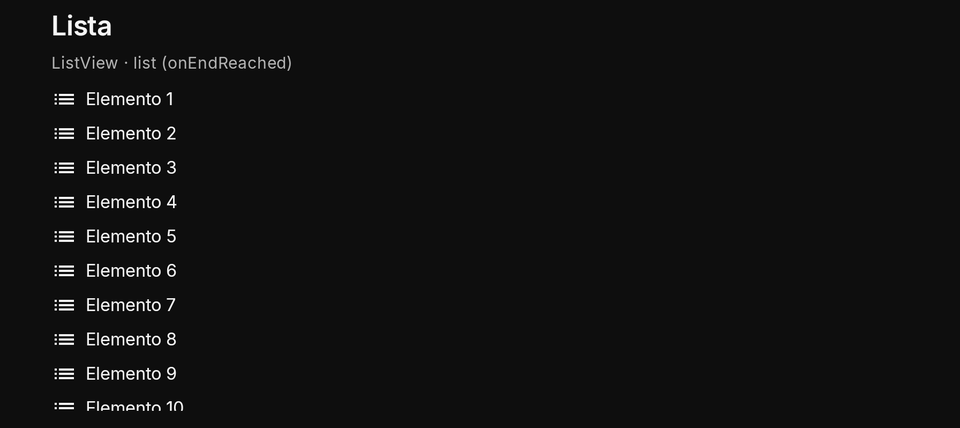

| Propiedad | Tipo | Por defecto | Por tamaño | Notas |
| --- | --- | --- | --- | --- |
| `items` | nodos[] | ninguno | no | como mucho 500, cada uno con su propia `key`; dibujados de forma perezosa |
| `empty` | nodo | ninguno | no | se dibuja cuando no hay elementos |
| `columns` | de 1 a 8 | `1` | sí | una rejilla de elementos |
| `stickToBottom` | boolean | `false` | sí | abre en el último elemento y sigue a los nuevos mientras la persona está al final; una columna, en una lista que se desplaza sola ([layout fill](player-panel.md#layout-fill)) |
| `newItemsHint` | boolean | `false` | no | los elementos que se agregan mientras la persona lee más arriba muestran el chip propio de Kino «↓ Nuevos» (su texto, nunca el tuyo); un toque va al final ([elementos nuevos](#new-items-hint)) |
| `onEndReached` | `{ event, arg? }` | ninguno | no | se envía una vez cuando el último elemento entra en la vista, y de nuevo solo después de que tu respuesta dibujó una lista más larga (o `loadingMore` pasó de true a false); nunca más de una vez por segundo |
| `loadingMore` | boolean | `false` | no | `true` dibuja el indicador de carga de Kino después de los elementos |
| `done` | boolean | `false` | no | `true` deja de pedir más |

```json
{ "type": "ListView", "key": "feed", "onEndReached": { "event": "more" }, "loadingMore": false, "done": false,
  "empty": { "type": "emptyState", "title": "Sin elementos", "titleEn": "No items" },
  "items": [
    { "type": "Text", "key": "i1", "text": "Elemento 1", "textEn": "Item 1" },
    { "type": "Text", "key": "i2", "text": "Elemento 2", "textEn": "Item 2" }
  ] }
```

```js
export async function screen({ state }) {
  const n = Number.isInteger(state.count) ? state.count : 10;
  const items = Array.from({ length: n }, (_, i) => ({ type: "Text", key: "row" + i, text: "Elemento " + (i + 1) }));
  return { type: "ListView", key: "feed", items, onEndReached: { event: "more" }, loadingMore: state.loading === true, done: n >= 100 };
}

export async function screenEvent({ name, state }) {
  if (name === "more") return { state: { count: Math.min(100, (state.count || 10) + 10) } };
  return null;
}
```

- **TV:** `onEndReached` se dispara cuando el último elemento entra en la vista, igual que en el celular.
- **Celular y TV:** la misma lista perezosa. Con `stickToBottom: true` abre en su último elemento y un nuevo último
  elemento se desplaza a la vista mientras la persona está al final (o a un elemento de él); cuando sube, la lista se
  queda quieta hasta que vuelve a bajar (un chat: ver el [layout fill del panel del reproductor](player-panel.md#layout-fill)).
  Necesita una lista que se desplace sola: una columna, en una pantalla completa o en un panel con `layout: "fill"`.
  Dibujada plana (el diseño con desplazamiento por defecto de un panel, dentro de un `SingleChildScrollView`) no hace
  nada, con un registro una sola vez.
- **Límites y errores:** 500 elementos; cada uno necesita su propia `key`. `onEndReached` vuelve a llegar solo después de
  que tu respuesta dibujó una lista más larga o `loadingMore` pasó de true a false, como mucho una vez por segundo,
  nunca mientras la pantalla está oculta. Un temporizador que apaga `loadingMore` en cada tic sin nada nuevo hace que
  Kino pida una vez por tic.

#### Elementos nuevos (`newItemsHint`) { #new-items-hint }

Con `newItemsHint: true`, los elementos que se agregan mientras la persona lee más arriba (el antiguo último elemento
sigue en la lista) muestran un chip pequeño propio de Kino sobre la parte baja de la lista, «↓ Nuevos» / «↓ New»: texto
de Kino, nunca el tuyo. Un toque va al final y el chip se oculta en cuanto se ve el final. Junto a `stickToBottom` el
chip solo aparece cuando la persona subió: al final la lista sigue al elemento nuevo por sí sola. Necesita una lista que
se desplace sola (una columna); una rejilla o una lista plana no dibuja chip.

```json
{ "type": "ListView", "key": "chat", "flex": 1, "stickToBottom": true, "newItemsHint": true,
  "items": [{ "type": "Text", "key": "m1", "text": "Hola", "textEn": "Hi" }] }
```

- **TV:** el chip es una parada de foco: Abajo desde la zona de la lista (una lista cuyos elementos no toman foco
  retiene el foco ella misma) llega a él antes que a los controles bajo la lista; OK va al final.

### TabBar { #tab-bar }

Una fila de pestañas: el selector principal de una pantalla con varias partes. **No es una entrada**: su valor no está
en `state.inputs`. Guarda la pestaña elegida en tu propio estado desde su evento `onChanged`, y dibuja el cuerpo que le
corresponde.

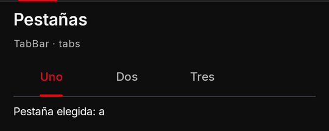
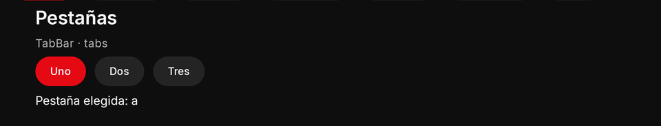

| Propiedad | Tipo | Por defecto | Por tamaño | Notas |
| --- | --- | --- | --- | --- |
| `tabs` | `{ value, label, labelEn?, badge? }[]` | obligatorio | no | de 1 a 500; el `badge` de una pestaña va junto a su etiqueta ([propiedades compartidas](screen-reference.md#shared-properties)) |
| `value` | string | la primera pestaña | no | la pestaña elegida; NO está en `state.inputs`: guárdala en tu estado desde `onChanged` |
| `onChanged` | acción | ninguno | no | el `value` de su evento es el valor de la pestaña |

```json
{ "type": "TabBar", "key": "section", "value": "news", "onChanged": "tab", "tabs": [
  { "value": "news", "label": "Noticias", "labelEn": "News" },
  { "value": "config", "label": "Configuración", "labelEn": "Settings" }
] }
```

```js
export async function screen({ state }) {
  const tab = state.tab === "config" ? "config" : "news";
  return { type: "Column", children: [
    { type: "TabBar", key: "section", value: tab, onChanged: "tab", tabs: [{ value: "news", label: "Noticias" }, { value: "config", label: "Ajustes" }] },
    { type: "Text", text: tab === "news" ? "Las noticias" : "Los ajustes", padding: 16 },
  ] };
}

export async function screenEvent({ name, value }) {
  return name === "tab" ? { state: { tab: value } } : null;
}
```

- **TV:** Izquierda y Derecha recorren las pestañas; al final de la barra siguen al próximo enfocable a su lado **en la
  misma fila** (un `IconButton` de actualizar después de las pestañas), y si no hay nada ahí se quedan en la barra,
  nunca saltan a otra fila ni a la barra de título de Kino. Al entrar en la barra, desde arriba, abajo o el costado, se
  llega a la pestaña elegida. Lo mismo para `Chips`.
- **Celular y TV:** un cuerpo bajo el primer `TabBar` de la pantalla (en cualquier parte: también una `Row` de
  encabezado) que sea un `Scroll`, un `ListView` o una rejilla de títulos con una `key` tuya conserva su desplazamiento
  por pestaña: con una key por pestaña (`newsBody`, `settingsBody`) o no, al volver a una pestaña está donde la persona
  la dejó.
- **Celular y TV:** una fila de pestañas en los dos.
- **Límites y errores:** leer `state.inputs.<key>` de una pestaña no da nada; un `TabBar` sin ninguna pestaña válida se
  descarta.

### ExpansionTile (acordeón) { #accordion }

Secciones que se abren y se cierran: preguntas frecuentes, opciones avanzadas. Abrir y cerrar lo hace Kino (sin llamar a
tu plugin); qué elementos están abiertos vive en `state.ui.open.<key>`, así que sobrevive a un nuevo dibujo. Uno a la vez
salvo con `multiple`.

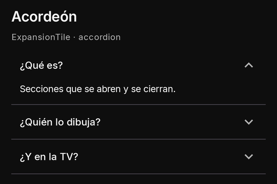
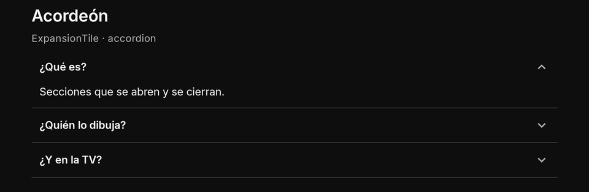

| Propiedad | Tipo | Por defecto | Por tamaño | Notas |
| --- | --- | --- | --- | --- |
| `key` | string | obligatorio | no | qué elementos están abiertos vive en `state.ui.open.<key>` |
| `items` | `{ key, title, titleEn?, children?, open? }[]` | obligatorio | no | de 1 a 500; `open` es solo el primer vistazo |
| `multiple` | boolean | `false` | no | varios elementos abiertos a la vez |

```json
{ "type": "ExpansionTile", "key": "faq", "items": [
  { "key": "what", "title": "¿Qué es?", "titleEn": "What is it?", "open": true, "children": [{ "type": "Text", "text": "Una sección.", "textEn": "A section." }] },
  { "key": "how", "title": "¿Cómo funciona?", "titleEn": "How does it work?", "children": [{ "type": "Text", "text": "Se abre y se cierra.", "textEn": "It opens and closes." }] }
] }
```

```js
export async function screen() {
  const faq = [["what", "¿Qué es?", "Una galería."], ["who", "¿Quién la dibuja?", "Kino."]];
  return { type: "ExpansionTile", key: "faq", items: faq.map(([key, title, text]) => ({ key, title, children: [{ type: "Text", text }] })) };
}
```

- **TV:** cada encabezado toma el foco y OK lo abre o lo cierra; Abajo desde un encabezado abierto entra a su contenido.
- **Celular y TV:** el mismo componente.
- **Límites y errores:** `key` es obligatoria; elementos de 1 a 500 con keys distintas; cada encabezado cuesta un nodo de
  los 600, y cuando se acaba el presupuesto el acordeón conserva menos elementos. Nunca en la ventana emergente de una
  respuesta. Un campo obligatorio en un elemento cerrado no impide el envío de un formulario, pero el envío abre el
  elemento cuando falla.

### steps { #steps }

Un flujo de configuración con el aspecto propio de Kino, para cualquier plugin con pasos que recorrer (iniciar sesión,
un código, una contraseña, listo): cada paso es un encabezado con el círculo numerado de Kino (una marca cuando está
hecho). El paso `current` está abierto, con sus `children` dibujados debajo (un `Form` con un `TextField` enmascarado, un
`QrImage`...); un paso `done` se pliega a su `subtitle` (o al «Listo» de Kino); uno `pending` se ve atenuado. Con
`onStepTap` un paso hecho se puede pulsar, para que la persona vuelva a él.

| Propiedad | Tipo | Por defecto | Por tamaño | Notas |
| --- | --- | --- | --- | --- |
| `items` | `{ key, title, titleEn?, subtitle?, subtitleEn?, state, children? }[]` | obligatorio | no | de 1 a 12; `state` `done`, `current`, `pending`; exactamente un `current` (sus hijos se dibujan debajo); uno `done` muestra su `subtitle` (si no, el «Listo» de Kino) |
| `onStepTap` | nombre de evento o `{ event }` | ninguno | no | un paso `done` se puede pulsar (con el dedo, o con OK en la TV): el evento va con la `key` del paso como `arg` |

```json
{ "type": "steps", "key": "login", "onStepTap": "goBack", "items": [
  { "key": "phone", "title": "Tu número", "titleEn": "Your number", "subtitle": "+57 300 •••• 12", "state": "done" },
  { "key": "code", "title": "Código", "titleEn": "Code", "state": "current", "children": [
    { "type": "Form", "key": "codeForm", "onSubmitted": "checkCode", "children": [
      { "type": "TextField", "key": "code", "kind": "number", "labelText": "Código", "required": true, "minLength": 5 },
      { "type": "ElevatedButton", "labelText": "Siguiente", "labelTextEn": "Next", "submit": true }
    ] }
  ] },
  { "key": "twofa", "title": "Contraseña", "titleEn": "Password", "state": "pending" }
] }
```

```js
export async function screenEvent({ name, arg, state }) {
  if (name === "goBack") return { state: { step: arg } }; // arg: the done step's key
  if (name === "checkCode") return { state: { step: "twofa" } };
  return null;
}
```

- **Celular y TV:** el mismo flujo. En la TV solo toman el foco un paso hecho que se puede pulsar y los campos propios del
  paso actual: Abajo desde un paso hecho entra al paso abierto; OK en un paso hecho envía `onStepTap`. Un lector de
  pantalla lee cada encabezado como «Paso 2 de 3: Código, actual».
- **Límites y errores:** de 1 a 12 pasos, cada uno con una `key` válida y distinta y un `title`. Exactamente un
  `current`: si no hay ninguno mientras queda un paso por hacer, el primero no hecho pasa a ser el actual; si hay dos, se
  queda el primero; un `state` desconocido se lee como `pending`; los hijos de un paso que no es el actual no se dibujan
  (todo con registro). Cada encabezado cuenta como un nodo del presupuesto del árbol; los hijos del paso abierto quedan
  un nivel por debajo del nodo.

### Card { #card }

La tarjeta de Kino alrededor de sus hijos: `plain` (por defecto), `outlined` o `filled`. Con `flush: true` la tarjeta no
tiene relleno propio y recorta a sus hijos a su forma redondeada, así una `Image` en su parte de arriba llega de borde a
borde (el relleno del texto lo pones tú). Una tarjeta con `onTap` es entera un objetivo de pulsación.

**Los contenedores llevan su propio relleno: un solo valor en todos los lados, los hijos no agregan nada.** Sin un
`padding` tuyo, una tarjeta deja 16 dp en cada lado de su contenido (24 en la TV) y a sus hijos a 8 dp entre sí (12 en la
TV); un `padding` o un `gap` que declares gana.

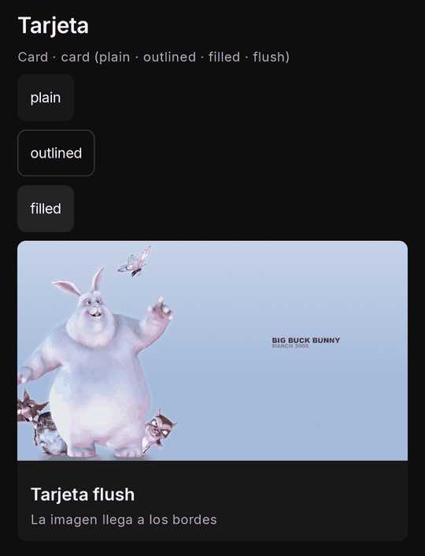
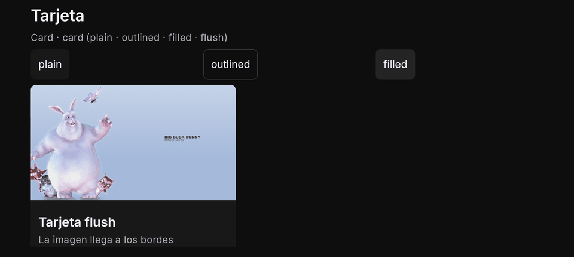

| Propiedad | Tipo | Por defecto | Por tamaño | Notas |
| --- | --- | --- | --- | --- |
| `children` | nodos[] | ninguno | no | sus hijos, dibujados en orden |
| `variant` | `plain` \| `outlined` \| `filled` | `plain` | sí | los tres aspectos de tarjeta de Kino |
| `flush` | boolean | `false` | sí | sin relleno propio y con sus hijos recortados a su forma redondeada: una `Image` en su parte de arriba llega de borde a borde |

```json
{ "type": "Card", "key": "story", "flush": true, "onTap": { "event": "read", "arg": "story-1" }, "children": [
  { "type": "Image", "url": "https://peach.blender.org/wp-content/uploads/title_anouncement.jpg", "aspect": "16:9", "alt": "Big Buck Bunny" },
  { "type": "Column", "padding": 12, "gap": 4, "children": [
    { "type": "Text", "text": "Un titular", "textEn": "A headline", "style": "h4", "maxLines": 3 },
    { "type": "Text", "text": "La fuente", "textEn": "The source", "style": "caption", "color": "muted" }
  ] }
] }
```

```js
export async function screen() {
  const card = (variant) => ({ type: "Card", variant, children: [{ type: "Text", text: variant }] });
  return { type: "Column", gap: 8, padding: 16, children: [card("plain"), card("outlined"), card("filled")] };
}
```

- **TV:** una tarjeta con una acción toma el foco con el anillo de Kino; una sin acción se salta.
- **Celular y TV:** el mismo aspecto; `flush` recorta en los dos.
- **Límites y errores:** con `flush` no se usa el `padding` propio de la tarjeta: ponle relleno a sus hijos de texto.
  Una tarjeta es una celda contenedora en una fila de doce columnas: se estira a la altura de su línea salvo que tenga
  un `height` fijo.

### Scaffold { #scaffold }

El `Scaffold` de Flutter: la raíz de una pantalla o de un panel del reproductor con un `appBar` fijo arriba de tu zona,
un `body` en la altura que queda, y un `floatingActionButton` sobre un `bottomNavigationBar` abajo. Solo como raíz de un
resultado (uno anidado se descarta, con registro); un resultado cuya raíz es un `Scaffold` se dibuja en
`layout: "fill"` sin pedirlo (otro `layout` se ignora, con registro). Su cuerpo tiene límites: un `ListView` o un
`SingleChildScrollView` dentro de él se desplaza solo mientras las barras se quedan quietas, y el teclado encoge el
cuerpo, nunca las barras. Un cuerpo con desplazamiento deja espacio bajo su última línea (16 dp, 24 en la TV), así el
final de un texto largo nunca se corta en el borde de la ventana; en la TV, Abajo sin nada más que enfocar pagina el
cuerpo (también el texto de un `ExpansionTile` abierto) y, en su final, se queda quieto.

**La barra de título propia de Kino se queda.** Sobre cada pantalla de plugin Kino dibuja la barra con el nombre de tu
plugin y Cerrar (una X sola; un lector de pantalla dice «Cerrar», «Close» en inglés); el `AppBar` de un `Scaffold` va
debajo, dentro de tu zona, y nunca la reemplaza ni la tapa (la persona siempre sabe de quién es la pantalla y cómo
salir). En un panel del reproductor el `AppBar` es compacto (una fila de 48 dp). La barra lleva un solo relleno en todos
los lados (16 dp; 24 en la TV, 16 en un panel) alrededor de su fila de título y de su TabBar `bottom` juntos, así la
primera pestaña queda alineada con el título y nada toca los bordes de la barra; una línea finísima marca su borde de
abajo, así el cuerpo que se desplaza debajo nunca se confunde con ella. En la TV el D-pad va del `leading` y las
`actions` del `AppBar` al cuerpo, luego a la barra de abajo y al botón; Arriba desde la primera parada del cuerpo llega
al TabBar `bottom` de la barra en su pestaña elegida (sin `bottom`, a su última acción), nunca más allá, al Cerrar de
Kino; mientras el cuerpo todavía puede subir, Arriba primero lo pagina. Derecha después de la última pestaña llega a las
acciones de la barra en orden (Izquierda antes de la primera pestaña, a su `leading`), Abajo desde una acción vuelve a
las pestañas, y Abajo desde las pestañas va al cuerpo. Atrás cierra o regresa como en todas partes.

| Propiedad | Tipo | Por defecto | Por tamaño | Notas |
| --- | --- | --- | --- | --- |
| `appBar` | un `AppBar` | ninguno | no | fijo arriba de tu zona, bajo la barra de título propia de Kino (nunca la reemplaza ni la tapa) |
| `body` | nodo | obligatorio | no | la altura limitada que queda: un `ListView` o un desplazamiento dentro de él se desplaza solo mientras las barras se quedan |
| `floatingActionButton` | un `FloatingActionButton` | ninguno | no | sobre la barra de abajo |
| `bottomNavigationBar` | un `NavigationBar` | ninguno | no | abajo |

Ver la receta [Una pantalla con barra de app, pestañas y un botón flotante](screen-reference.md#recipe-scaffold).

### AppBar { #app-bar }

Solo como `appBar` de un `Scaffold` (en cualquier otro lugar se descarta, con registro): una fila con un `IconButton`
`leading`, el `title` (que un lector de pantalla lee como encabezado) y hasta cuatro `IconButton` en `actions` (el resto
se descarta, con registro; cada uno necesita un `labelText`, lo que dice un lector de pantalla, y puede llevar un
`badge`), y luego un `TabBar` `bottom` opcional. `backgroundColor` es un rol de color, `elevation` la sombra de Kino. Una
barra sin título es una fila de botones.

**`title` es un string o cualquier nodo** (a la manera de Flutter): un string es un `Text` que se lee como encabezado
(`titleEn` su gemelo); un nodo (un `TabBar`, una `Row` de botones, una `Image`, un `Text` con su propio estilo; como
mucho 40 nodos, si no se descarta, con registro; localiza sus textos tú) toma el espacio que queda a la izquierda de las
`actions` en la misma fila: un `TabBar` ahí se desplaza de lado cuando no cabe, y en la TV sus pestañas y las acciones
son una sola fila para el D-pad (Derecha después de la última pestaña llega a la primera acción, Arriba desde el cuerpo
cae en la pestaña elegida). `bottom` se queda para la clásica segunda fila. Ver
[Pestañas en la barra de app](screen-reference.md#recipe-app-bar-tabs).

| Propiedad | Tipo | Por defecto | Por tamaño | Notas |
| --- | --- | --- | --- | --- |
| `title` | string o un nodo | ninguno | no | un string (`titleEn` su gemelo) se lee como encabezado; o, a la manera de Flutter, cualquier nodo (un `TabBar`, una `Row` de botones...; como mucho 40 nodos) en el espacio a la izquierda de las acciones |
| `leading` | un `IconButton` | ninguno | no | con un `labelText` (atrás, un menú) |
| `actions` | `IconButton[]` | ninguno | no | como mucho 4, cada uno con un `labelText`; se permite un `badge` |
| `bottom` | un `TabBar` | ninguno | no | bajo la fila |
| `centerTitle` | boolean | `false` | no | el título centrado |
| `backgroundColor` | un rol de color | la superficie de Kino | no | su texto y sus iconos en el color legible del rol |

### NavigationBar { #navigation-bar }

Solo como `bottomNavigationBar` de un `Scaffold` (en cualquier otro lugar se descarta, con registro): de 2 a 5 `items`
(`{ key, icon, label, labelEn?, badge? }`; los de más se descartan, con menos de dos se descarta la barra, ambos con
registro). Un celular dibuja la barra de navegación de Material, una TV una fila inferior de elementos enfocables con el
anillo de Kino. Pulsar otro elemento envía `onChanged` con la `key` del elemento como `value`; como en un `TabBar`, el
elemento elegido no está en `state.inputs`: guárdalo en tu estado y dibuja el cuerpo que le corresponde.

| Propiedad | Tipo | Por defecto | Por tamaño | Notas |
| --- | --- | --- | --- | --- |
| `items` | `{ key, icon, label, labelEn?, badge? }[]` | obligatorio | no | de 2 a 5, keys distintas |
| `value` | string | el primer elemento | no | la key del elemento elegido (o `selectedIndex`); NO está en `state.inputs`: guárdala en tu estado desde `onChanged` |
| `selectedIndex` | entero | ninguno | no | el elemento elegido por su posición, cuando no hay `value` |
| `onChanged` | acción | ninguno | no | el `value` de su evento es la key del elemento |

### PageView (y el carrusel) { #page-view }

El `PageView` de Flutter: sus `children` son páginas, que se deslizan de lado en un celular; en una TV, Izquierda y
Derecha en el borde de una página pasan de página (una página sin nada enfocable deja al paginador mismo como parada).
Kino dibuja los puntos de página debajo y un lector de pantalla oye «Página 2 de 5». `onPageChanged` envía el índice de
la página en la que se quedó como `value`; `initialPage` es solo el primer vistazo (la página a la que llegó la persona
sobrevive a tus nuevos dibujos). `autoPlayMs` (de 3.000 a 60.000) pasa la página sola, en pausa mientras la persona la
toca o la enfoca y cuando las animaciones del aparato están apagadas. Un `viewportFraction` menor que 1 es el carrusel
de Kino: las páginas vecinas se asoman a los lados (`padEnds: false` empieza la primera página en el borde). Nunca
dentro de un desplazamiento lateral ni de una celda de tabla (se descarta, con registro); como mucho 24 páginas.

| Propiedad | Tipo | Por defecto | Por tamaño | Notas |
| --- | --- | --- | --- | --- |
| `children` | nodos (las páginas)[] | ninguno | no | sus hijos, dibujados en orden |
| `initialPage` | entero | `0` | no | solo el primer vistazo; después de la última página, la última |
| `onPageChanged` | acción | ninguno | no | el `value` de su evento es el índice de la página en la que se quedó |
| `autoPlayMs` | de 3.000 a 60.000 | ninguno | no | pasa la página sola; en pausa mientras se toca o se enfoca y con las animaciones apagadas |
| `viewportFraction` | de 0,3 a 1 | `1` | sí | menor que 1, el carrusel de Kino: las páginas vecinas se asoman |
| `padEnds` | boolean | `true` | sí | la primera y la última página centradas en un carrusel |

```json
{ "type": "PageView", "key": "covers", "viewportFraction": 0.8, "autoPlayMs": 5000, "onPageChanged": "page", "children": [
  { "type": "Card", "flush": true, "children": [{ "type": "Image", "url": "https://img.example.com/1.jpg", "aspect": "16:9" }] },
  { "type": "Card", "flush": true, "children": [{ "type": "Image", "url": "https://img.example.com/2.jpg", "aspect": "16:9" }] }
] }
```

### ListTile { #list-tile }

El `ListTile` de Flutter: una fila de una lista con las alturas de Material (56 dp, 72 con `subtitle`, 48 con `dense`):
un `leading` y un `trailing` (un nodo pequeño cada uno: un `Icon`, un `CircleAvatar`, una `Image`, un `Badge`, un
`Text` o un indicador de carga; nunca se pulsan ellos mismos, sus acciones se ignoran, con registro), el `title` y el
`subtitle`. Toda la fila es una sola pulsación (`onTap`, `onLongPress`) y, en la TV, una sola parada de foco con el
anillo de Kino (solo con un `onTap`: una fila que no hace nada nunca muestra el anillo). `selected` (con un `onTap`) la
rellena con el primaryContainer de Kino y se lee como seleccionada.

| Propiedad | Tipo | Por defecto | Por tamaño | Notas |
| --- | --- | --- | --- | --- |
| `title` | string | obligatorio | no | `titleEn`; como mucho dos líneas |
| `subtitle` | string | ninguno | no | `subtitleEn`; la segunda línea atenuada de Kino |
| `leading` | nodo | ninguno | no | uno de `Icon`, `CircleAvatar`, `Image`, `Badge`, `Text`, `CircularProgressIndicator`, nunca se pulsa él mismo |
| `trailing` | nodo | ninguno | no | como `leading`, al final |
| `dense` | boolean | `false` | sí | una fila más baja (48 dp en vez de 56, 72 con subtítulo) |

```json
{ "type": "ListView", "items": [
  { "type": "ListTile", "key": "m1", "title": "María", "subtitle": "En línea", "subtitleEn": "Online", "onTap": "chat",
    "leading": { "type": "CircleAvatar", "text": "MA" }, "trailing": { "type": "Badge", "text": "2" } }
] }
```

## Contenido { #content }

Lo que la persona lee y mira.

### Text { #text }

Texto simple en uno de los estilos de Kino. Nunca contiene marcado ni enlaces, conserva los saltos de línea y sigue la
dirección de lectura de la app. Dale a cada texto su gemelo en inglés (`textEn`): Kino elige según el idioma de la
persona.

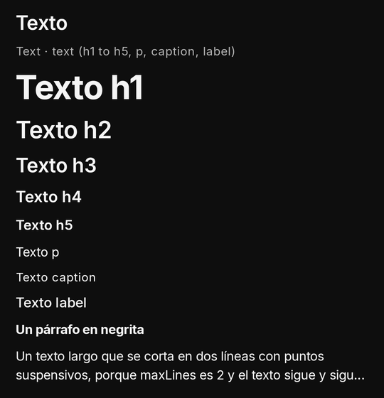
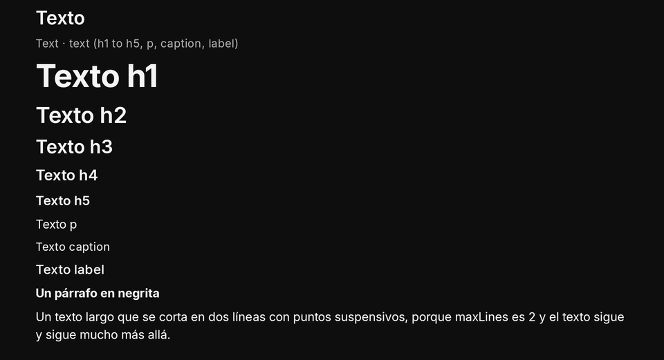

| Propiedad | Tipo | Por defecto | Por tamaño | Notas |
| --- | --- | --- | --- | --- |
| `text` | string | obligatorio (opcional con `time`) | no | de 1 a 2.000 caracteres, simple (sin marcado, sin enlaces); se conservan los saltos de línea; con un `time` es su prefijo |
| `textEn` | string | ninguno | no | el gemelo en inglés, que se muestra cuando la app está en inglés |
| `style` | `h1` \| `h2` \| `h3` \| `h4` \| `h5` \| `p` \| `caption` \| `label` | `p` | sí | la escala tipográfica de Kino ([Escala de texto](#text-scale)); `display`, `title`, `subtitle`, `body` se leen como `h1`, `h3`, `h4`, `p` |
| `maxLines` | entero ≥ 1 | ninguno | sí | se corta con puntos suspensivos |
| `bold` | boolean | `false` | sí | los encabezados ya son negrita; `false` nunca adelgaza uno |
| `time` | epoch ms | ninguno | no | un número entero de 0 a 253.402.300.799.999: Kino escribe la hora él mismo en el idioma de la app ([Texto con una hora](#text-time)) |
| `timeFormat` | `relative` \| `clock` \| `countdown` | `relative` | no | `relative` («hace 2 min», reescrito cada minuto mientras se ve, sin llamarte), `clock` («18:42», las 12/24 h del aparato) o `countdown` («0:42» restantes, cada segundo, «0:00» al llegar) |

```json
{ "type": "Column", "gap": 4, "children": [
  { "type": "Text", "text": "Título", "textEn": "Title", "style": "h1" },
  { "type": "Text", "text": "Un párrafo que se corta en dos líneas.", "textEn": "A paragraph cut at two lines.", "maxLines": 2 },
  { "type": "Text", "text": "Importante", "textEn": "Important", "bold": true, "color": "warning" }
] }
```

```js
export async function screen({ state }) {
  const name = typeof state.name === "string" ? state.name : "Ana";
  return { type: "Text", text: "Hola, " + name, textEn: "Hello, " + name, style: "h2", crossAxisAlignment: "center" };
}
```

- **TV:** nunca recibe el foco por sí solo (un texto dentro de una tarjeta que se puede pulsar va con la tarjeta).
- **Celular y TV:** cada estilo crece 1,25 en la TV, así el orden de la escala se mantiene a tres metros; la escala de
  letra de la persona se respeta en los dos.
- **Límites y errores:** como mucho 2.000 caracteres; un texto vacío se descarta. No hay familia tipográfica, tamaño,
  cursiva ni color libre: solo `style`, `bold` y un rol de color. `onPrimary` nunca se lee sobre una superficie: vuelve
  al valor por defecto (con registro).

#### Texto con una hora { #text-time }

`time` (epoch ms) hace que Kino escriba la hora él mismo, en el idioma de la app: `timeFormat: "relative"` (por defecto:
«ahora», «hace 2 min», «hace 3 h», «ayer», una fecha más allá; «en 5 min» para una hora futura), reescrito una vez por
minuto mientras se ve sin llamar a tu plugin, `"clock"` («18:42», según el ajuste de 12 o 24 horas del aparato), o
`"countdown"` (la espera restante, «0:42», «1:02:03», reescrita cada segundo mientras corre, «0:00» al llegar). Con un
`time` el `text` es opcional y es su prefijo. Una hora que no es un número entero desde 0 se descarta (con registro), y
el `text` vuelve a ser obligatorio.

El `enabledAt` de un elemento que se puede pulsar (un botón, un `FloatingActionButton`, una tarjeta o un `ListTile` con
`onTap`) lo dibuja apagado hasta esa hora del reloj del aparato y lo enciende solo, sin llamar a tu plugin: «Reenviar»
después de un minuto.

```json
{ "type": "Row", "gap": 8, "children": [
  { "type": "TextButton", "labelText": "Reenviar código", "labelTextEn": "Send the code again", "enabledAt": 1761580860000, "onPressed": "resend" },
  { "type": "Text", "text": "en", "textEn": "in", "time": 1761580860000, "timeFormat": "countdown", "style": "caption" }
] }
```

```json
{ "type": "Column", "children": [
  { "type": "Text", "text": "Actualizado", "textEn": "Updated", "style": "caption", "time": 1761580800000 },
  { "type": "Text", "time": 1761580800000, "timeFormat": "clock", "style": "caption", "color": "muted" }
] }
```

### Escala de texto { #text-scale }

`style` corresponde a la escala tipográfica propia de Kino: en el celular `h1` es el escalón headline-large, hasta `p`,
el escalón body-medium; `caption` es el escalón pequeño y atenuado y `label` el que usan los botones. En la TV cada
escalón crece 1,25. Los encabezados ya son negrita. Los nombres antiguos `display`, `title`, `subtitle` y `body` se leen
como `h1`, `h3`, `h4` y `p`; un estilo desconocido es `p` (con registro).

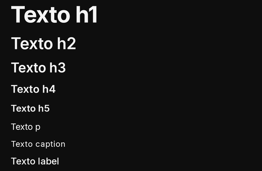
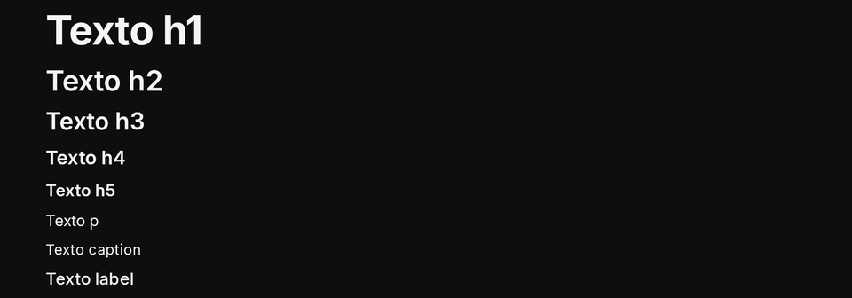

```json
{ "type": "Column", "gap": 4, "children": [
  { "type": "Text", "text": "h1", "style": "h1" }, { "type": "Text", "text": "h2", "style": "h2" },
  { "type": "Text", "text": "h3", "style": "h3" }, { "type": "Text", "text": "h4", "style": "h4" },
  { "type": "Text", "text": "h5", "style": "h5" }, { "type": "Text", "text": "p", "style": "p" },
  { "type": "Text", "text": "caption", "style": "caption" }, { "type": "Text", "text": "label", "style": "label" }
] }
```

### Colores { #colors }

`color` acepta un **rol**, nunca un valor: `primary`, `secondary`, `surface`, `muted`, `warning`, `error`, `onPrimary`,
`primaryContainer` y `surfaceVariant`, pintados con la paleta de Kino (el `theme` de tu manifiesto tiñe `primary` donde
pasa las reglas de contraste). Un rol que no se leería sobre su superficie se acerca al color de texto propio de esa
superficie hasta que se lee (4,5:1). En un `Text` colorea el texto; en un contenedor (un `Stack`, un fallback) es el
relleno.

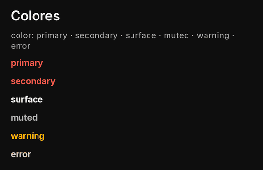
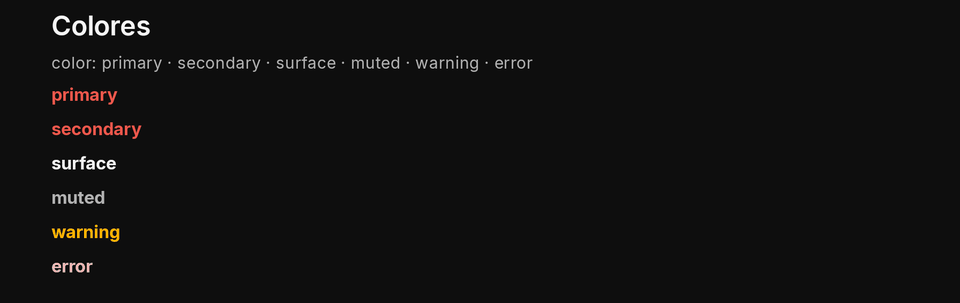

```json
{ "type": "Column", "gap": 4, "children": [
  { "type": "Text", "text": "primary", "color": "primary" },
  { "type": "Text", "text": "muted", "color": "muted" },
  { "type": "Text", "text": "warning", "color": "warning" },
  { "type": "Text", "text": "error", "color": "error" }
] }
```

- **Errores:** un valor hexadecimal (`"#ff0000"`) está fuera de la lista de roles y se descarta. Usa `MaterialBanner` o
  el `role` de un toast para el color de éxito (`success` es un rol de esos, no de `color`). Una palabra que Kino
  reconoce recibe el rol más cercano, nombrado en su línea de registro, igual en la app y en el kit: `screen: text color
  "success" is not a color role ("success" is a banner and toast role; the closest color role is "primary"), dropped`
  (también `info` → `secondary`, `danger` → `error`, `grey` → `muted`, un rol con otras mayúsculas → ese rol).

Los dos roles de contenedor sirven para una caja que destaca sin ser un banner: `primaryContainer` (la superficie de
Kino teñida con el primario; el `theme` del manifiesto la tiñe igual que tiñe `primary`) y `surfaceVariant` (la
superficie elevada de Kino). En una caja (`Card`, `Column`, `Row`, `Stack`) son su relleno, y su texto y sus iconos toman
solos el color "on" que les corresponde; en un `Text` o un `Icon` son el color, ajustado para que se lea como todo rol.
La burbuja propia de un chat, como mucho de tres cuartos de ancho, con la esquina de la cola pequeña:

```json
{ "type": "Column", "crossAxisAlignment": "end", "fill": true, "children": [
  { "type": "Card", "key": "mine", "color": "primaryContainer", "maxWidthFraction": 0.75,
    "borderRadius": { "topStart": "large", "topEnd": "large", "bottomStart": "large", "bottomEnd": "small" },
    "children": [{ "type": "Text", "text": "Ya llegué", "textEn": "I'm here" }] }
] }
```

### Image { #image }

Una imagen desde una dirección https pública (no hace falta declarar el host, como para toda imagen en Kino). `aspect`
fija la forma de la caja; `fallback` es un nodo que se dibuja en esa caja cuando la imagen falla o no hay `url`, así un
feed roto nunca muestra un hueco.

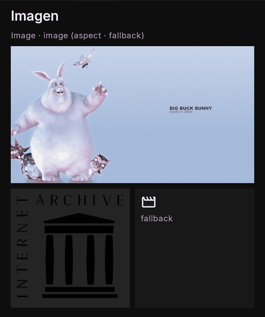
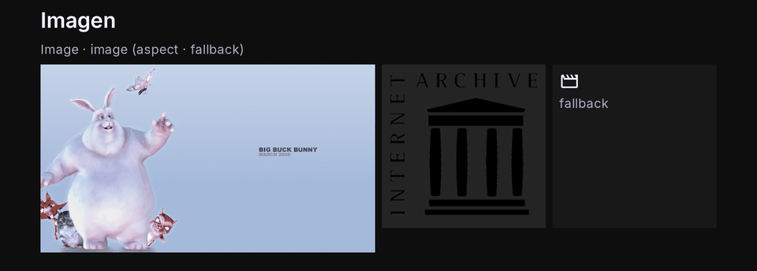

| Propiedad | Tipo | Por defecto | Por tamaño | Notas |
| --- | --- | --- | --- | --- |
| `url` | URL https | obligatorio sin `fallback` | no | un host https público (no hace falta declararlo); con un `fallback`, sin `url` se dibuja el fallback (también con una vacía o rechazada, con registro) |
| `alt` | string | ninguno | no | lo que dice un lector de pantalla (`altEn` el de inglés) |
| `aspect` | `16:9` \| `2:3` \| `1:1` \| `banner` | el de la imagen | sí | la forma de la caja |
| `fallback` | nodo | ninguno | no | se dibuja en la caja de la imagen cuando la imagen falla o no hay `url`: solo `Column`, `Row`, `Stack`, `Card`, `Spacer`, `Divider`, `Text`, `Icon`, `Badge`, `Skeleton`, `Image`, a cualquier profundidad, nunca se pulsa |

```json
{ "type": "Image", "url": "https://kinotvapp.github.io/kino-plugins/missing-picture.png", "aspect": "16:9", "alt": "Sin imagen", "altEn": "No picture",
  "fallback": { "type": "Stack", "color": "surface", "children": [
    { "type": "Column", "padding": 12, "children": [{ "type": "Icon", "name": "movie" }, { "type": "Text", "text": "La fuente", "textEn": "The source", "style": "h3" }] }
  ] } }
```

```js
export async function screen({ state }) {
  const picture = typeof state.picture === "string" && state.picture ? { url: state.picture } : {}; // no url at all: the fallback, no log line
  return { type: "Image", ...picture, aspect: "16:9", alt: "Póster", fallback: { type: "Text", text: "Sin imagen", textEn: "No picture", padding: 12 } };
}
```

- **TV:** una imagen no recibe el foco salvo que ella (o lo que la contiene) tenga una acción.
- **Celular y TV:** igual.
- **Límites y errores:** `http://` y las direcciones privadas se rechazan (sin fallback el nodo se descarta; con uno se
  dibuja el fallback, y una `url` presente pero vacía o rechazada queda en el registro: omite `url` cuando no la hay).
  El fallback solo acepta nodos simples (`Column`, `Row`, `Stack`, `Card`, `Spacer`, `SizedBox`, `Divider`, `Text`,
  `Icon`, `Badge`, `Skeleton`, `Image`) y nada dentro de él se pulsa. Sin fallback, una imagen que falla muestra la marca
  de Kino.

### Icon { #icon }

Uno de los iconos de Kino por su `name`; `color` acepta un rol. Los mismos nombres sirven para el `icon` de un botón
(también un `IconButton`), el de un elemento de menú, el de los estados vacío y de error, el `screen.icon` del
manifiesto y el `panel.icon` del panel del reproductor. Son Material Symbols (outlined), dibujados como vectores: nítidos
a cualquier tamaño, teñidos por el rol de color que los rodea. Un icono no le dice nada a un lector de pantalla: un
`IconButton` se lee por su `labelText`.

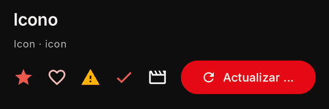
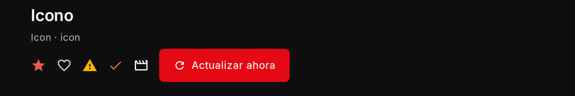

| Propiedad | Tipo | Por defecto | Por tamaño | Notas |
| --- | --- | --- | --- | --- |
| `name` | 50 nombres | obligatorio | no | uno de los iconos de Kino (la [tabla de iconos](#icon-names)): `info`, `tune`, `settings`, `star`, `bolt`, `language`, `subtitles`, `list`, `magic`, `heart`, `movie`, `tv`, `sports`, `music`, `bookmark`, `help`, `refresh`, `sync`, `add`, `remove`, `delete`, `edit`, `search`, `close`, `check`, `share`, `play`, `pause`, `download`, `upload`, `link`, `open_in_new`, `home`, `person`, `lock`, `notifications`, `warning`, `error`, `visibility`, `copy`, `arrow_back`, `arrow_forward`, `expand_more`, `expand_less`, `more_vert`, `filter_list`, `calendar`, `schedule`, `send`, `mood`; los últimos 34 desde apiVersion 14 |

```json
{ "type": "Row", "gap": 8, "children": [
  { "type": "Icon", "name": "star", "color": "primary" },
  { "type": "Icon", "name": "heart", "color": "error" },
  { "type": "Icon", "name": "movie" }
] }
```

```js
export async function screen() {
  return { type: "Row", gap: 8, children: ["info", "star", "heart"].map((name) => ({ type: "Icon", name })) };
}
```

- **Errores:** un nombre fuera de la lista (`"replay"`, un nombre de icono de Material como `"Refresh"`) descarta el
  nodo. Los iconos no se pueden enfocar.
- **apiVersion:** los primeros dieciséis nombres funcionan desde apiVersion 9 (el botón del panel del reproductor); el
  resto llegó con apiVersion 14. Las pantallas necesitan apiVersion 14, así que una pantalla conoce todos los nombres;
  un `panel.icon` con uno de los nombres nuevos en un plugin por debajo de apiVersion 14 es un nombre desconocido (el
  botón dibuja `tune`).

#### Nombres de iconos { #icon-names }

Cada nombre, lo que muestra y desde cuándo. El [ejemplo galería](https://github.com/kinotvapp/kino-plugin-ui-gallery)
los dibuja todos, cada uno con su nombre, en la sección «Todos los iconos» de su pestaña Contenido.

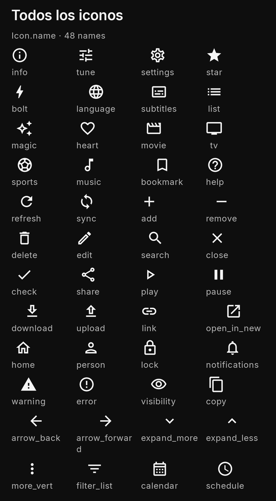
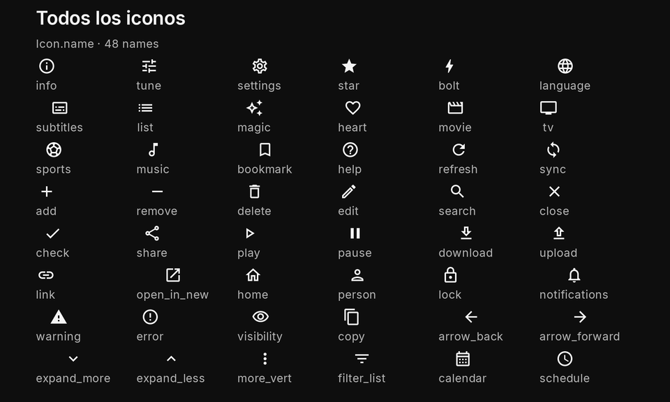

| Nombre | Lo que muestra | Desde |
| --- | --- | --- |
| `info` | información, detalles | apiVersion 9 |
| `tune` | opciones, ajustes finos (el de Kino por defecto) | apiVersion 9 |
| `settings` | ajustes | apiVersion 9 |
| `star` | un favorito, una calificación | apiVersion 9 |
| `bolt` | rápido, en vivo, una acción | apiVersion 9 |
| `language` | idioma, la web | apiVersion 9 |
| `subtitles` | subtítulos | apiVersion 9 |
| `list` | una lista, un índice | apiVersion 9 |
| `magic` | sugerencias, algo automático | apiVersion 9 |
| `heart` | me gusta, guardado | apiVersion 9 |
| `movie` | una película | apiVersion 9 |
| `tv` | una serie, televisión | apiVersion 9 |
| `sports` | deporte | apiVersion 9 |
| `music` | música, audio | apiVersion 9 |
| `bookmark` | guardado para después | apiVersion 9 |
| `help` | ayuda, una pregunta | apiVersion 9 |
| `refresh` | actualizar ahora (una flecha circular) | apiVersion 14 |
| `sync` | sincronizar entre aparatos | apiVersion 14 |
| `add` | agregar, nuevo | apiVersion 14 |
| `remove` | quitar uno, menos | apiVersion 14 |
| `delete` | borrar (una papelera) | apiVersion 14 |
| `edit` | editar (un lápiz) | apiVersion 14 |
| `search` | buscar | apiVersion 14 |
| `close` | cerrar, descartar | apiVersion 14 |
| `check` | hecho, confirmado | apiVersion 14 |
| `share` | compartir | apiVersion 14 |
| `play` | reproducir | apiVersion 14 |
| `pause` | pausar | apiVersion 14 |
| `download` | descargar | apiVersion 14 |
| `upload` | subir, enviar un archivo | apiVersion 14 |
| `link` | un enlace | apiVersion 14 |
| `open_in_new` | se abre afuera (un enlace que sale) | apiVersion 14 |
| `home` | inicio, el comienzo | apiVersion 14 |
| `person` | una persona, una cuenta | apiVersion 14 |
| `lock` | bloqueado, privado | apiVersion 14 |
| `notifications` | notificaciones, alertas | apiVersion 14 |
| `warning` | una advertencia (un triángulo) | apiVersion 14 |
| `error` | un error (un círculo con una marca) | apiVersion 14 |
| `visibility` | mostrar, visto (un ojo) | apiVersion 14 |
| `copy` | copiar | apiVersion 14 |
| `arrow_back` | atrás, anterior | apiVersion 14 |
| `arrow_forward` | adelante, siguiente | apiVersion 14 |
| `expand_more` | abrir, más (un chevrón hacia abajo) | apiVersion 14 |
| `expand_less` | cerrar, menos (un chevrón hacia arriba) | apiVersion 14 |
| `more_vert` | más acciones (tres puntos) | apiVersion 14 |
| `filter_list` | filtrar | apiVersion 14 |
| `calendar` | una fecha, un calendario | apiVersion 14 |
| `schedule` | una hora, programado (un reloj) | apiVersion 14 |
| `send` | enviar un mensaje (un avión de papel) | apiVersion 14 |
| `mood` | una reacción, un sentimiento (una carita) | apiVersion 14 |

```json
{ "type": "ElevatedButton", "labelText": "Actualizar ahora", "labelTextEn": "Refresh now", "icon": "refresh", "onPressed": "refresh" }
```

### Badge { #badge }

Una etiqueta pequeña: un conteo, una etiqueta de calidad, "Nuevo".

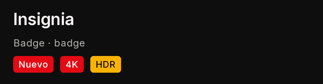
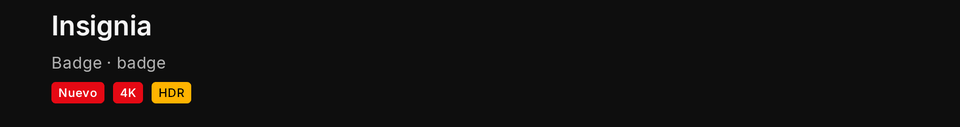

| Propiedad | Tipo | Por defecto | Por tamaño | Notas |
| --- | --- | --- | --- | --- |
| `text` | string | obligatorio | no | una etiqueta corta (`textEn` la de inglés) |

```json
{ "type": "Row", "gap": 8, "children": [
  { "type": "Badge", "text": "Nuevo", "textEn": "New" },
  { "type": "Badge", "text": "HDR", "color": "warning" }
] }
```

```js
export async function screen({ state }) {
  const unread = Number.isInteger(state.unread) ? state.unread : 3;
  return { type: "Row", gap: 8, children: [{ type: "Text", text: "Mensajes" }, { type: "Badge", text: String(unread) }] };
}
```

- **Errores:** un `text` vacío lo descarta; una insignia no se puede pulsar por sí sola (pon la acción en su padre).

### CircleAvatar { #circle-avatar }

El `CircleAvatar` de Flutter: un círculo de `radius` dp en un rol de color que contiene una imagen (https, por la cadena
de imágenes propia de Kino y sus reglas de hosts), si no unas iniciales (como mucho tres caracteres), si no un icono (la
persona de Kino por defecto). Una imagen que falla muestra las iniciales. Siempre es un círculo: no acepta
`borderRadius` (su `radius` es un número). Un lector de pantalla dice su `labelText`, si no sus iniciales.

| Propiedad | Tipo | Por defecto | Por tamaño | Notas |
| --- | --- | --- | --- | --- |
| `image` | URL https | ninguno | no | una imagen https pública, por la cadena de imágenes de Kino; si falla, las iniciales |
| `text` | string | ninguno | no | iniciales, como mucho 3 caracteres (`textEn`) |
| `icon` | un nombre de icono de Kino | `person` | no | sin imagen ni iniciales |
| `radius` | de 12 a 64 (dp) | `20` | sí | siempre un círculo: un `CircleAvatar` no acepta `borderRadius` |
| `backgroundColor` | un rol de color | `primaryContainer` | no | sus iniciales y su icono en el color legible del rol |
| `labelText` | string | ninguno | no | lo que dice un lector de pantalla (`labelTextEn`); si no, las iniciales |

```json
{ "type": "Row", "gap": 8, "children": [
  { "type": "CircleAvatar", "image": "https://img.example.com/me.jpg", "text": "MA", "labelText": "María" },
  { "type": "CircleAvatar", "text": "JP", "backgroundColor": "secondary", "radius": 24 },
  { "type": "CircleAvatar", "icon": "person" }
] }
```

### MaterialBanner { #banner }

Una línea de aviso a lo ancho de la pantalla en el color de Kino para su `role`: una actualización, una advertencia, un
fallo con «Reintentar». Puede llevar un título, un botón de acción y el cierre de Kino cuando es `dismissible`.

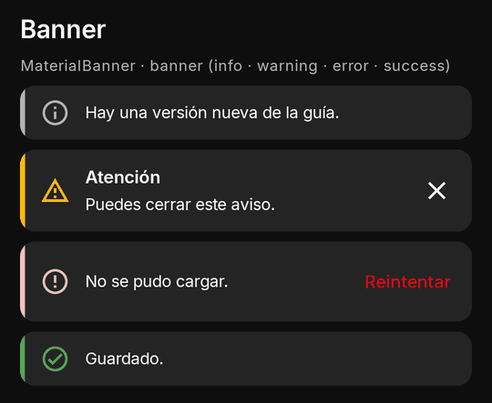
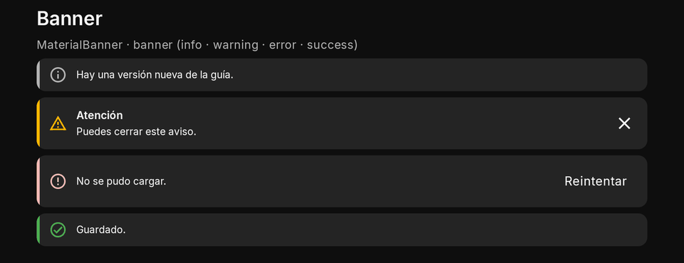

| Propiedad | Tipo | Por defecto | Por tamaño | Notas |
| --- | --- | --- | --- | --- |
| `text` | string | obligatorio | no | `textEn` |
| `role` | `info` \| `warning` \| `error` \| `success` | `info` | no | el color y el icono de Kino para ese rol |
| `title` | string | ninguno | no | `titleEn` |
| `action` | `{ label, labelEn?, onTap }` | ninguno | no | un botón |
| `dismissible` | boolean | `false` | no | el cierre de Kino (necesita una `key` propia): lo oculta y envía el evento `dismiss` con la key como `arg` |

```json
{ "type": "Column", "gap": 8, "children": [
  { "type": "MaterialBanner", "role": "error", "text": "No se pudo cargar.", "textEn": "Could not load.", "action": { "label": "Reintentar", "labelEn": "Retry", "onTap": "retry" } },
  { "type": "MaterialBanner", "key": "tip", "role": "info", "title": "Consejo", "titleEn": "Tip", "text": "Puedes cerrar este aviso.", "textEn": "You can dismiss this notice.", "dismissible": true }
] }
```

```js
export async function screen({ state }) {
  if (!state.failed) return { type: "Text", text: "Todo bien", textEn: "All good" };
  return { type: "MaterialBanner", role: "warning", text: "Sin conexión", textEn: "Offline", action: { label: "Reintentar", labelEn: "Retry", onTap: "retry" } };
}

export async function screenEvent({ name }) {
  if (name === "dismiss") return null; // a dismissible banner's close: arg is its key, Kino already hid it
  if (name === "retry") return { state: { failed: false } };
  return null;
}
```

- **TV:** la acción y el cierre son paradas de foco en el orden del árbol.
- **Celular y TV:** a todo lo ancho en los dos.
- **Límites y errores:** `dismissible` necesita una `key` tuya (una generada se ignora, con registro). El cierre lo
  oculta enseguida (`state.ui.hidden`) y envía el evento `dismiss` con la key como `arg`.

### LinearProgressIndicator { #progress }

Una barra de progreso: `value` de 0 a 1, o ninguno para una indeterminada. Un `labelText` va a su lado.

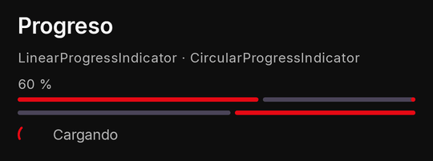
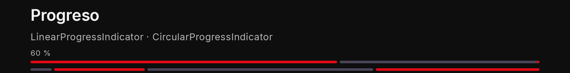

| Propiedad | Tipo | Por defecto | Por tamaño | Notas |
| --- | --- | --- | --- | --- |
| `value` | número de 0 a 1 | ninguno | no | sin él se dibuja una barra indeterminada; fuera de 0..1 se recorta |
| `labelText` | string | ninguno | no | una etiqueta junto a la barra (`labelTextEn`) |

```json
{ "type": "Column", "gap": 8, "children": [
  { "type": "LinearProgressIndicator", "value": 0.6, "labelText": "60 %" },
  { "type": "LinearProgressIndicator" }
] }
```

```js
export async function screen({ state }) {
  const done = Number.isFinite(state.done) ? state.done : 0;
  return { type: "LinearProgressIndicator", value: Math.min(1, done / 10), labelText: done + " / 10" };
}
```

- **Errores:** un valor fuera de 0..1 se recorta (con registro); algo que no es un número la vuelve indeterminada.

### CircularProgressIndicator { #loading }

El indicador de carga de Kino, con una línea opcional debajo. Mientras una pantalla espera datos, un
[`Skeleton`](#skeleton) con la forma del contenido se lee mejor.

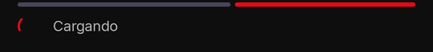


| Propiedad | Tipo | Por defecto | Por tamaño | Notas |
| --- | --- | --- | --- | --- |
| `text` | string | ninguno | no | una línea bajo el indicador de carga de Kino (`textEn`) |

```json
{ "type": "CircularProgressIndicator", "text": "Cargando", "textEn": "Loading" }
```

```js
export async function screen({ state }) {
  return state.ready ? { type: "Text", text: "Listo" } : { type: "CircularProgressIndicator", text: "Cargando", textEn: "Loading" };
}
```

### Skeleton { #skeleton }

Un marcador de lugar mientras algo carga, en el color atenuado de Kino, con un pulso suave (quieto cuando las
animaciones del sistema están apagadas), que se lee como "Cargando…": `line` (de 1 a 6 barras), `block`, `circle` o
`card` (un póster y sus líneas).

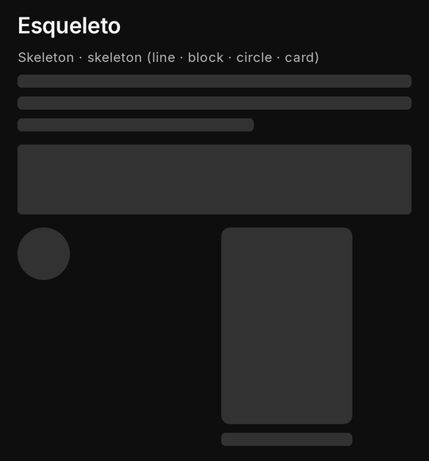
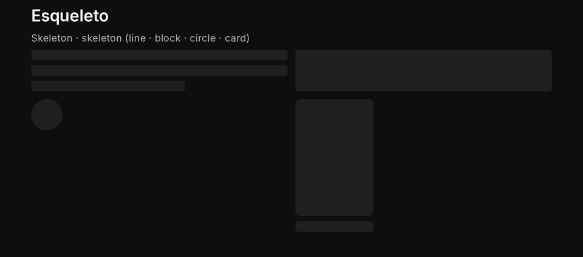

| Propiedad | Tipo | Por defecto | Por tamaño | Notas |
| --- | --- | --- | --- | --- |
| `shape` | `line` \| `block` \| `circle` \| `card` | `line` | sí | dale tamaño con `width`/`height` |
| `lines` | de 1 a 6 | `1` | sí | barras de un `line` |

```json
{ "type": "Row", "gap": 12, "children": [
  { "type": "Skeleton", "shape": "circle", "width": 48, "height": 48 },
  { "type": "Skeleton", "shape": "line", "lines": 3, "flex": 1 }
] }
```

```js
export async function screen({ state }) {
  if (!Array.isArray(state.items)) return { type: "Column", gap: 12, padding: 16, children: [1, 2, 3].map(() => ({ type: "Skeleton", shape: "card", width: 160 })) };
  return { type: "Column", children: state.items.slice(0, 50).map((t, i) => ({ type: "Text", key: "t" + i, text: String(t) })) };
}
```

- **Errores:** `lines` por encima de 6 se reduce (con registro). Dale `height` a un `block`, o será una barra delgada.

### QrImage { #qr }

Un código QR que Kino dibuja en el aparato (sin red), negro sobre blanco con su zona de silencio: un enlace para que
quien ve la TV lo abra en su celular, un código de sala para escanear. Nunca se pulsa ni recibe el foco; puede ir en una
ventana emergente.


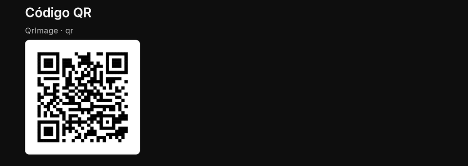

| Propiedad | Tipo | Por defecto | Por tamaño | Notas |
| --- | --- | --- | --- | --- |
| `value` | string | obligatorio | no | de 1 a 1.000 caracteres, dibujado tal como se escribe; un valor que contiene uno de tus secretos nunca se dibuja |
| `labelText` | string | ninguno | no | lo que dice un lector de pantalla (`labelTextEn`) |
| `size` | `small` \| `medium` \| `large` | `medium` | sí | uno de los tres tamaños de Kino |
| `expiresInMs` | de 1.000 a 3.600.000 | ninguno | no | el código deja de servir ese tiempo después de que Kino dibuja este valor por primera vez: Kino lo cuenta hacia atrás bajo el código y lo atenúa en cero ([cuenta regresiva](#qr-countdown)) |
| `expiresAt` | epoch ms | ninguno | no | lo mismo como una hora (el reloj del aparato, leído una vez), como mucho a 3.600.000 ms; se ignora junto a `expiresInMs` |
| `onExpire` | nombre de evento o `{ event, arg? }` | ninguno | no | se envía una vez por valor: `renew` `renewBeforeMs` antes del final, si no `expired` en cero; `value` es `{ phase, remainingMs }` |
| `renewBeforeMs` | de 1.000 a 3.600.000 | ninguno | no | con `onExpire`: pedir un código nuevo ese tiempo antes del final (por debajo de la duración, si no la mitad de ella) |

```json
{ "type": "QrImage", "value": "https://kinotvapp.github.io/kino-plugins/", "size": "medium", "labelText": "Guía de plugins", "labelTextEn": "Plugin guide" }
```

```js
export async function screen({ device }) {
  const link = "https://kinotvapp.github.io/kino-plugins/";
  return device === "tv"
    ? { type: "QrImage", value: link, size: "large", labelText: "Escanéalo con tu teléfono" }
    : { type: "ElevatedButton", labelText: "Abrir", onPressed: { go: { url: { href: link } } } };
}
```

- **Celular y TV:** la misma imagen; en una TV es la forma de entregar un enlace (una TV no puede escanear:
  [`kino.qr.scan`](qr.md) responde `unavailable` ahí).
- **Tamaños:** `small`, `medium` y `large` son 160, 200 y 240 dp en un celular y 180, 220 y 300 dp en una TV. En una TV
  un código nunca es más alto que el 30 % de la ventana, así que en una TV de 1280×720 (540 dp de alto) cada tamaño se
  dibuja a 162 dp: el encabezado de un paso, la cuenta regresiva y un botón bajo el código todavía caben a la vista y el
  control remoto llega a ellos. Una página que aun así pueda ser más alta que la ventana va en un
  `SingleChildScrollView`: el control remoto la recorre y Kino desplaza cada elemento enfocado a la vista (una raíz
  `Column` no se desplaza).
- **Límites y errores:** de 1 a 1.000 caracteres, dibujado tal como se escribe. Nunca armes uno a partir de un secreto:
  un valor que contiene uno de tus secretos sellados no se dibuja (se muestra el estado vacío de Kino, con registro).

#### Un código que caduca (`expiresInMs`, `onExpire`, `renewBeforeMs`) { #qr-countdown }

Un código de inicio de sesión que deja de servir al rato (el QR de inicio de sesión de una app de mensajería, unos
30 s) recibe la cuenta regresiva propia de Kino: una barra y «Caduca en 23 s» bajo el código, que Kino actualiza solo
entre tus llamadas, y en cero el código se atenúa bajo «Código caducado». Con `onExpire` Kino además te pide un código
nuevo, una vez por código, sin esperar a tu [temporizador](screens.md#timers) `every`:

```json
{ "type": "QrImage", "value": "myapp://login?token=AbC", "size": "large", "labelText": "Escanéalo con la app",
  "expiresInMs": 30000, "renewBeforeMs": 5000, "onExpire": "newCode" }
```

```js
export async function screenEvent({ name, value }) {
  if (name !== "newCode") return null; // value: { phase: "renew" | "expired", remainingMs }
  const token = "AbC" + Date.now(); // ask your service for a new token here
  return { state: { qr: "myapp://login?token=" + token } }; // a new value: a new countdown, the square keeps its size
}
```

- **Cuándo sale el evento:** una vez por valor de código: `renewBeforeMs` antes del final (`phase: "renew"`), o en cero
  (`phase: "expired"`) cuando no hay anticipación. Una respuesta lenta deja el código viejo contando hasta su aspecto de
  caducado; una respuesta que nunca llega no se vuelve a pedir para ese código (tu temporizador `every` sigue siendo el
  respaldo). Una anticipación que no es menor que la duración se recorta a la mitad de ella (con registro).
- **Relojes:** `expiresInMs` cuenta desde que Kino dibuja ese valor por primera vez; `expiresAt` (epoch ms) se lee una vez
  contra el reloj del aparato y luego se cuenta como `expiresInMs`, así un cambio de reloj posterior nunca lo mueve.
  Volver a enviar el mismo valor (un temporizador que reenvía `expiresInMs: 30000`) nunca reinicia su cuenta regresiva;
  un valor nuevo siempre la reinicia.
- **Segundo plano, TV, secretos:** la cuenta regresiva sigue el tiempo mientras la pantalla está oculta, pero el evento
  espera: uno que se venció sale cuando la pantalla vuelve a mostrarse (`expired` si el final también pasó). El código y
  su cuenta regresiva nunca toman el foco. Un código que contiene uno de tus secretos nunca se dibuja, ni se cuenta, ni
  se pregunta por él.
- **Su respuesta** no viene de una pulsación de nadie: conserva `state`, `toast`, `close` y `config`, como la de un
  temporizador.

### DataTable { #table }

Una tabla con el aspecto propio de Kino: `TableRow` que contienen `TableCell`. `columns` reparte el ancho (`flex`),
`header` hace de la primera fila el encabezado, `zebra` alterna el fondo de las filas; en un ancho compacto la tabla se
desplaza de lado salvo con `wrap`.

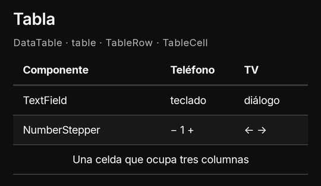
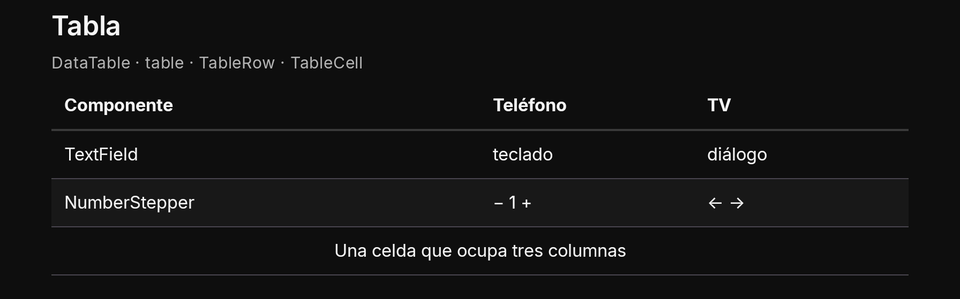

| Propiedad | Tipo | Por defecto | Por tamaño | Notas |
| --- | --- | --- | --- | --- |
| `children` | `TableRow[]` | obligatorio | no | de 1 a 200 filas |
| `columns` | `{ key?, flex? }[]` | la cantidad de la fila más ancha | sí | como mucho 20; cada `flex` de 1 a 12 |
| `header` | boolean | `false` | sí | la primera fila es el encabezado (en negrita, leída como encabezados) |
| `wrap` | boolean | `false` | sí | en un ancho compacto, envolver en vez de desplazarse de lado |
| `zebra` | boolean | `false` | sí | una fila de cada dos sobre la superficie de Kino |

```json
{ "type": "DataTable", "header": true, "zebra": true, "columns": [{ "flex": 2 }, { "flex": 1 }], "children": [
  { "type": "TableRow", "children": [{ "type": "TableCell", "text": "Plan" }, { "type": "TableCell", "text": "Precio", "textEn": "Price" }] },
  { "type": "TableRow", "children": [{ "type": "TableCell", "text": "Gratis", "textEn": "Free" }, { "type": "TableCell", "text": "0" }] },
  { "type": "TableRow", "key": "note", "children": [{ "type": "TableCell", "text": "Precios en dólares", "textEn": "Prices in dollars", "colSpan": 2, "crossAxisAlignment": "center" }] }
] }
```

```js
export async function screen() {
  const rows = [["Lunes", "3"], ["Martes", "5"]].map(([day, n]) => ({ type: "TableRow", children: [{ type: "TableCell", text: day }, { type: "TableCell", text: n, crossAxisAlignment: "end" }] }));
  return { type: "DataTable", header: true, children: [{ type: "TableRow", children: [{ type: "TableCell", text: "Día" }, { type: "TableCell", text: "Vistos" }] }, ...rows] };
}
```

- **TV:** la tabla no toma el foco; el D-pad recorre solo lo enfocable dentro de sus celdas.
- **Celular y TV:** al menos 96 dp por columna cuando se desplaza de lado en un celular; una TV tiene espacio para toda la
  tabla.
- **Límites y errores:** 200 filas, 20 columnas, `colSpan` de 1 a 8. Una fila con menos celdas se completa; las celdas
  después de la última columna se descartan (con registro). Cada fila y cada celda cuesta un nodo. Las celdas nunca
  contienen un `ListView`, un desplazamiento ni otra tabla.

#### TableRow { #table-row }

Una fila de una `DataTable`. Su `key` permite que un `show`, `hide` o `toggle` de `ui` la nombre (una fila de detalles
que se muestra a pedido).

| Propiedad | Tipo | Por defecto | Por tamaño | Notas |
| --- | --- | --- | --- | --- |
| `children` | `TableCell[]` | ninguno | no | como mucho 20; una fila corta se completa |
| `key` | string | ninguno | no | permite que `show`, `hide`, `toggle` nombren la fila |
| `hidden` | boolean | `false` | no | empieza oculta; un campo obligatorio en una fila oculta no se revisa |

#### TableCell { #table-cell }

Una celda: un `text` simple, o `children` (nodos un nivel por debajo de la tabla). `colSpan` y `crossAxisAlignment`
pueden ser mapas por tamaño (`colSpan: { compact: 1, expanded: 3 }`).

| Propiedad | Tipo | Por defecto | Por tamaño | Notas |
| --- | --- | --- | --- | --- |
| `text` | string | ninguno | no | una celda simple (`textEn`); con un `text` los hijos se ignoran |
| `children` | nodos[] | ninguno | no | nunca `ListView`, `SingleChildScrollView`, `DataTable` a ninguna profundidad |
| `colSpan` | de 1 a 8 | `1` | sí | columnas que cubre la celda |
| `crossAxisAlignment` | `start` \| `center` \| `end` | `start` | sí | su contenido a lo ancho |

### emptyState { #empty-state }

El estado vacío de Kino (un icono, un título y una línea): una lista sin nada, una búsqueda sin resultados. Es un
componente de Kino: su nombre no tiene gemelo en Flutter.

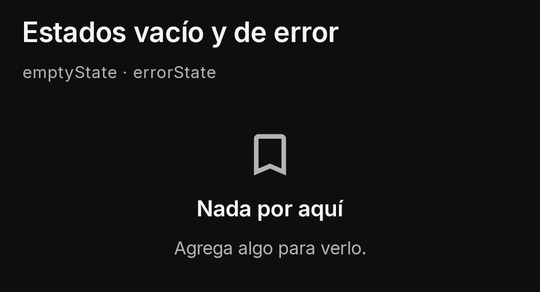
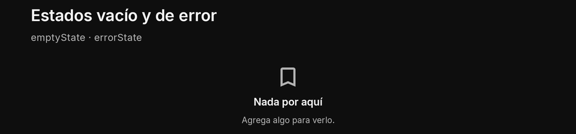

| Propiedad | Tipo | Por defecto | Por tamaño | Notas |
| --- | --- | --- | --- | --- |
| `title` | string | obligatorio | no | `titleEn` el de inglés |
| `text` | string | ninguno | no | una línea bajo el título (`textEn`) |
| `icon` | un nombre de icono de Kino | el de Kino | no |  |

```json
{ "type": "emptyState", "title": "Nada por aquí", "titleEn": "Nothing here", "text": "Agrega algo para verlo.", "textEn": "Add something to see it.", "icon": "bookmark" }
```

```js
export async function screen({ state }) {
  const saved = Array.isArray(state.saved) ? state.saved : [];
  if (saved.length === 0) return { type: "emptyState", title: "Sin guardados", titleEn: "Nothing saved", icon: "bookmark" };
  return { type: "Column", children: saved.slice(0, 50).map((s, i) => ({ type: "Text", key: "s" + i, text: String(s) })) };
}
```

### errorState { #error-state }

El estado de error de Kino, con la misma forma que el vacío: una carga fallida sin nada que mostrar. Acompáñalo con un
botón para reintentar, o muestra un [`MaterialBanner`](#banner) sobre los datos viejos cuando los hay.


| Propiedad | Tipo | Por defecto | Por tamaño | Notas |
| --- | --- | --- | --- | --- |
| `title` | string | obligatorio | no | `titleEn` el de inglés |
| `text` | string | ninguno | no | una línea bajo el título (`textEn`) |
| `icon` | un nombre de icono de Kino | el de Kino | no |  |

```json
{ "type": "Column", "gap": 12, "crossAxisAlignment": "center", "children": [
  { "type": "errorState", "title": "Algo falló", "titleEn": "Something failed", "text": "Inténtalo de nuevo.", "textEn": "Try again." },
  { "type": "ElevatedButton", "labelText": "Reintentar", "labelTextEn": "Retry", "onPressed": "retry" }
] }
```

```js
export async function screen() {
  return { type: "errorState", title: "Sin conexión", titleEn: "Offline", icon: "help" };
}
```

### titleCard { #title-card }

Una tarjeta de póster del Inicio para un `KinoItem` (la forma que devuelve una fila de `home`). Su toque abre el título
como lo hace la tarjeta del Inicio, con ese mismo elemento, así «Continuar viendo», las listas guardadas y el progreso
lo conocen. `onTap` puede reemplazar eso con un evento, un `go` u operaciones `ui`; el `open: { screen }` de un elemento
vuelve a abrir tu pantalla en su lugar.


| Propiedad | Tipo | Por defecto | Por tamaño | Notas |
| --- | --- | --- | --- | --- |
| `item` | `KinoItem` | obligatorio | no | la forma que devuelve una fila de `home` (`id`, `ref`, `title`, `kind`, `poster`...); una serie necesita tu capacidad `episodes` |
| `size` | `small` \| `medium` \| `large` | `medium` | sí | uno de los tres tamaños de Kino |

```json
{ "type": "titleCard", "size": "medium", "item": { "id": "bbb", "ref": "bbb", "title": "Big Buck Bunny", "kind": "movie", "year": 2008, "poster": "https://peach.blender.org/wp-content/uploads/title_anouncement.jpg" } }
```

```js
export async function screen() {
  const item = { id: "bbb", ref: "bbb", title: "Big Buck Bunny", kind: "movie", poster: "https://peach.blender.org/wp-content/uploads/title_anouncement.jpg" };
  return { type: "titleCard", item, size: "large" };
}
```

- **TV:** recibe el foco como las tarjetas del Inicio.
- **Celular y TV:** la propia tarjeta del Inicio en cada uno.
- **Límites y errores:** se lee con las reglas del Inicio: una `series` necesita tu capacidad `episodes`, los pósters
  son solo https (si no, el marcador de lugar de Kino), un elemento 18+ solo se muestra mientras el código 18+ de la
  persona está desbloqueado. Como mucho 1.000 títulos por árbol.

### titleRail { #title-rail }

Una fila del Inicio: un encabezado, una fila lateral de tarjetas de títulos y, con un `ref`, su «Ver más» (tu `browse`).
La forma de darle a una pantalla el aspecto del Inicio propio de Kino.


| Propiedad | Tipo | Por defecto | Por tamaño | Notas |
| --- | --- | --- | --- | --- |
| `title` | string | obligatorio | no | el encabezado de la fila (`titleEn`) |
| `items` | `KinoItem[]` | obligatorio | no | de 1 a 500 (60 cuando se dibuja todo de una vez) |
| `ref` | string | ninguno | no | con él, el «Ver más» de la fila abre tu `browse` (como mucho 4.096 caracteres) |
| `size` | `small` \| `medium` \| `large` | `medium` | sí | uno de los tres tamaños de Kino |
| `onEndReached` | `{ event, arg? }` | ninguno | no | se envía una vez cuando el último elemento entra en la vista, y de nuevo solo después de que tu respuesta dibujó una lista más larga (o `loadingMore` pasó de true a false); nunca más de una vez por segundo |
| `loadingMore` | boolean | `false` | no | `true` dibuja el indicador de carga de Kino después de los elementos |
| `done` | boolean | `false` | no | `true` deja de pedir más |

```json
{ "type": "titleRail", "title": "Recomendadas", "titleEn": "Recommended", "size": "small", "items": [
  { "id": "bbb", "ref": "bbb", "title": "Big Buck Bunny", "kind": "movie", "poster": "https://peach.blender.org/wp-content/uploads/title_anouncement.jpg" },
  { "id": "sintel", "ref": "sintel", "title": "Sintel", "kind": "movie" }
] }
```

```js
export async function screen({ state }) {
  const items = Array.isArray(state.items) && state.items.length ? state.items : [{ id: "bbb", ref: "bbb", title: "Big Buck Bunny", kind: "movie" }];
  return { type: "titleRail", title: "Para ti", titleEn: "For you", items, onEndReached: { event: "more" }, done: items.length >= 60 };
}
```

- **TV:** Izquierda y Derecha recorren las tarjetas; el riel se desplaza con el foco.
- **Límites y errores:** de 1 a 500 elementos (60 cuando el riel está dentro de un desplazamiento lateral, dibujado todo
  de una vez). Sin `title` el riel se descarta.

### titleGrid { #title-grid }

Tarjetas del Inicio en una rejilla de `columns` (3 por defecto): una página de catálogo, resultados de búsqueda.


| Propiedad | Tipo | Por defecto | Por tamaño | Notas |
| --- | --- | --- | --- | --- |
| `items` | `KinoItem[]` | obligatorio | no | de 1 a 500 (60 cuando se dibuja todo de una vez) |
| `columns` | de 1 a 8 | `3` | sí |  |
| `onEndReached` | `{ event, arg? }` | ninguno | no | se envía una vez cuando el último elemento entra en la vista, y de nuevo solo después de que tu respuesta dibujó una lista más larga (o `loadingMore` pasó de true a false); nunca más de una vez por segundo |
| `loadingMore` | boolean | `false` | no | `true` dibuja el indicador de carga de Kino después de los elementos |
| `done` | boolean | `false` | no | `true` deja de pedir más |

```json
{ "type": "titleGrid", "columns": { "compact": 3, "expanded": 6 }, "items": [
  { "id": "bbb", "ref": "bbb", "title": "Big Buck Bunny", "kind": "movie" },
  { "id": "sintel", "ref": "sintel", "title": "Sintel", "kind": "movie" },
  { "id": "tos", "ref": "tos", "title": "Tears of Steel", "kind": "movie" }
] }
```

```js
export async function screen() {
  const items = ["Big Buck Bunny", "Sintel", "Tears of Steel"].map((title, i) => ({ id: "t" + i, ref: "t" + i, title, kind: "movie" }));
  return { type: "titleGrid", columns: { compact: 3, expanded: 6 }, items };
}
```

- **Límites y errores:** de 1 a 500 elementos, 60 cuando se dibuja todo de una vez (una rejilla dentro de un
  desplazamiento, una lista, una ventana emergente o una celda de tabla): una rejilla larga pide una página propia en la
  raíz.

### heroCard { #hero-card }

El banner de una sección: una imagen grande, un título, una línea y como mucho dos botones. La parte de arriba de una
página de inicio.


| Propiedad | Tipo | Por defecto | Por tamaño | Notas |
| --- | --- | --- | --- | --- |
| `title` | string | obligatorio | no | `titleEn` el de inglés |
| `text` | string | ninguno | no | `textEn` |
| `image` | URL https | ninguno | no | una imagen https pública |
| `buttons` | nodos de botón | ninguno | no | como mucho 2 |

```json
{ "type": "heroCard", "title": "Estreno", "titleEn": "Premiere", "text": "Un conejo y tres roedores.", "textEn": "A rabbit and three rodents.",
  "image": "https://peach.blender.org/wp-content/uploads/title_anouncement.jpg",
  "buttons": [
    { "type": "ElevatedButton", "labelText": "Ver", "labelTextEn": "Watch", "onPressed": { "go": { "titleByIds": { "tmdb": 10378, "kind": "movie" } } } },
    { "type": "TextButton", "labelText": "Más", "labelTextEn": "More", "onPressed": "more" }
  ] }
```

```js
export async function screen() {
  return { type: "heroCard", title: "Destacado", image: "https://peach.blender.org/wp-content/uploads/title_anouncement.jpg", buttons: [{ type: "ElevatedButton", labelText: "Abrir", onPressed: "open-hero" }] };
}
```

- **Límites y errores:** como mucho 2 botones (el resto se descarta, con registro), solo botones; una imagen `http` se
  descarta.

## Acciones { #actions }

Lo que hace una pulsación es una **acción**: el `onTap` y el `onLongPress` de un nodo, el `onPressed` de un botón, el
`onChanged` y el `onSubmitted` de una entrada, el `onSubmitted` de un formulario, el `onTap` de un elemento de menú.
Cuatro formas, más un presupuesto de tiempo:

```js
onPressed: "refresh"                                        // an event for screenEvent; its arg is the node's arg
onPressed: { event: "read", arg: "story-42" }               // an event with its arg (at most 4,096 characters)
onPressed: { ui: [{ toggle: "details" }], event: "seen" }   // local operations first (no plugin call), then the event
onPressed: { go: { url: { href: "https://kinotvapp.github.io/kino-plugins/" } } } // somewhere in Kino, no plugin call
onPressed: { event: "login", timeoutMs: 28000 }               // this press's call may take up to 28 s
```

`screenEvent` recibe `{ name, arg, value, state, route, device, lang }` y responde qué debe cambiar
([Respuestas](screens.md#answers)). El nombre de evento `open` está reservado: Kino lo envía una vez cuando se abre la
pantalla. Cada destino de `go` está en [Navegación](screen-forms.md#navigation); las operaciones `ui`, [más
abajo](#ui-ops).

### Botones { #button }

`ElevatedButton` es el botón principal de Kino, `Button` con `variant: "secondary"` el secundario, `TextButton` uno plano
e `IconButton` un icono (su `labelText` es lo que dice un lector de pantalla). `confirm` hace que Kino pregunte antes de
ejecutar la acción; `submit: true` dentro de un [`Form`](screen-forms.md#form) lo revisa y lo envía; `enabled: false` lo
dibuja apagado.

| Propiedad | Tipo | Por defecto | Por tamaño | Notas |
| --- | --- | --- | --- | --- |
| `labelText` | string | obligatorio (no para `IconButton`) | no | `labelTextEn` el de inglés; en un `IconButton` es lo que dice un lector de pantalla |
| `icon` | un nombre de icono de Kino | ninguno | no | obligatorio para `IconButton` (variante `icon`) |
| `variant` | `primary` \| `secondary` \| `text` \| `icon` | `primary` | sí | la fijan `ElevatedButton`, `TextButton`, `IconButton`; `secondary` solo como `Button` |
| `onPressed` | acción | ninguno | no | lo que hace una pulsación ([Acciones](#actions)) |
| `confirm` | string | ninguno | no | Kino hace esta pregunta (`confirmEn`) antes de ejecutar la acción |
| `submit` | boolean | `false` | no | dentro de un `Form`: revisa y envía el formulario (su propio `onPressed` se ignora) |

```json
{ "type": "Row", "wrap": true, "gap": 8, "children": [
  { "type": "ElevatedButton", "labelText": "Guardar", "labelTextEn": "Save", "icon": "bookmark", "onPressed": "save" },
  { "type": "Button", "variant": "secondary", "labelText": "Compartir", "labelTextEn": "Share", "onPressed": "share" },
  { "type": "TextButton", "labelText": "Borrar", "labelTextEn": "Delete", "confirm": "¿Borrar?", "confirmEn": "Delete it?", "onPressed": "delete" },
  { "type": "IconButton", "icon": "heart", "labelText": "Me gusta", "labelTextEn": "Like", "onPressed": "like" }
] }
```

```js
export async function screen({ state }) {
  return { type: "ElevatedButton", key: "send", labelText: state.sent ? "Enviado" : "Enviar", enabled: !state.sent, onPressed: { event: "send", arg: "now" } };
}

export async function screenEvent({ name }) {
  return name === "send" ? { state: { sent: true }, toast: "Enviado", toastEn: "Sent" } : null;
}
```

- **TV:** cada botón es una parada de foco con el anillo de Kino; OK lo pulsa. Un botón desactivado se dibuja apagado y
  no hace nada.
- **Celular y TV:** las mismas variantes; dale a un botón un `height` fijo por clase de tamaño para un pulgar o un
  control remoto (una matriz al estilo calculadora usa 80 en un celular, 48 en una TV).
- **Límites y errores:** un botón necesita un `labelText` (un `IconButton`, un `icon`), si no se descarta. `onPressed`
  solo funciona en botones (en lo demás es `onTap`). `submit` fuera de un formulario se ignora (con registro).
  `OutlinedButton` no existe.

### Pulsaciones ocupadas y lentas (`loading`, `timeoutMs`) { #busy }

Una pulsación cuya llamada tarda muestra la señal de espera propia de Kino: cuando la llamada de la pulsación de la
persona pasa de 400 ms, el botón, `FloatingActionButton`, tarjeta o `ListTile` pulsado se dibuja con el aspecto ocupado
de Kino (un indicador de carga en lugar de su icono, sin pulsación, leído como ocupado) hasta tu respuesta.
`loading: true` en uno de esos nodos dibuja el mismo aspecto desde tu árbol (un inicio de sesión que sigues esperando,
por ejemplo); en la TV el nodo conserva su foco.

Un objeto de acción puede darle a la llamada de su evento un presupuesto propio, `timeoutMs` (de 1.000 a 30.000 ms; el
valor por defecto sigue siendo 20.000): solo en una pulsación (`onPressed`, `onTap`, `onLongPress`, `onSubmitted`,
`onTrailingTap`) y respetado solo cuando lo envía la pulsación o el envío de la propia persona; un cambio, un
temporizador, `open` o una carga de más conservan el valor por defecto.

```json
{ "type": "ElevatedButton", "key": "send", "labelText": "Enviar código", "labelTextEn": "Send code", "onPressed": { "event": "sendCode", "timeoutMs": 28000 } }
```

```js
export async function screen({ state }) {
  return { type: "ElevatedButton", key: "refresh", labelText: "Actualizar", loading: state.refreshing === true, onPressed: "refresh" };
}
```

- **Límites y errores:** `timeoutMs` fuera de 1.000..30.000 se recorta; en algo que no es una pulsación o sin evento se
  ignora (con registro). `loading` en otro lugar que un botón, un `FloatingActionButton`, una tarjeta o un `ListTile`
  con `onTap` se ignora (con registro).

### FloatingActionButton { #floating-action-button }

El `FloatingActionButton` de Flutter: uno por pantalla (otro se descarta, con registro), dibujado por Kino sobre el
extremo inferior (o el centro, `fabPosition`) de tu zona, nunca en su lugar del árbol, nunca bajo las barras del sistema
ni el teclado; en un `Scaffold` sobre su barra de abajo, en un panel del reproductor sobre el cuerpo del cajón. Con un
`labelText` es la forma extendida. Nunca dentro de una lista, una tabla, una ventana emergente, un `ListTile` o el
fallback de una imagen (se descarta, con registro). Acepta `selected`, `badge`, `autofocus` y `tooltip`; en la TV es una
parada de foco con el anillo de Kino, a la que se llega con el D-pad.

| Propiedad | Tipo | Por defecto | Por tamaño | Notas |
| --- | --- | --- | --- | --- |
| `icon` | un nombre de icono de Kino | obligatorio | no | dibujado sobre el relleno primario de Kino |
| `labelText` | string | ninguno | no | la forma extendida: la etiqueta junto al icono (`labelTextEn`); si no, lo que dice un lector de pantalla es el `tooltip`, y si no, la palabra propia de Kino |
| `onPressed` | acción | obligatorio | no | lo que hace una pulsación |
| `fabPosition` | `end` \| `center` | `end` | sí | extremo inferior o centro inferior de la zona del plugin, nunca bajo las barras del sistema ni el teclado ([botón flotante](#floating-action-button)) |

```json
{ "type": "Column", "children": [
  { "type": "Text", "text": "Tus listas", "textEn": "Your lists", "style": "h3" },
  { "type": "FloatingActionButton", "icon": "add", "labelText": "Nueva", "labelTextEn": "New", "onPressed": "newList" }
] }
```

### Tooltip { #tooltip }

`tooltip` (y `tooltipEn`), en cualquier nodo que hace algo (un botón, un campo, una elección, un `FloatingActionButton`,
cualquier nodo con `onTap` o `onLongPress`; en lo demás se ignora, con registro), como mucho 80 caracteres: la pista
propia de Kino. Un celular la muestra con una pulsación larga (un nodo con su propio `onLongPress` no muestra ninguna:
gana su acción), una TV después de unos 800 ms de foco (hasta que el foco se va), y un lector de pantalla la recibe como
la etiqueta de la pulsación larga. Nunca toma el foco ni una pulsación. **Nunca pongas información esencial en un
tooltip**: quien nunca hace una pulsación larga, o una TV en la que se pasa rápido, nunca la ve. Un nodo desactivado
también muestra la tuya (Kino no agrega una pista propia).

```json
{ "type": "IconButton", "icon": "share", "labelText": "Compartir", "labelTextEn": "Share", "tooltip": "Copia el enlace del episodio", "tooltipEn": "Copies the episode's link", "onPressed": "share" }
```

### Chips { #chips }

Una elección (o varias con `multiple`) entre unas pocas `options`, dibujadas como chips: filtros sobre una lista,
categorías, etiquetas. Es una entrada: su valor está en `state.inputs`, y `onChanged` avisa del cambio.


| Propiedad | Tipo | Por defecto | Por tamaño | Notas |
| --- | --- | --- | --- | --- |
| `key` | string | obligatorio | no | nombra el valor en `state.inputs`; única en la pantalla |
| `labelText` | string | ninguno | no | la etiqueta del campo (`labelTextEn`) |
| `hintText` | string | ninguno | no | una pista dentro o debajo (`hintTextEn`) |
| `onChanged` | acción | ninguno | no | la persona lo cambió; el `value` del evento es el valor nuevo |
| `options` | `{ value, label, labelEn? }[]` | obligatorio | no | de 1 a 500, valores distintos |
| `multiple` | boolean | `false` | no | se pueden elegir varios chips |
| `value` | string o string[] | ninguno | no | el valor elegido (una lista con `multiple`); un valor que no nombra ninguna opción se descarta |
| `bind` | una clave de ajuste | ninguno | no | muestra y guarda uno de tus ajustes `select` o `text` ([bind](screen-forms.md#bind-and-config)) |
| `required` | boolean | `false` | no | regla de formulario: un texto no vacío, una elección hecha, un interruptor encendido, un chip elegido |
| `minLength` | entero | ninguno | no | regla de formulario: caracteres (chips: chips elegidos) |
| `maxLength` | entero | ninguno | no | regla de formulario: caracteres (chips: chips elegidos) |
| `errorText` | string | el texto de Kino | no | regla de formulario: lo que la persona lee bajo el campo que falla (`errorTextEn`) |
| `forceErrorText` | string | ninguno | no | tu propio veredicto bajo el campo (`forceErrorTextEn`, como mucho 200 caracteres) hasta que la persona lo edita ([validación](screen-forms.md#validation)) |

```json
{ "type": "Chips", "key": "genre", "value": "all", "onChanged": "filter", "options": [
  { "value": "all", "label": "Todo", "labelEn": "All" },
  { "value": "movies", "label": "Películas", "labelEn": "Movies" },
  { "value": "series", "label": "Series" }
] }
```

```js
export async function screen({ state }) {
  const picked = Array.isArray(state.inputs?.extras) ? state.inputs.extras : ["hd"];
  return { type: "Column", gap: 8, children: [
    { type: "Chips", key: "extras", multiple: true, value: picked, onChanged: "extras", options: [{ value: "hd", label: "HD" }, { value: "sub", label: "Subtítulos" }] },
    { type: "Text", text: "Elegidos: " + picked.join(", ") },
  ] };
}
```

- **TV:** Izquierda y Derecha se quedan dentro de la fila de chips; al entrar se llega al chip elegido; OK elige.
- **Límites y errores:** de 1 a 500 opciones con valores distintos; un `value` que no nombra ninguna opción se descarta
  (con registro). En un `Form`, `minLength` y `maxLength` cuentan los chips elegidos.

### Toasts { #toast }

Un mensaje corto abajo, desde una respuesta: un string, o `{ text, textEn?, role?, action?, ms? }`. Uno a la vez (uno
más nuevo lo reemplaza); su `action` envía su evento una vez.

```json
{ "toast": { "text": "Elemento borrado", "textEn": "Item deleted", "role": "success", "ms": 6000,
  "action": { "label": "Deshacer", "labelEn": "Undo", "event": "undo" } } }
```

```js
export async function screenEvent({ name, lang }) {
  if (name === "save") return { toast: lang === "es" ? "Guardado" : "Saved" };
  if (name === "delete") return { toast: { text: "Borrado", textEn: "Deleted", action: { label: "Deshacer", labelEn: "Undo", event: "undo" } } };
  return null;
}
```

- **TV:** el toast nunca toma el foco por sí solo: Abajo desde la parte de abajo del árbol llega a su acción (Arriba o
  Atrás lo dejan), y la tecla Menú o Reproducir/Pausa del control remoto la ejecuta; el toast lo dice con palabras.
- **Límites y errores:** `ms` de 2.000 a 8.000 (3.500 por defecto). Un toast de tipo string lleva su gemelo en inglés en
  `toastEn`; el objeto lleva `textEn`.

### Operaciones `ui` locales { #ui-ops }

Operaciones que Kino ejecuta enseguida, sin llamar a tu plugin, sobre otros nodos de la misma pantalla por su `key`:
mostrar un bloque de detalles, desactivar un botón, llenar un campo, abrir una [ventana emergente](screen-forms.md#popup)
declarada. Como mucho 8 por acción o respuesta; una key desconocida se ignora (con registro). Lo que hacen queda guardado
en `state.ui` (`hidden`, `enabled`, y `open` para cada acordeón), así tu siguiente llamada lo ve y un nuevo dibujo lo
conserva.

| Operación | Forma | Lo que hace |
| --- | --- | --- |
| `show` | `{ show: key }` | muestra un nodo oculto |
| `hide` | `{ hide: key }` | lo oculta (guardado en `state.ui.hidden`) |
| `toggle` | `{ toggle: key, prop? }` | lo muestra o lo oculta; con `prop: "selected"`, invierte el `selected` de un botón o de una tarjeta que se puede tocar |
| `enable` | `{ enable: key }` | lo enciende |
| `disable` | `{ disable: key }` | lo dibuja apagado (guardado en `state.ui.enabled`) |
| `focus` | `{ focus: key }` | lleva el foco ahí; se descarta en un `onClose` |
| `set` | `{ set: { key, value } }` | le da un valor a una entrada: un string (como mucho 2.000 caracteres), un booleano, un número, o hasta 500 strings para `Chips`; en un botón o una tarjeta que se puede tocar, `true` o `false` es su `selected`; no se dispara ningún evento |
| `clear` | `{ clear: key }` | vacía una entrada |
| `open` | `{ open: key }` | abre una ventana emergente declarada (reemplazando una abierta); en una respuesta espera al árbol nuevo; se descarta en un `onClose` |
| `close` | `{ close: key }` | la cierra cuando es la que está abierta |

```json
{ "type": "Column", "gap": 8, "children": [
  { "type": "Text", "key": "details", "text": "Detalles", "textEn": "Details", "hidden": true },
  { "type": "TextButton", "labelText": "Más", "labelTextEn": "More", "onPressed": { "ui": [{ "toggle": "details" }] } },
  { "type": "TextField", "key": "q", "labelText": "Buscar", "labelTextEn": "Search" },
  { "type": "TextButton", "labelText": "Limpiar", "labelTextEn": "Clear", "onPressed": { "ui": [{ "clear": "q" }, { "focus": "q" }] } }
] }
```

- **Errores:** un valor de `set` no dispara ningún evento (léelo de `state.inputs` en la siguiente llamada); `state.ui`
  es el registro de Kino, pero puedes fijar sus claves tú mismo en un parche de `state`.
- **`selected`** ([propiedades compartidas](screen-reference.md#shared-properties)): `{ toggle: key, prop: "selected" }`
  invierte el `selected` de un botón o de una tarjeta que se puede tocar y `{ set: { key, value: true } }` lo fija,
  enseguida y sin llamada. Kino conserva ese valor solo hasta que tu siguiente dibujo lo vuelve a decir (no está en
  `state.ui`), así que envía también el evento y guárdalo en tu propio estado. Cualquier otro `prop` descarta la
  operación (con registro); sin `prop`, `toggle` sigue significando `hidden`.
