# Screen components: forms, pop-ups and navigation { #screen-forms }

!!! note "Available with Kino 0.9.74"
    Available with Kino 0.9.74 (the next version, not published yet). An older Kino refuses these plugins with
    «Este plugin necesita una versión más nueva de Kino»; to keep reaching people on an older version use
    `enhancements` (see [Screens without raising your apiVersion](enhancements.md)).

This is the second part of the component catalogue of a [screen](screens.md): the inputs and forms, the pop-ups and
everything a node can open with `go`. The catalogue has three pages:

- [Layout, content and actions](screen-components.md): `Column` to `ListTile`, `Text` to `heroCard`, buttons to the `ui`
  operations.
- **Forms, pop-ups and navigation** (this page): `Form` to `bind` and `config`, `Dialog` to `anchor`, every `go` shape and
  routes.
- [Data, behaviour and recipes](screen-reference.md): state, inputs, events, answers, timers, per-size values, style,
  common properties, animations, limits, and the recipes.

What a screen is, how it is declared and how it answers is in the guide, [Screens](screens.md).

## Forms { #forms }

Inputs hold values Kino keeps in `state.inputs` by key ([Inputs](screen-reference.md#inputs)). Inside a `Form` they also
take rules that **Kino checks before anything reaches your code**.

### Form { #form }

Fields with one submit: a button with `submit: true` checks every field, shows the errors under each failing one and
focuses the first; only a valid form runs the form's `onSubmitted`, whose event `value` holds every field by key.

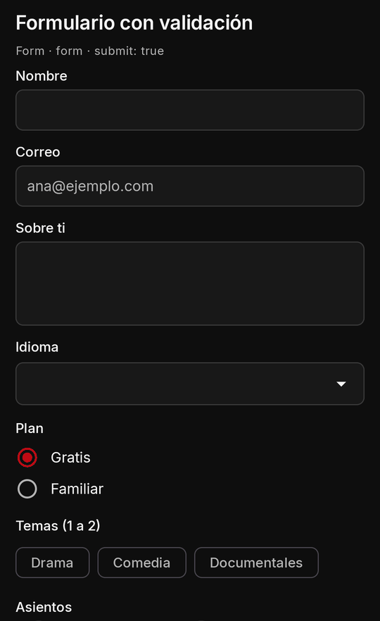
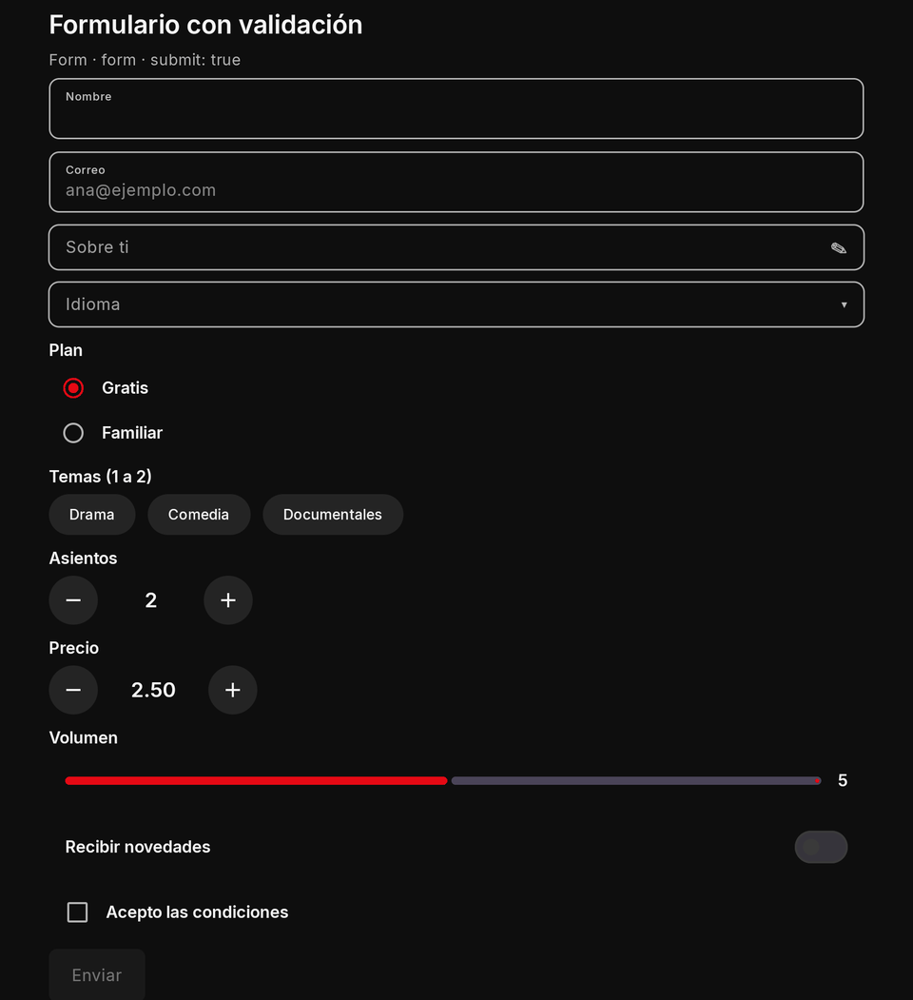

| Property | Type | Default | Per size | Notes |
| --- | --- | --- | --- | --- |
| `children` | nodes (its fields among them)[] | none | no | its children, drawn in order |
| `onSubmitted` | action | required | no | runs only when every field passes; its event's `value` holds every field by key |

```json
{ "type": "Form", "key": "contact", "onSubmitted": "send", "gap": 12, "children": [
  { "type": "TextField", "key": "email", "kind": "email", "labelText": "Correo", "labelTextEn": "Email", "required": true,
    "pattern": "^[^@\\s]+@[^@\\s]+\\.[A-Za-z]{2,}$", "errorText": "Revisa el correo", "errorTextEn": "Check the email" },
  { "type": "TextField", "key": "msg", "labelText": "Mensaje", "labelTextEn": "Message", "multiline": true, "maxLength": 500, "required": true },
  { "type": "Checkbox", "key": "ok", "labelText": "Acepto", "labelTextEn": "I agree", "required": true },
  { "type": "ElevatedButton", "labelText": "Enviar", "labelTextEn": "Send", "submit": true }
] }
```

```js
export async function screen() {
  return { type: "Form", key: "contact", onSubmitted: "send", gap: 12, children: [
    { type: "TextField", key: "name", labelText: "Nombre", required: true, minLength: 2 },
    { type: "ElevatedButton", labelText: "Enviar", submit: true },
  ] };
}

export async function screenEvent({ name, value }) {
  if (name !== "send") return null;
  return { state: { sentBy: value.name }, toast: "Enviado", toastEn: "Sent" }; // value: every field by key, already checked
}
```

- **TV:** the error moves focus to the first failing field.
- **Phone and TV:** identical rules; only the text entry differs ([TextField](#text-field)).
- **Limits and mistakes:** a form without `onSubmitted` is dropped; forms do not nest (write two siblings); an answer's
  pop-up takes none (a declared one does). Enter does not submit a form.

### TextField { #text-field }

A text field: a name, a search box, an email. `kind` picks the keyboard (`text`, `number`, `email`, `url`, `search`).
`onSubmitted` is the keyboard's action; `onChanged` reports changes. A `trailingIcon` (one of Kino's
[icons](screen-components.md#icon-names)) is drawn inside the field's box at its end, a chat's «Enviar» or a search's lens:
its `onTrailingTap` is sent like `onSubmitted`, with what the field holds now as the event's `value`, and `trailingLabel`
(`trailingLabelEn`, at most 40 characters) is what a screen reader says for it.

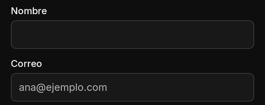
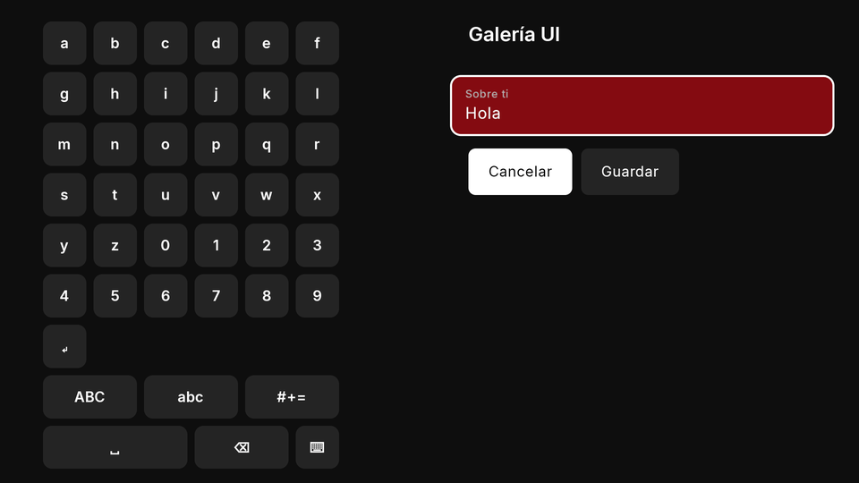

| Property | Type | Default | Per size | Notes |
| --- | --- | --- | --- | --- |
| `key` | string | required | no | names the value in `state.inputs`; unique on the screen |
| `labelText` | string | none | no | the field's label (`labelTextEn`) |
| `hintText` | string | none | no | a hint inside or under it (`hintTextEn`) |
| `onChanged` | action | none | no | the person changed it; the event's `value` is the new value |
| `kind` | `text` \| `number` \| `email` \| `url` \| `search` | `text` | no | the keyboard; there is no password kind (a masked field is `obscureText`) |
| `value` | string | `""` | no | the starting text (what `state.inputs` holds wins); ignored on an `obscureText` field |
| `obscureText` | boolean | `false` | no | masked like a password on phone and TV, with Kino's show / hide; never in your state, sent only with the person's own tap or submit, then cleared ([secret fields](#secret-field)); one line only; binds only a `password` setting |
| `maxLength` | 1 to 2,000 | 2,000 | no | also a form rule |
| `onSubmitted` | action | none | no | the keyboard's action (Enter); on the TV, the text dialog's accept |
| `trailingIcon` | one of the 50 [icons](screen-components.md#icon-names) | none | yes | drawn inside the field's box at its end, tinted by `color`; never on a disabled field; needs `trailingLabel` and `onTrailingTap`, else the field is drawn without it (logged) |
| `trailingLabel` | 1 to 40 characters | none | no | what a screen reader says for the icon (`trailingLabelEn` in English); required with `trailingIcon` |
| `onTrailingTap` | action | none | no | the icon's press: sent like `onSubmitted`, with the field's current text as `value` (a person's press); on the TV the icon is its own focus stop, Right from the field |
| `bind` | a setting key | none | no | shows and stores one of your `text` settings ([bind](#bind-and-config)) |
| `required` | boolean | `false` | no | form rule: a text not blank, a choice made, a toggle on, a chip picked |
| `minLength` | integer | none | no | form rule: characters (chips: picked chips) |
| `pattern` | string | none | no | form rule: must match the whole value; Kino's own safe subset, at most 200 characters ([Patterns](#pattern)) |
| `errorText` | string | Kino's text | no | form rule: what the person reads under the failing field (`errorTextEn`) |
| `forceErrorText` | string | none | no | your own verdict under the field (`forceErrorTextEn`, at most 200 characters) until the person edits it ([validation](#validation)) |

```json
{ "type": "TextField", "key": "q", "kind": "search", "labelText": "Buscar", "labelTextEn": "Search", "hintText": "Una película", "hintTextEn": "A film", "maxLength": 100, "onSubmitted": "search" }
```

```js
export async function screen({ state }) {
  return { type: "Column", gap: 8, children: [
    { type: "TextField", key: "q", kind: "search", labelText: "Buscar", onSubmitted: "search" },
    { type: "Text", text: state.query ? "Buscaste: " + state.query : "Escribe algo" },
  ] };
}

export async function screenEvent({ name, state }) {
  if (name === "search") return { state: { query: String(state.inputs.q ?? "").trim().slice(0, 100), inputs: { q: "" } } };
  return null;
}
```

A chat's field with its send icon inside (the icon and Enter send the same event):

```json
{ "type": "TextField", "key": "msg", "hintText": "Escribe un mensaje", "hintTextEn": "Type a message", "maxLength": 300,
  "onSubmitted": "send", "trailingIcon": "send", "trailingLabel": "Enviar", "trailingLabelEn": "Send", "onTrailingTap": "send" }
```

- **Trailing icon:** all three of `trailingIcon`, `trailingLabel` and `onTrailingTap`, or the field is drawn without the
  icon (logged): an unknown icon, a missing or too long label, a missing or bad action. `trailingIcon` may be a per-size
  map (a class without one draws no icon there). Never shown on a disabled field. Only on a one-line field: a
  `TextField` with several lines ignores it (logged).
- **Phone and TV:** on the phone a press on the icon sends the text as typed, its pending change first. On the TV the icon
  is a focus stop of its own inside the field's box: Right from the field reaches it, Left goes back, Up and Down leave as
  from the field; OK on it sends what the field holds.
- **TV:** **text on the TV is a simulated input**: the field draws as a row showing its value that, pressed, opens Kino's
  TV text dialog with its on-screen keyboard. `onChanged` and then `onSubmitted` fire **once, when the dialog is
  accepted**, with the final value, untrimmed. A hardware keyboard on a TV commits on Enter or when focus leaves.
- **Phone and TV:** the phone uses a normal field and the phone's keyboard; `onChanged` is debounced
  (300 ms). Your code cannot tell how a value was entered and never needs to.
- **Limits and mistakes:** `key` is required (a missing or repeated input key drops the node). There is no password kind:
  a masked field is `obscureText: true` ([secret fields](#secret-field)).
  To clear or prefill a field, answer `{ state: { inputs: { q: "" } } }`. Kino never autofills the person's saved data.

#### Secret fields (`obscureText`) { #secret-field }

`obscureText: true` masks a one-line `TextField` like a password, on the phone (dots, the password keyboard, Kino's show /
hide eye when there is no `trailingIcon`) and on the TV (dots on the field, the text dialog masked with its show / hide
toggle, the same D-pad path as any field). Put it in a `Form` to check and send a token or a password with a «Siguiente»:

```json
{ "type": "Form", "key": "login", "onSubmitted": "next", "children": [
  { "type": "TextField", "key": "token", "obscureText": true, "labelText": "Token", "required": true, "minLength": 20 },
  { "type": "ElevatedButton", "labelText": "Siguiente", "labelTextEn": "Next", "submit": true }
] }
```

```js
export async function screenEvent({ name, value }) {
  if (name !== "next") return null;
  const ok = /^[A-Za-z0-9_-]{20,}$/.test(value.token); // what was typed, only in this call
  return ok ? { state: { step: "done" } } : { toast: "Token no válido", toastEn: "Invalid token" }; // the field is now empty
}
```

- **Where the text goes:** only with the person's own tap or submit, in `state.inputs.<key>` and, for the form's or the
  field's own `onSubmitted` (or `onTrailingTap`), in `value`. Never in a `screen()` render, a change, a timer's tick, `open`,
  a load-more or a pop-up's `onClose`.
- **Never kept:** not in the screen's state (so not in a player panel's kept state, a restored screen or anything that
  syncs), not in Kino's logs or crash reports, not in the keyboard's suggestions or Autofill. Once the call that carried it
  ends (answered, failed or timed out) the field is empty again, unless your answer gives a text back in
  `state: { inputs: { <key>: "..." } }` (kept in memory only) or the person typed something new meanwhile. The screen
  closing forgets it.
- **Its own rules:** `value` from the tree and `onChanged` are ignored (logged); `obscureText` that is not `true` or
  `false`, or on a field with several lines, drops the field. The form rules (`required`, `minLength`, `pattern`) check
  what was typed.
- **`bind`:** only to a `password` setting (and a password binds only to a secret field): the field always starts empty
  (a password is never read back) and writes what was typed on commit; an empty field never clears the password (use
  `config: { <key>: null }`).
- **Editing a saved secret:** a stored secret is never shown, so the field starts empty. Leave it `required: false` (a
  `pattern` or `minLength` still checks what was typed, and an empty field passes) and read an empty `value` as "keep the
  stored one": write `config` only when the person typed something, and offer a separate button that sends
  `config: { <key>: null }` to remove it.

### TextField with several lines { #text-area }

A `TextField` with `multiline: true` (or a `maxLines` above 1 in any size class) takes several lines: a message, a note.
Kino reads it as the older `textArea`.

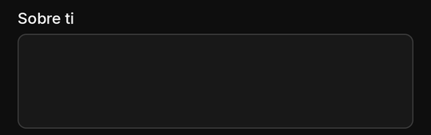
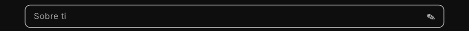

| Property | Type | Default | Per size | Notes |
| --- | --- | --- | --- | --- |
| `key` | string | required | no | names the value in `state.inputs`; unique on the screen |
| `labelText` | string | none | no | the field's label (`labelTextEn`) |
| `hintText` | string | none | no | a hint inside or under it (`hintTextEn`) |
| `onChanged` | action | none | no | the person changed it; the event's `value` is the new value |
| `multiline` | boolean | `false` | no | `true` (or `maxLines` above 1) makes a `TextField` several lines |
| `maxLines` | integer | none | no | above 1 in any size class: several lines |
| `kind` | `text` \| `number` \| `email` \| `url` \| `search` | `text` | no | as a one-line field |
| `value` | string | `""` | no | the starting text |
| `maxLength` | 1 to 2,000 | 2,000 | no | also a form rule |
| `onSubmitted` | action | none | no | sent on the TV only (the phone's multi-line keyboard has no submit: add a button) |
| `bind` | a setting key | none | no | shows and stores one of your `text` settings ([bind](#bind-and-config)) |
| `required` | boolean | `false` | no | form rule: a text not blank, a choice made, a toggle on, a chip picked |
| `minLength` | integer | none | no | form rule: characters (chips: picked chips) |
| `pattern` | string | none | no | form rule: must match the whole value; Kino's own safe subset, at most 200 characters ([Patterns](#pattern)) |
| `errorText` | string | Kino's text | no | form rule: what the person reads under the failing field (`errorTextEn`) |
| `forceErrorText` | string | none | no | your own verdict under the field (`forceErrorTextEn`, at most 200 characters) until the person edits it ([validation](#validation)) |

```json
{ "type": "TextField", "key": "note", "labelText": "Nota", "labelTextEn": "Note", "multiline": true, "maxLength": 500 }
```

```js
export async function screen() {
  return { type: "Column", gap: 8, children: [
    { type: "TextField", key: "note", labelText: "Nota", maxLines: 4, maxLength: 500 },
    { type: "ElevatedButton", labelText: "Guardar", onPressed: "saveNote" },
  ] };
}
```

- **TV:** the multi-line TV text dialog; `onSubmitted` is sent on the TV only.
- **Mistakes:** the phone's multi-line keyboard has no submit: always give the field a button.

### DropdownButton { #dropdown }

One choice among `options` in a closed field that opens a picker: a language, a sort order, a quality. Its value is the
option's `value` (or `null` before a choice).

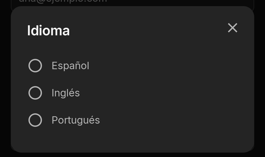
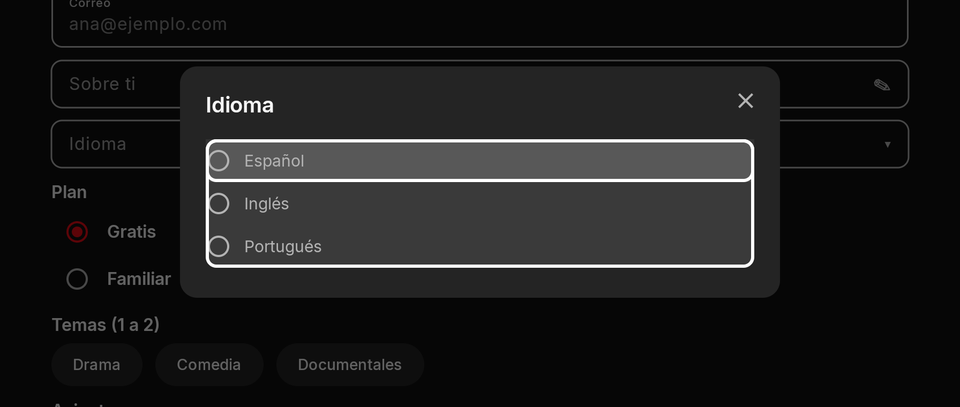

| Property | Type | Default | Per size | Notes |
| --- | --- | --- | --- | --- |
| `key` | string | required | no | names the value in `state.inputs`; unique on the screen |
| `labelText` | string | none | no | the field's label (`labelTextEn`) |
| `hintText` | string | none | no | a hint inside or under it (`hintTextEn`) |
| `onChanged` | action | none | no | the person changed it; the event's `value` is the new value |
| `options` | `{ value, label, labelEn? }[]` | required | no | 1 to 500, values distinct |
| `value` | string | none (`null`) | no | the chosen option's value |
| `bind` | a setting key | none | no | shows and stores one of your `select` or `text` settings ([bind](#bind-and-config)) |
| `required` | boolean | `false` | no | form rule: a text not blank, a choice made, a toggle on, a chip picked |
| `errorText` | string | Kino's text | no | form rule: what the person reads under the failing field (`errorTextEn`) |
| `forceErrorText` | string | none | no | your own verdict under the field (`forceErrorTextEn`, at most 200 characters) until the person edits it ([validation](#validation)) |

```json
{ "type": "DropdownButton", "key": "lang", "labelText": "Idioma", "labelTextEn": "Language", "value": "es", "onChanged": "lang", "options": [
  { "value": "es", "label": "Español", "labelEn": "Spanish" },
  { "value": "en", "label": "Inglés", "labelEn": "English" }
] }
```

```js
export async function screen() {
  const sorts = [["new", "Más reciente"], ["title", "Título"]];
  return { type: "DropdownButton", key: "sort", labelText: "Ordenar", value: "new", onChanged: "sort", options: sorts.map(([value, label]) => ({ value, label })) };
}
```

- **TV:** OK opens Kino's picker; focus stays inside it until a choice or Back (over an open pop-up, only the picker is
  focusable).
- **Limits and mistakes:** 1 to 500 options with distinct values. `bind` holds a `select` or `text` setting.

### RadioGroup { #radio-group }

One choice among a few `options`, all visible at once: two to five choices the person should compare.

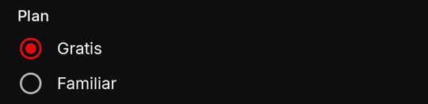
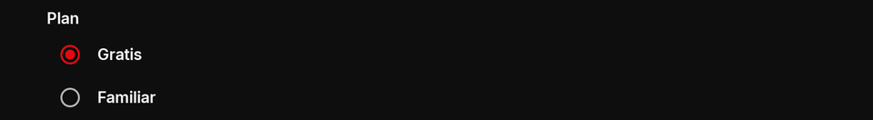

| Property | Type | Default | Per size | Notes |
| --- | --- | --- | --- | --- |
| `key` | string | required | no | names the value in `state.inputs`; unique on the screen |
| `labelText` | string | none | no | the field's label (`labelTextEn`) |
| `hintText` | string | none | no | a hint inside or under it (`hintTextEn`) |
| `onChanged` | action | none | no | the person changed it; the event's `value` is the new value |
| `options` | `{ value, label, labelEn? }[]` | required | no | 1 to 500, values distinct |
| `value` | string | none (`null`) | no | the chosen option's value |
| `bind` | a setting key | none | no | shows and stores one of your `select` or `text` settings ([bind](#bind-and-config)) |
| `required` | boolean | `false` | no | form rule: a text not blank, a choice made, a toggle on, a chip picked |
| `errorText` | string | Kino's text | no | form rule: what the person reads under the failing field (`errorTextEn`) |
| `forceErrorText` | string | none | no | your own verdict under the field (`forceErrorTextEn`, at most 200 characters) until the person edits it ([validation](#validation)) |

```json
{ "type": "RadioGroup", "key": "plan", "labelText": "Plan", "value": "free", "options": [
  { "value": "free", "label": "Gratis", "labelEn": "Free" },
  { "value": "family", "label": "Familiar", "labelEn": "Family" }
] }
```

```js
export async function screen() {
  return { type: "RadioGroup", key: "quality", labelText: "Calidad", value: "auto", onChanged: "quality", options: ["auto", "720p", "1080p"].map((value) => ({ value, label: value })) };
}
```

- **Mistakes:** in a form, a failing `RadioGroup`'s error shows on the group.

### Checkbox { #checkbox }

A check box with its label: "I accept the terms", one item of a list to pick. In a form, `required` means ticked.

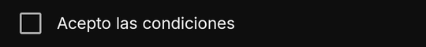


| Property | Type | Default | Per size | Notes |
| --- | --- | --- | --- | --- |
| `key` | string | required | no | names the value in `state.inputs`; unique on the screen |
| `labelText` | string | none | no | the field's label (`labelTextEn`) |
| `onChanged` | action | none | no | the person changed it; the event's `value` is the new value |
| `value` | boolean | `false` | no | ticked or not |
| `bind` | a setting key | none | no | shows and stores one of your `toggle` settings ([bind](#bind-and-config)) |
| `required` | boolean | `false` | no | form rule: a text not blank, a choice made, a toggle on, a chip picked |
| `errorText` | string | Kino's text | no | form rule: what the person reads under the failing field (`errorTextEn`) |
| `forceErrorText` | string | none | no | your own verdict under the field (`forceErrorTextEn`, at most 200 characters) until the person edits it ([validation](#validation)) |

```json
{ "type": "Checkbox", "key": "terms", "labelText": "Acepto las condiciones", "labelTextEn": "I accept the terms", "required": true, "errorText": "Hace falta aceptarlas", "errorTextEn": "You need to accept them" }
```

```js
export async function screen({ state }) {
  return { type: "Checkbox", key: "remember", labelText: "Recordarme", value: state.inputs?.remember === true };
}
```

### Switch { #switch }

An on/off setting that applies at once. With `bind` it stores one of your `toggle` settings by itself.

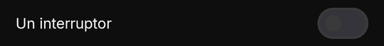


| Property | Type | Default | Per size | Notes |
| --- | --- | --- | --- | --- |
| `key` | string | required | no | names the value in `state.inputs`; unique on the screen |
| `labelText` | string | none | no | the field's label (`labelTextEn`) |
| `onChanged` | action | none | no | the person changed it; the event's `value` is the new value |
| `value` | boolean | `false` | no | on or off |
| `bind` | a setting key | none | no | shows and stores one of your `toggle` settings ([bind](#bind-and-config)) |
| `required` | boolean | `false` | no | form rule: a text not blank, a choice made, a toggle on, a chip picked |
| `errorText` | string | Kino's text | no | form rule: what the person reads under the failing field (`errorTextEn`) |
| `forceErrorText` | string | none | no | your own verdict under the field (`forceErrorTextEn`, at most 200 characters) until the person edits it ([validation](#validation)) |

```json
{ "type": "Switch", "key": "autoplay", "labelText": "Reproducir solo", "labelTextEn": "Autoplay", "value": true, "onChanged": "autoplay" }
```

```js
export async function screen() {
  return { type: "Switch", key: "tipsSwitch", labelText: "Mostrar consejos", bind: "tips" }; // "tips" is a toggle setting of the manifest
}
```

- **TV:** OK flips it. **Mistakes:** a `Switch` is a toggle: for a choice of two named options use a `RadioGroup`.

### Slider { #slider }

A number between `min` and `max`, by `step`: a volume, a level. Its value in `state.inputs` is a number.

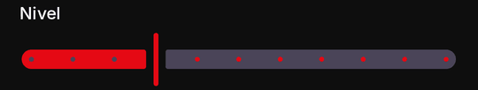
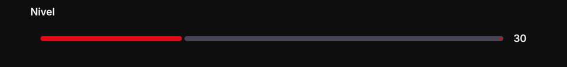

| Property | Type | Default | Per size | Notes |
| --- | --- | --- | --- | --- |
| `key` | string | required | no | names the value in `state.inputs`; unique on the screen |
| `labelText` | string | none | no | the field's label (`labelTextEn`) |
| `hintText` | string | none | no | a hint inside or under it (`hintTextEn`) |
| `onChanged` | action | none | no | the person changed it; the event's `value` is the new value |
| `min` | number | `0` | no | below `max` |
| `max` | number | `100` | no | above `min` |
| `step` | number | none (continuous) | no | above 0 and at most `max - min` |
| `value` | number | `min` | no | clamped to `min..max` |
| `bind` | a setting key | none | no | shows and stores one of your `text` settings ([bind](#bind-and-config)) |
| `forceErrorText` | string | none | no | your own verdict under the field (`forceErrorTextEn`, at most 200 characters) until the person edits it ([validation](#validation)) |

```json
{ "type": "Slider", "key": "volume", "labelText": "Volumen", "labelTextEn": "Volume", "min": 0, "max": 10, "step": 1, "value": 5, "onChanged": "volume" }
```

```js
export async function screen({ state }) {
  const v = Number.isFinite(state.inputs?.level) ? state.inputs.level : 30;
  return { type: "Column", gap: 8, children: [
    { type: "Slider", key: "level", min: 0, max: 100, step: 10, value: v, onChanged: "level" },
    { type: "Text", text: "Nivel " + v },
  ] };
}
```

- **Mistakes:** `min` must be below `max` (else dropped); a `step` outside `0..max-min` is dropped (logged). No form rules
  of its own; `bind` holds a `text` setting (its number as text).

### NumberStepper { #number-stepper }

A number drawn `[ − ] value [ + ]`: seats, servings, a price. Each press moves it by `step`, kept within `min`..`max` and
rounded to `decimals`; holding a button repeats, slowly faster. Its value in `state.inputs` is **text** (`"2.50"`).
Flutter's `Stepper` is another widget (a wizard): that name is unknown here.

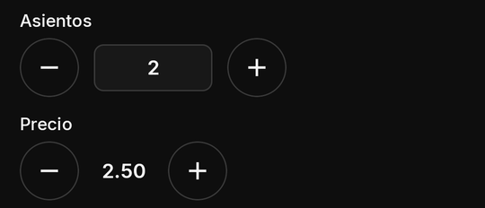
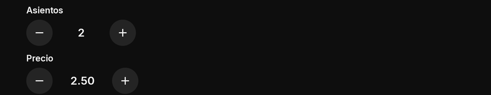

| Property | Type | Default | Per size | Notes |
| --- | --- | --- | --- | --- |
| `key` | string | required | no | names the value in `state.inputs`; unique on the screen |
| `labelText` | string | none | no | the field's label (`labelTextEn`) |
| `hintText` | string | none | no | a hint inside or under it (`hintTextEn`) |
| `onChanged` | action | none | no | the person changed it; the event's `value` is the new value |
| `value` | number | `min`, else 0 | no | rounded to `decimals`; in `state.inputs` as text (`"2.50"`) |
| `min` | number | none | no | below `max` |
| `max` | number | none | no | above `min` |
| `step` | number > 0 | `1` | no | rounded to `decimals` |
| `decimals` | 0 to 6 | `0` | no |  |
| `editable` | boolean | `false` | no | lets the person type it (digits only); only with `decimals: 0` and a `min` of 0 or more |
| `bind` |  |  | no | not taken (ignored, logged) |
| `required` | boolean | `false` | no | form rule: a text not blank, a choice made, a toggle on, a chip picked |
| `errorText` | string | Kino's text | no | form rule: what the person reads under the failing field (`errorTextEn`) |
| `forceErrorText` | string | none | no | your own verdict under the field (`forceErrorTextEn`, at most 200 characters) until the person edits it ([validation](#validation)) |

```json
{ "type": "Column", "gap": 12, "children": [
  { "type": "NumberStepper", "key": "seats", "labelText": "Asientos", "labelTextEn": "Seats", "value": 2, "min": 1, "max": 8, "editable": true },
  { "type": "NumberStepper", "key": "price", "labelText": "Precio", "labelTextEn": "Price", "value": 2.5, "min": 0, "max": 10, "step": 0.25, "decimals": 2 }
] }
```

```js
export async function screen({ state }) {
  const seats = Number(state.inputs?.seats ?? "2"); // text in state.inputs
  return { type: "Column", gap: 8, children: [
    { type: "NumberStepper", key: "seats", value: seats, min: 1, max: 8, onChanged: "seats" },
    { type: "Text", text: "Total: " + seats * 5 },
  ] };
}
```

- **TV:** Left and Right move between −, the value (only when `editable`) and +; a button at its limit stays focusable
  (drawn off), so holding OK never drops focus. `editable` opens the TV's digits-only pad.
- **Limits and mistakes:** at most 6 decimals; numbers at most 1e15 either way (clamped, logged). `editable` only with
  `decimals: 0` and a `min` of 0 or more (else ignored, logged). No `bind`. Its `required` always passes (it always has a
  value).

### Focus on TV { #tv-focus }

Kino draws one of two focus looks on the TV, by the kind of node; a plugin never chooses it.

| Node | Focus on TV |
| --- | --- |
| `Switch`, `Checkbox`, each `RadioGroup` row | row: a soft tint over the whole row and an accent underline across its bottom edge |
| `TextField` (one line or several), `DropdownButton`, `Slider` | row |
| buttons (`ElevatedButton`, `TextButton`, `IconButton`...), `FloatingActionButton` | ring: a white outline and a soft fill |
| `Chips`, `TabBar`, `NavigationBar` items, `NumberStepper` buttons | ring |
| a pressable `Card`, `ListTile`, `Text` or `Icon`; title cards | ring |

A row keeps at least 16 dp between its edges and its text, so neither the tint nor the underline touches a letter. A
screen reader reads the focused node as before. The `settings` node is Kino's own settings form: its switch and option
rows show the row look too, as every full-width row and field in Kino does on the TV. On the TV its rows are at least
56 dp tall (12 dp above and below their text, a select's options 4 dp apart, 8 dp under its label), so a focused row's
underline never touches the next; on the phone at least 48 dp. Its rows hold no D-pad key of their own: Up and Down from
its first or last row go on as from any node (the row above, else a page, else the `AppBar`'s tab), and Left and Right
stay on a switch or option row.

How focus moves around a whole screen is in the guide: [Focus on TV](screens.md#tv-focus).

### Validation { #validation }

Every input in a `Form` takes the rules the [inputs table](screen-reference.md#inputs) lists:

- `required`: a text not blank, a choice made, a toggle or checkbox on, a chip picked. An empty field that is not required
  passes every check.
- `minLength` / `maxLength`: characters of a text; picked chips of a [`Chips`](screen-components.md#chips).
- `pattern`: a [pattern](#pattern) the whole text must match.
- `errorText` / `errorTextEn`: what the person reads under the failing field (a `RadioGroup`'s or `Chips`' on the group);
  without it Kino's own message.

Values of fields that are `hidden` or disabled are still sent, unchecked; a required field in a hidden
[`TableRow`](screen-components.md#table-row) is not checked.

**Your own verdict:** `forceErrorText` (and `forceErrorTextEn`), Flutter's, on any input, from your state: Kino draws it
under the field exactly as its own errors (a failed submit's wins while it shows) and a screen reader reads it with the
field. The person's edit of the field hides it until your next verdict: the answer to their next press or submit, or a
different text. At most 200 characters. It never blocks a submit.

```json
{ "type": "TextField", "key": "code", "kind": "number", "labelText": "Código", "labelTextEn": "Code", "forceErrorText": "El código no es válido", "forceErrorTextEn": "That code is not valid" }
```

Rules on a field outside a form are not used. Kino's verdict is the one that counts: check again in your code only what
your own logic needs.

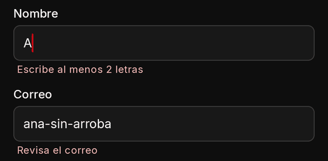
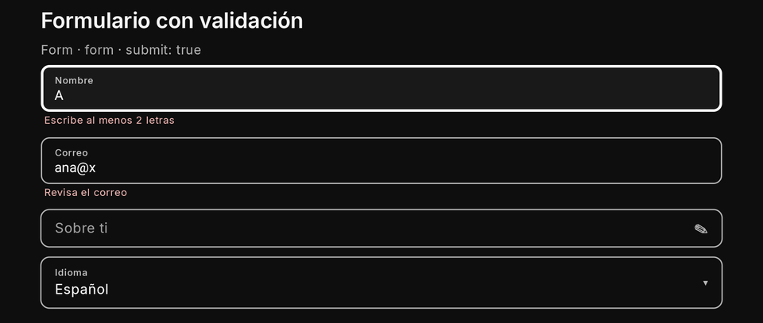

### Patterns (Kino's own matcher) { #pattern }

**The pattern engine is Kino's own** (a linear-time matcher, the same in the app and the kit), never the platform's
regex, so a hostile pattern cannot freeze the device. A pattern must match the **whole** value, in a safe subset:
literals, `.`, `^`, `$`, `|`, groups `( )` and `(?: )`, classes `[...]`, the escapes `\d \D \w \W \s \S \b \B \n \r \t`
and escaped punctuation, the quantifiers `* + ? {n} {n,} {n,m}` (optionally lazy), which may nest. No backreferences, no
lookarounds. The meanings are ASCII: `\d` is `[0-9]`, `\w` `[A-Za-z0-9_]`, `\s` ASCII whitespace, `.` any character but a
newline.

| Limit | Value |
| --- | --- |
| A pattern | at most 200 characters |
| A count (`{n,m}`) | at most 1,000 |
| Steps once counts are expanded | at most 500 (so `[a-z]{1,600}` is refused: write `[a-z]+` and `maxLength: 600`) |
| Work to read one pattern | 20,000 units |
| One submit | at most 16 patterns and 4,000,000 matcher steps; past either, the remaining patterns pass |

A pattern outside the subset is dropped (logged) and the field still checks its other rules.

```js
pattern: "^[^@\\s]+@[^@\\s]+\\.[A-Za-z]{2,}$" // an email (in JSON, every backslash doubled)
pattern: "^\\d{4,6}$"                          // a code of 4 to 6 digits
pattern: "^[A-Za-z0-9 ]+$"                     // letters, digits and spaces
```

### Submit rules { #submit }

- The button with `submit: true` submits; its own `onPressed` is ignored. It is drawn off while a required field is empty.
- An invalid form never calls your code: errors show under each failing field and focus goes to the first.
- **Enter does not submit a form**, and a field's own `onSubmitted` inside a form runs without the form's check.
- A required field in a closed [`ExpansionTile`](screen-components.md#accordion) item does not keep the button off, but
  the submit checks it and, if it fails, opens the item and focuses it.
- The form's `onSubmitted` gets `value`: every field's value by key (the same types as `state.inputs`).

### settings node { #settings-node }

Kino's own settings form for your plugin, the very one Ajustes shows, inside your screen: every setting type, both
languages, validation, Kino's fields for secrets and its buttons for actions, «Enviar a otro aparato», its own save.
`keys` shows only those settings, in that order. Your code never sees what is typed in it; with `onSaved` it hears
that a save or an action button finished, never the values ([onSaved](#on-saved)). The form itself is described in
[The settings form](settings-form.md); the guide shows it in a screen in [Settings inside a
screen](screens.md#settings-in-screen).

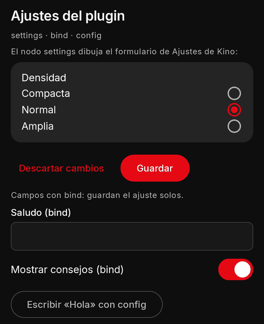
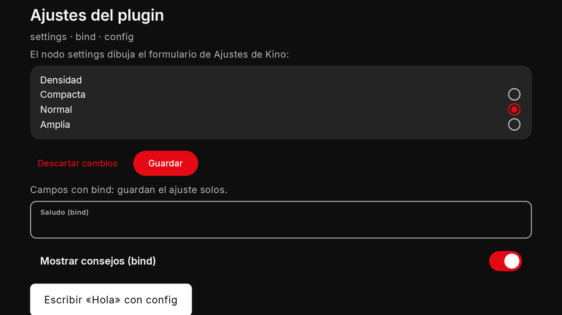

| Property | Type | Default | Per size | Notes |
| --- | --- | --- | --- | --- |
| `keys` | string[] | all settings | no | only those settings, in that order; each setting shows at most once per screen |
| `autoSave` | boolean | `false` | no | its `toggle` and `select` settings save as they change (no `validateSettings`); with only those, no Guardar ([settings node](#settings-node)) |
| `onSaved` | event name or `{ event, arg? }` | none | no | sent after Kino's form here saved (Guardar, or an autosave) or one of its action buttons finished: `value` is `{ kind, ok, keys, action?, reason? }`, setting keys only, never a value ([onSaved](#on-saved)) |

```json
{ "type": "Column", "gap": 12, "children": [
  { "type": "Text", "text": "Ajustes", "textEn": "Settings", "style": "h3" },
  { "type": "settings", "keys": ["density"] }
] }
```

- **`autoSave`:** `true` saves the node's toggles and selects as the person changes them, through the same store and sync
  (your [`validateSettings`](settings-form.md#validate) is not asked, as with `bind`; your web session stays); a refused
  write puts the stored value back. When every valued setting the node shows is a toggle or a select, Kino draws no
  Guardar nor Descartar; a text, an address, a password or a list keeps them. A locked setting saves only after its code.
- **Only buttons:** a node whose keys hold no valued setting (`keys: ["logout"]`: an action, a status, a section, a link, a
  help, a QR) draws just those items and no Guardar nor Descartar; the action runs from its own button, its `confirm`
  first, exactly as in Ajustes.
- **A locked setting** (`"unlockWith": "adultCode"` in the manifest, a toggle or a select): moving it away from its default
  here asks the device's 18+ code with Kino's own prompt first (phone and TV); a wrong code or Cancelar keeps the old
  value, back toward the default never asks. Only this node (and Ajustes) changes it away from the default: never `bind`
  or `config` ([A setting the 18+ code guards](settings-form.md#unlock-with)).
- **Limits and mistakes:** never inside a `Form` or an answer's pop-up. Each setting shows at most once per screen, so
  several `settings` nodes are fine. A `url` setting can only be filled here (never through `bind` or `config`). A
  `password` can be filled here, by an answer's `config`, or by an `obscureText` field bound to it ([secret
  fields](#secret-field)).

#### `onSaved` { #on-saved }

`onSaved` (an event name or `{ event, arg }`) is sent after Kino's form in this node saved (its Guardar, or, with
`autoSave`, a toggle or select that saved as it changed: `kind: "save"` with that key; an autosave that changed nothing
sends none) or one of its action buttons finished (a node with only buttons has no Guardar: only `kind: "action"`), so
your screen reacts at once instead of on its next [`every`](screens.md#timers) tick. Quick autosaves still waiting are
merged into one event. The event's `value`:

| Field | What it holds |
| --- | --- |
| `kind` | `"save"` or `"action"` |
| `ok` | `true` when it saved, or the action ran and answered |
| `keys` | the settings that changed (keys only, sorted): what was edited, what an action cleared or set; never a value |
| `action` | the action button's key (`kind: "action"` only) |
| `reason` | when not `ok`: `rejected` (your `validateSettings` refused), `checkFailed` (it could not check), `refused` (Kino's store refused), `failed` (the action threw or timed out) |

```js
export async function screenEvent({ name, value }) {
  if (name === "saved" && value.ok && value.keys.includes("twoStepPassword")) return { state: { step: "login" } };
  return null;
}
```

- **Order and pace:** it waits in the screen's queue like the person's own events (a timer's tick never runs before it).
  A save while an earlier save's event still waits is merged into it (the keys of both, the later verdict); action events
  are never merged. It is nobody's press: its answer opens no title page and no link.
- **A closed screen:** a save or action that ends after the screen closed (or after the node left the tree) sends
  nothing; the next opening's `open` reads `kino.config` as always. The save itself always lands.
- **Never a value:** a password's key may be in `keys`, its text never is.

### bind and config { #bind-and-config }

- **`bind: "<settingKey>"`** on an input shows the stored value when the screen opens and writes the person's change back
  by itself: a choice on change, a text on commit (the keyboard's action, focus leaving, the TV dialog's accept), only
  when it differs. You still get the field's events. A plain settings tab needs no JavaScript at all.
- **`config: { <settingKey>: value }`** in an answer writes settings from your code: only keys your manifest declares, at
  most 32 per answer, each value fitting its type (`text` a string, `toggle` a boolean, `select` one of its values,
  `list` an array of records, `password` a string).
- **A `password`** is kept exactly as given (never trimmed); `null`, `""` or blanks empty it (never a `required` one); at
  most 500 characters. It is saved where Ajustes saves a typed one: a synced password reaches the person's other devices
  (an emptied one is cleared there too), a [`"sync": false`](settings-form.md#sync-false) one stays on this device. A
  screen never reads one back (`bind` never prefills it, `state` never holds it) and Kino never writes its text in a log
  line, only its key. Bind one only with an `obscureText` field ([secret fields](#secret-field)).
- **Never from a screen:** a `url` setting, an `action` or a `help` setting, a value holding one of your sealed secrets, a
  `list` write that adds an address, a setting with `unlockWith` moved away from its default (no field binds one). All
  dropped, logged.
- **Pace and cost:** each setting is written at most once every 500 ms per screen (a timer's answer: once a minute); every
  write restarts your runtime so `kino.config` reads the new value (toggles and selects keep your web session; any other
  write is Kino's full Guardar).

```json
{ "type": "Column", "gap": 8, "children": [
  { "type": "TextField", "key": "greetingField", "bind": "greeting", "labelText": "Saludo", "labelTextEn": "Greeting" },
  { "type": "Switch", "key": "tipsField", "bind": "tips", "labelText": "Mostrar consejos", "labelTextEn": "Show tips" },
  { "type": "DropdownButton", "key": "densityField", "bind": "density", "labelText": "Densidad", "labelTextEn": "Density", "options": [
    { "value": "compact", "label": "Compacta", "labelEn": "Compact" }, { "value": "normal", "label": "Normal" }, { "value": "roomy", "label": "Amplia", "labelEn": "Roomy" }
  ] }
] }
```

```json
{ "config": { "greeting": "Hola", "tips": false }, "toast": "Guardado", "toastEn": "Saved" }
```

## Overlays { #overlays }

One pop-up at a time; opening another replaces it; Back closes it before anything else; it never covers Kino's title
bar, and Kino always draws its close: an X alone (a screen reader says «Cerrar», «Close» in English), at the end of the
title row, or, with no title, at the start (left) of the bottom row, with your buttons together at its end (right), never
beside your main action; buttons that do not fit wrap to more lines, still at the end. Two ways to show one: **from an
answer** (`dialog`, `sheet`, `menu`: built by `screenEvent`, text or simple nodes) or **declared in the tree** (a `popup`
node, hidden until a [`ui`](screen-components.md#ui-ops) `open` names it, whose body is part of your tree and may hold
forms and inputs).

### Dialog { #dialog }

A question or a short message that needs an answer. From an answer: `dialog: { title, body, buttons }` (at most 3
buttons; one without `event` closes it). Declared: an `AlertDialog` node with `children` and `buttons`.

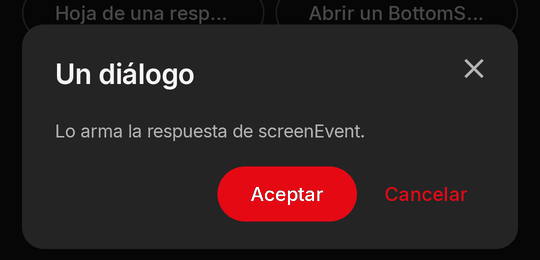
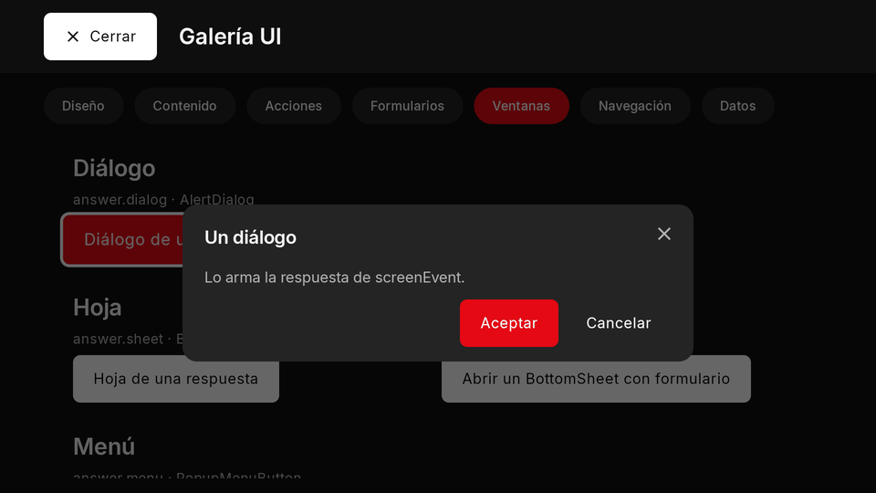

```json
{ "dialog": { "title": "¿Borrar la lista?", "titleEn": "Delete the list?", "body": "No se puede deshacer.", "bodyEn": "It cannot be undone.",
  "buttons": [{ "label": "Borrar", "labelEn": "Delete", "event": "deleteList", "variant": "primary" }, { "label": "Cancelar", "labelEn": "Cancel", "variant": "text" }] } }
```

```js
export async function screenEvent({ name }) {
  if (name === "ask") return { dialog: { title: "¿Seguro?", titleEn: "Are you sure?", buttons: [{ label: "Sí", labelEn: "Yes", event: "yes" }, { label: "No" }] } };
  if (name === "yes") return { toast: "Hecho", toastEn: "Done" };
  return null;
}
```

- **TV:** focus stays inside the dialog; its first focus is its first focusable node, else (a body taller than the frame
  with nothing to focus) the body itself, else its first button, else its close; a body taller than the frame scrolls
  with Down and Up (keep a button at its end). Only the focused control draws Kino's ring: the frame and a scrolling body
  never do (scrolling is the cue). Left and Right move between Kino's X and your buttons in the bottom row.
- **Phone and TV:** a centred dialog on both.
- **Limits and mistakes:** with more than one of `dialog`, `sheet` and `menu` in one answer, the dialog wins. An answer's
  pop-up never holds a `Form`, an `ExpansionTile`, `bind` or the `settings` node (declare one for that).

### Sheet { #sheet }

More room than a dialog for details or a few actions: a bottom sheet on the phone, a side drawer on the TV. From an
answer: `sheet: { title, body }`; declared: a `BottomSheet` node.

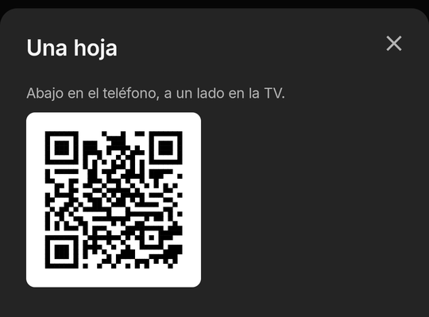
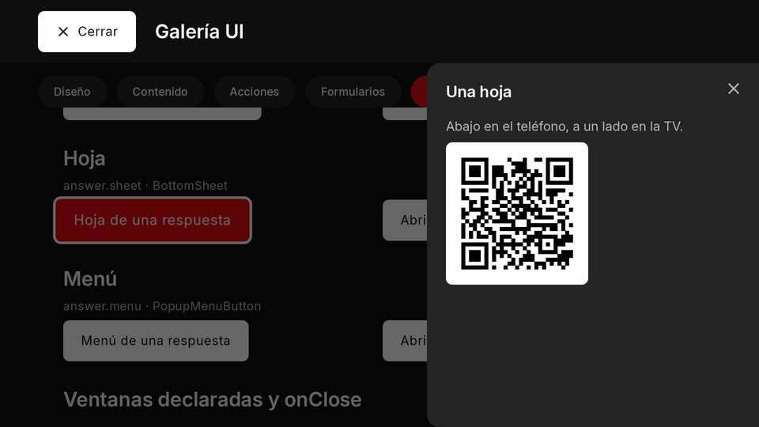

```json
{ "sheet": { "title": "Compartir", "titleEn": "Share", "body": [
  { "type": "Text", "text": "Escanéalo con tu teléfono.", "textEn": "Scan it with your phone." },
  { "type": "QrImage", "value": "https://kinotvapp.github.io/kino-plugins/", "size": "small" }
] } }
```

```js
export async function screenEvent({ name }) {
  return name === "info" ? { sheet: { title: "Información", body: "Una línea de texto.", bodyEn: "A line of text." } } : null;
}
```

- **Phone and TV:** the bottom of the screen on the phone, the side on the TV. Back closes it.

### Menu { #menu }

A short list of actions (1 to 8 items with a label, an optional icon and an `onTap`); the menu closes before the item's
action runs. From an answer: `menu: { title, items }`; declared: a `PopupMenuButton` node opened with `{ open: key }`.

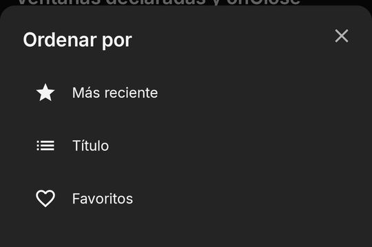
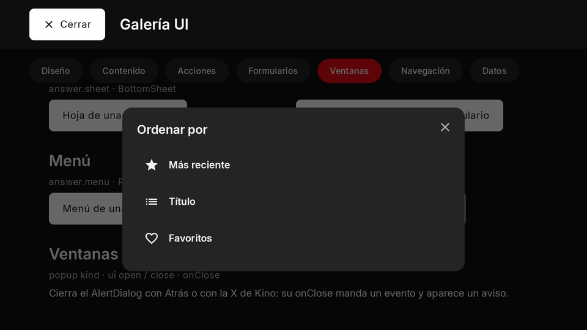

```json
{ "menu": { "title": "Ordenar por", "titleEn": "Sort by", "items": [
  { "label": "Más reciente", "labelEn": "Newest", "icon": "star", "onTap": { "event": "sort", "arg": "new" } },
  { "label": "Título", "labelEn": "Title", "icon": "list", "onTap": { "event": "sort", "arg": "title" } }
] } }
```

```js
export async function screen() {
  return { type: "Column", children: [
    { type: "TextButton", labelText: "Ordenar", onPressed: { ui: [{ open: "sortMenu" }] } },
    { type: "PopupMenuButton", key: "sortMenu", items: [{ label: "Título", onTap: { event: "sort", arg: "title" } }, { label: "Año", onTap: { event: "sort", arg: "year" } }] },
  ] };
}
```

- **Phone and TV:** a menu is not anchored to what opened it: on the phone it is an action list at the bottom of the
  canvas, on the TV it is centred (to draw one next to a node, see [`anchor`](#anchor)).
- **Limits and mistakes:** at most 8 items; a menu item keeps `label` and `onTap` (never `labelText`/`onPressed`).

### Declared pop-ups, `ui` open and close, `onClose` { #popup }

A `popup` node (`AlertDialog`, `BottomSheet`, `PopupMenuButton`, or `popup` with its `kind`) with a `key`, anywhere in
the tree, hidden until a `ui` `open` names it. Its body is part of your tree, so it can hold forms and inputs and your
next render updates it.

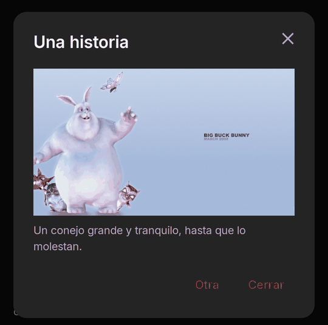
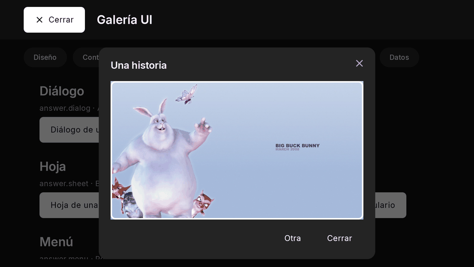

| Property | Type | Default | Per size | Notes |
| --- | --- | --- | --- | --- |
| `key` | string | required | no | what `{ open: key }` and `{ close: key }` name |
| `kind` | `dialog` \| `sheet` \| `menu` | set by the type | no | `AlertDialog` is `dialog`, `BottomSheet` `sheet`, `PopupMenuButton` `menu` |
| `title` | string | none | no | `titleEn`; none (or blank) draws no empty title row |
| `children` | nodes[] | none | no | the body of a dialog or sheet: forms and inputs allowed |
| `buttons` | `{ label, labelEn?, event?, arg?, variant? }[]` | none | no | a dialog's, at most 3; one without `event` closes it |
| `items` | `{ label, labelEn?, icon?, onTap }[]` | required for a menu | no | 1 to 8; the menu closes first |
| `onClose` | event name or `{ ui?, event?, arg? }` | none | no | runs after the person dismissed it (Back, Kino's close, a tap outside), never after its own buttons |
| `anchor` | a node's key | none | no | drawn next to that node, over the content, taking no room ([anchored pop-up](#anchor)); the only pop-up a player panel draws |

The robust way to open one with new content is **from the answer**, not from the tap: the tap sends the event, the
answer patches the state and carries `ui: [{ open }]`; Kino opens it once the new tree is drawn, so the pop-up never
shows the last item's body (Back before then cancels it). Close it the same way after its own Save.

```json
{ "type": "AlertDialog", "key": "story", "title": "Una historia", "titleEn": "A story", "onClose": "storyClosed",
  "children": [{ "type": "Text", "text": "El texto de la historia.", "textEn": "The story's text." }],
  "buttons": [{ "label": "Cerrar", "labelEn": "Close" }] }
```

```js
export async function screen({ state }) {
  return { type: "Column", children: [
    { type: "ElevatedButton", labelText: "Leer", onPressed: { event: "read", arg: "42" } },
    { type: "AlertDialog", key: "story", title: "Historia " + (state.reading || ""), onClose: "storyClosed", children: [{ type: "Text", text: "…" }] },
  ] };
}

export async function screenEvent({ name, arg }) {
  if (name === "read") return { state: { reading: arg }, ui: [{ open: "story" }] }; // opens once the new tree is drawn
  if (name === "storyClosed") return { state: { reading: null } };                  // the person dismissed it
  return null;
}
```

- **`onClose`** (an event name, or `{ ui?, event?, arg? }`) runs after the **person** dismissed the pop-up (Back, Kino's
  close, a tap outside), never after its own buttons, a menu item, your `close` or another pop-up replacing it. Its event
  is no press: no [`kino.qr.scan`](qr.md), no `go.titleByIds` or `go.url`; its answer opens no pop-up, moves no focus and
  goes nowhere (dropped, logged).
- **TV:** focus is trapped inside the open pop-up; Back closes it and focus returns to what opened it.
- **Limits and mistakes:** `title` is optional (without one no empty row is drawn; never pass `" "`). A pop-up whose node
  is `hidden` cannot open. Whether a pop-up is open is not in `state.ui`. In a panel in [screen
  mode](player-panel.md#screen-mode) a `popup` node is dropped (pop-ups belong to the screen), unless it has an `anchor`
  (below).

#### Anchored pop-up (`anchor`) { #anchor }

`anchor` (a node's key) turns any declared pop-up into a popover: Kino draws it **next to that node**, above it when there
is more room above, else below, sized to its content and at most the area's width, over the content without dimming it
and taking no layout space. It opens and closes as every pop-up does (`ui` `open` and `close`, Back, a tap outside) and
has no close button of its own. A quick pick beside a button (a reaction, a speed, a sort order):

```json
{ "type": "Row", "children": [
  { "type": "IconButton", "key": "react", "icon": "mood", "labelText": "Reacciones", "labelTextEn": "Reactions",
    "onPressed": { "ui": [{ "open": "palette" }] } },
  { "type": "PopupMenuButton", "key": "palette", "anchor": "react", "items": [
    { "label": "Me gusta", "labelEn": "Like", "icon": "heart", "onTap": { "event": "react", "arg": "like" } },
    { "label": "Me encanta", "labelEn": "Love", "icon": "star", "onTap": { "event": "react", "arg": "love" } }] }
] }
```

- **TV:** focus moves into it (its first focusable, or its `autofocus` node) and stays inside while it is open; Back
  closes it and gives focus back to the anchor.
- **Player panel:** a `popup` with an `anchor` is the one pop-up a panel in [screen mode](player-panel.md#screen-mode)
  draws, inside the drawer.
- **Fallback:** when the anchor is not on screen, or there is no room above or below it (a compact window, a tall body),
  it is drawn in its kind's own place, logged once. Without `anchor` it behaves as before.

## Navigation { #navigation }

A node's action or an answer may carry `go`: one of twelve shapes, **always into this plugin's own content or one of
Kino's own pages**. Kino's page opens over your screen; Back returns to it with its state. At most one page-opening `go`
every 500 ms. No shape names an intent or an app, and only `liveChannel` names another plugin (an En vivo provider, whose
channel Kino tunes to for a plugin whose player tab joins live channels). The guide covers `go` in
[Navigation with `go`](screens.md#go).

| Shape | Written | What opens | Sent from |
| --- | --- | --- | --- |
| [`title`](#go-title) | `{ title: { ref, kind, id, title, adult } }` | this plugin's title page | a tap or an event's answer (never `open`'s, a timer's or an `onClose`'s) |
| [`play`](#go-play) | `{ play: { ref, kind, id, title, adult } }` | plays this plugin's title | a tap or an event's answer (never `open`'s, a timer's or an `onClose`'s) |
| [`search`](#go-search) | `{ search: { q } }` | Kino's search with `q` (at most 200 characters), only this plugin as the source | a tap or an event's answer (never `open`'s, a timer's or an `onClose`'s) |
| [`browse`](#go-browse) | `{ browse: { ref, title?, titleEn? } }` | this plugin's «Ver más» list for a `ref` | a tap or an event's answer (never `open`'s, a timer's or an `onClose`'s) |
| [`section`](#go-section) | `{ section: true }` | this plugin's section | a tap or an event's answer (never `open`'s, a timer's or an `onClose`'s) |
| [`categories`](#go-categories) | `{ categories: true }` | Kino's Categorías, this plugin's group first | a tap or an event's answer (never `open`'s, a timer's or an `onClose`'s) |
| [`close`](#go-close) | `{ close: true }` | closes the screen | a tap or an event's answer (never `open`'s, a timer's or an `onClose`'s) |
| [`screen`](#go-screen) | `{ screen: { route?, args? } }` | this plugin's own screen at `route` (at most 64 characters) with `args` (at most 4,096 bytes) | a tap or an answer, `open`'s included |
| [`titleByIds`](#go-title-by-ids) | `{ titleByIds: { tmdb, imdb, kind, season, episode, title, year } }` | Kino's own title page for TMDB or IMDb ids, with every source the person has | only the person's own press or submit |
| [`url`](#go-url) | `{ url: { href, title } }` | an https link in the browser, after Kino's own sheet (a QR code on a TV) | only the person's own press or submit |
| [`copy`](#go-copy) | `{ copy: { text, label, sensitive } }` | Kino copies `text` (at most 500 characters, 6 lines) and shows its own «Copiado» toast; a TV cannot | only the person's own press or submit |
| [`liveChannel`](#go-live-channel) | `{ liveChannel: { provider, code } }` | tunes the player to an En vivo provider's channel (only for a plugin whose player tab joins live channels) | only the person's own press or submit |

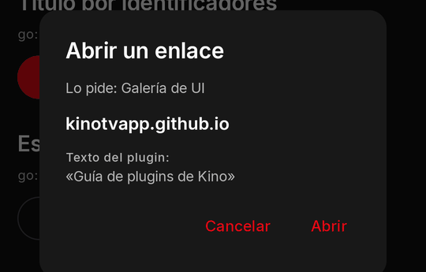
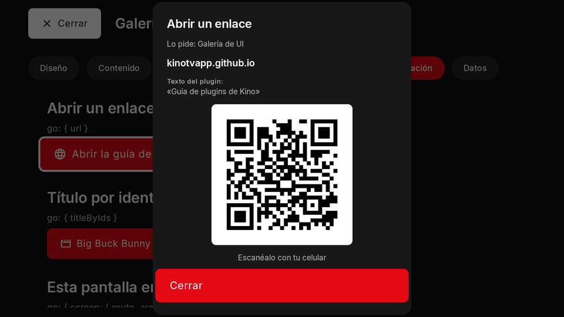

### `go.title` { #go-title }

Opens this plugin's title page. A title on the canvas (a [`titleCard`](screen-components.md#title-card), rail or grid
item) opens with that very item (pass its `id` when two items share a `ref`); a title that is not on the canvas needs its
`id` and `title` (and `adult: true` when it is 18+).

```json
{ "go": { "title": { "ref": "movie/123", "kind": "movie", "id": "m123", "title": "Una película" } } }
```

### `go.play` { #go-play }

Plays this plugin's title, written as `title`. A live channel plays; a series opens its page; a movie, a track or a
podcast episode plays at once. The 18+ gate holds.

```json
{ "type": "ElevatedButton", "labelText": "Reproducir", "labelTextEn": "Play", "onPressed": { "go": { "play": { "ref": "live/1", "kind": "live", "id": "c1", "title": "Canal 1" } } } }
```

### `go.search` { #go-search }

Kino's search with `q` filled in and only this plugin as the source (the person sees its chip and may clear it). Refused
for a plugin without `search`.

```json
{ "go": { "search": { "q": "big buck bunny" } } }
```

### `go.browse` { #go-browse }

This plugin's «Ver más» list for a `ref` (your `browse`).

```json
{ "go": { "browse": { "ref": "genre/drama", "title": "Drama" } } }
```

### `go.section` { #go-section }

This plugin's section (its rows of cards).

```json
{ "go": { "section": true } }
```

### `go.categories` { #go-categories }

Kino's Categorías with this plugin's group first; with [`screen.replaces: ["categories"]`](screens.md#manifest) your own
screen at the route `categories`. Refused, logged, for a plugin without its own Categorías tiles.

```json
{ "go": { "categories": true } }
```

### `go.close` { #go-close }

Closes the screen (the same as the answer's `close: true`).

```json
{ "type": "TextButton", "labelText": "Cerrar", "labelTextEn": "Close", "onPressed": { "go": { "close": true } } }
```

### `go.screen` { #go-screen }

This plugin's own screen at a `route` with `args`, from its other surfaces (its player panel, its `home`/`section`/`browse`
items and rows with `open: { screen }`, the «Mis plugins» card) or from inside the screen, which starts again at that
route (the state stays). The reserved `open` event comes again with the new route, so one path loads what the args name.
At most one restart a second.

```json
{ "type": "Button", "variant": "secondary", "labelText": "Ver los ajustes", "labelTextEn": "See the settings", "onPressed": { "go": { "screen": { "route": "main", "args": { "tab": "config" } } } } }
```

```js
export async function screenEvent({ name, route }) {
  if (name === "open" && route.args?.tab === "config") return { state: { tab: "config" } };
  return null;
}
```

### `go.titleByIds` { #go-title-by-ids }

How people with **different plugins** reach the same title: Kino's own title page (the one a Home TMDB card opens), with
every source the person has. At least one of `tmdb` and `imdb`; it names no plugin, ref or URL, never plays, and tells you
nothing back. Only from the person's own press or submit.

```json
{ "type": "ElevatedButton", "labelText": "Abrir este título", "labelTextEn": "Open this title", "icon": "movie",
  "onPressed": { "go": { "titleByIds": { "tmdb": 10378, "kind": "movie", "title": "Big Buck Bunny", "year": 2008 } } } }
```

- 18+: while the person's 18+ code is locked it opens only when TMDB says the title is not adult. An `imdb` alone costs a
  TMDB lookup («Buscando el título…»). A series opens whole (no episode focus yet).

### `go.url` { #go-url }

Asks Kino to open an https link in a browser, a «Ver noticia» button. Nothing opens by itself: Kino shows **its own**
sheet first (your plugin's name, the host with its end always visible, your `title` under «Texto del plugin:»,
«Cancelar» focused first and «Abrir», inert for its first 600 ms). On a TV, or a phone without a browser, the sheet shows
the link as a QR code to scan.

```json
{ "type": "ElevatedButton", "labelText": "Ver noticia", "labelTextEn": "Read the story", "icon": "language",
  "onPressed": { "go": { "url": { "href": "https://kinotvapp.github.io/kino-plugins/", "title": "Guía de plugins" } } } }
```

- `href`: `https://` only, at most 2,048 characters of printable ASCII, a public DNS name with a dot (never an IP,
  `localhost`, `.local`, `.lan`...), no `user:password@`, no port but 443. Only from the person's own press or submit; an
  answer more than 5 s after the tap drops it. Nothing comes back to you.

### `go.copy` { #go-copy }

A «Copiar» button: Kino puts your text on the clipboard itself and **always** shows its own toast, «Copiado» (or
«Copiado: <label>»), so nothing is ever copied unseen. Kino never reads the clipboard. Only from the person's own press or
submit (a tap, a submit, the answer to one, a pop-up's button, a panel press); the panel stays open.

```json
{ "type": "ElevatedButton", "labelText": "Copiar invitación", "labelTextEn": "Copy invite", "icon": "copy",
  "onPressed": { "go": { "copy": { "text": "Sala: luna roja azul\nCódigo: 4821", "label": "Invitación", "sensitive": true } } } }
```

- `text`: 1 to 500 characters in at most 6 lines, once control, direction and zero-width characters are removed
  (newlines stay). `label` (at most 40) names what was copied in Kino's toast. `sensitive: true` hides it from the
  clipboard's preview on Android 13 and later (a room code, a password).
- One copy every 500 ms and 20 a minute per plugin. A TV has no clipboard worth using: Kino shows «No se puede copiar en
  este aparato»; hide the button there (`kino.device` / `device: "tv"`).

### `go.liveChannel` { #go-live-channel }

Tunes Kino's player to an En vivo channel: `provider` is the id of the plugin that lists it, `code` the channel's id in
that plugin's listing (what a live tab's context carries as `channel`). How a Party Chat guest watches the same channel as
the host: the host's tab reads `context.channel`, sends it to the room, and the guest presses «Ver el mismo canal».

```json
{ "type": "ElevatedButton", "labelText": "Ver el mismo canal", "labelTextEn": "Watch the same channel", "icon": "tv",
  "onPressed": { "go": { "liveChannel": { "provider": "tdt", "code": "la1" } } } }
```

- Only for a plugin whose approved contributed tab declares [`"kinds": ["live"]`](player-panel.md#live-kinds)
  (`panel.contributes`, [`playerPanelTab`](player-panel.md#contributed-tab)): the same consent; any other plugin's is
  dropped, logged `needs_live_tab`. Only from the person's own press or submit.
- The provider must be an installed, usable plugin with live channels (never `own`, «Mis canales»); an 18+ provider only
  while the 18+ code is unlocked, and an 18+ channel is not found while it is locked (Kino's usual message).
- In the player panel on a live channel the channel changes in place (the panel and its pin stay); from anywhere else the
  panel or screen closes and the player opens the channel. Nothing comes back to you: the next context says the channel.

### Routes (`route` push and pop) { #routes }

Screens of your own deeper in the canvas: an answer's `route: { push: "detail", params }` goes one level deeper,
`{ pop: true }` back; Back pops a pushed route before it closes the canvas. `screen({ route })` gets
`{ name, params, args? }`.

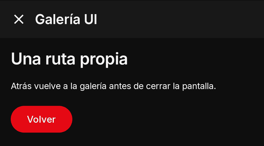
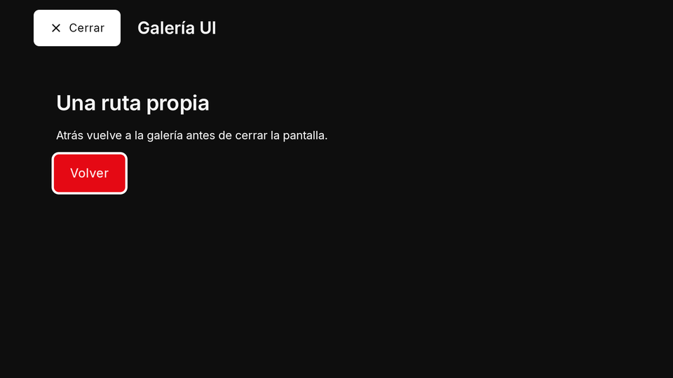

```json
{ "route": { "push": "detail", "params": { "id": "42" } } }
```

```js
export async function screen({ route }) {
  if (route.name === "detail") return { type: "Column", padding: 16, children: [{ type: "Text", text: "Detalle " + route.params.id }, { type: "TextButton", labelText: "Volver", onPressed: "back" }] };
  return { type: "ElevatedButton", labelText: "Ver detalle", onPressed: { event: "detail", arg: "42" } };
}

export async function screenEvent({ name, arg }) {
  if (name === "detail") return { route: { push: "detail", params: { id: arg } } };
  if (name === "back") return { route: { pop: true } };
  return null;
}
```
